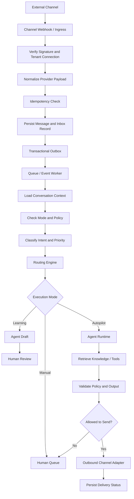
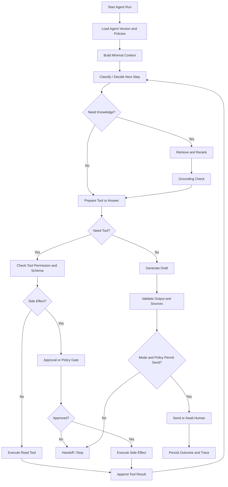
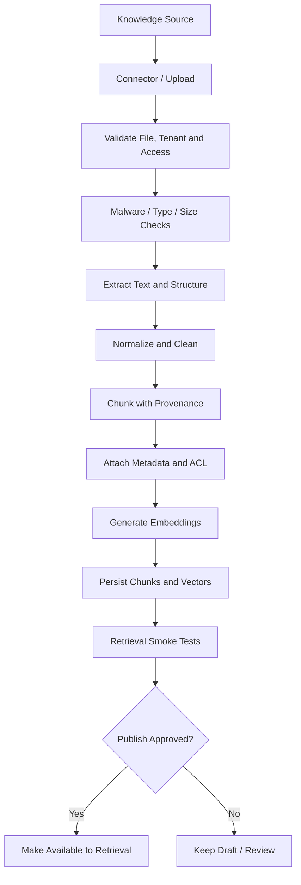

# PROJECT_CONTEXT.md

# AI Workforce / AI Helpdesk Platform — Project Context & Engineering Blueprint

> **Mục đích của tài liệu:** Đây là tài liệu ngữ cảnh gốc để một AI agent hoặc developer ở một phiên làm việc mới có thể hiểu dự án mà không cần đọc lại lịch sử hội thoại. Tài liệu mô tả mục tiêu sản phẩm, vấn đề cần giải quyết, tư duy thiết kế, các quyết định công nghệ, kiến trúc hệ thống, pipeline agent, human-in-the-loop, learning loop, tích hợp hệ thống ngoài, dữ liệu, bảo mật, vận hành, kiểm thử và tiêu chí chất lượng.
>
> **Không phải tài liệu giao deadline hoặc ép tiến độ.** Không có deadline, sprint calendar hay cam kết hoàn thành trong một số tuần/tháng. Những trình tự triển khai trong tài liệu chỉ thể hiện quan hệ phụ thuộc và thứ tự hợp lý về mặt kỹ thuật. Không được diễn giải chúng thành áp lực phải làm nhanh, cắt giảm kiểm thử hoặc bỏ qua thiết kế. Ưu tiên tính đúng đắn, khả năng bảo trì, độ tin cậy, an toàn dữ liệu và khả năng vận hành thực tế.
>
> **Lịch sử phiên bản tài liệu:**
> - v1: blueprint kiến trúc ban đầu (product vision, stack, Clean Architecture, agent pipeline, learning loop, reliability, security).
> - v2 (2026-11-19): bổ sung kết quả nghiên cứu sản phẩm tham chiếu Jarvis (jarvis.cx) và đối thủ, ràng buộc chính sách từng kênh (Zalo OA, Meta, Telegram, Shopee, TikTok Shop, Gmail), pháp lý Việt Nam (Luật BVDLCN 91/2025/QH15, NĐ 356/2025, NĐ 53/2022, NĐ 91/2020), mode ladder có Shadow, agent templates, approval qua kênh chat, credit metering, chiến lược tri thức ngoài RAG, ranh giới framework AI, và định hướng AI engineer của người dùng. Các dữ kiện bên ngoài được gom ở **Mục 30 — External facts** với nhãn độ tin cậy.

---

# 0. Hướng dẫn dành cho AI agent đọc tài liệu này

Khi một AI agent nhận được file này ở phiên mới, hãy thực hiện các nguyên tắc sau:

1. Đọc toàn bộ tài liệu trước khi đề xuất thay đổi kiến trúc hoặc bắt đầu viết code. Đây là ngữ cảnh dự án có tính liên tục, không phải một yêu cầu rời rạc.
2. Xem các mục **“Quyết định đã thống nhất”** là định hướng hiện tại. Không tự ý thay đổi stack hoặc mô hình kiến trúc chỉ vì có một framework mới hoặc vì một lựa chọn khác đang phổ biến.
3. Phân biệt rõ ba loại thông tin:
   - **Đã thống nhất:** quyết định đã được người dùng và trợ lý thống nhất trong quá trình định hình dự án.
   - **Đề xuất thiết kế:** giải pháp kỹ thuật hợp lý đang được đề xuất, cần được kiểm tra bằng yêu cầu thực tế, spike kỹ thuật hoặc ADR trước khi coi là quyết định cuối cùng.
   - **Chưa xác minh / câu hỏi mở:** điểm cần nghiên cứu thêm, đặc biệt là API của nền tảng bên ngoài, quy định pháp luật, giá dịch vụ, giới hạn rate limit và hành vi của nhà cung cấp.
4. Không giả định dự án có deadline hoặc mốc hoàn thành cố định. Người dùng chấp nhận phát triển dài hạn và ưu tiên sản phẩm hoàn chỉnh, có thể đưa vào vận hành thật.
5. Không tự thu hẹp yêu cầu thành một chatbot demo. Đích đến là một **AI Workforce / AI Helpdesk Platform** gồm AI Agent, nhân viên, bộ phận, hội thoại, điều phối, học từ phản hồi có kiểm soát, tích hợp hệ thống ngoài, đánh giá và quản trị.
6. Không overengineering. Bắt đầu với modular monolith có ranh giới module rõ ràng. Chỉ thêm microservices, vector database riêng, workflow engine, nhiều model hoặc nhiều ngôn ngữ khi có nhu cầu được chứng minh.
7. Không coi “AI tự học” là model tự thay đổi trọng số sau mỗi cuộc trò chuyện. Cơ chế học mặc định là thu thập correction, tạo candidate knowledge/rule/example, đánh giá, phê duyệt, versioning và phát hành có kiểm soát.
8. Không đưa dữ liệu hoặc câu trả lời do khách hàng/nhân viên nhập thẳng vào knowledge production mà không có kiểm duyệt, xác minh nguồn, quyền sở hữu và kiểm tra xung đột.
9. Không để LLM là nơi quyết định quyền truy cập, tenant isolation, phân quyền hoặc thực thi hành động quan trọng. Các quyết định bảo mật và side-effect phải được backend/policy engine kiểm tra bằng logic xác định.
10. Khi dùng API bên ngoài hoặc tài liệu có thể thay đổi theo thời gian, hãy xác minh bằng nguồn chính thức mới nhất. Không đoán endpoint, OAuth scope, webhook signature, giới hạn kênh hoặc điều khoản sử dụng.
11. Không khẳng định biết source code hay kiến trúc nội bộ của Jarvis. Jarvis là sản phẩm tham chiếu về trải nghiệm và năng lực người dùng quan sát được; kiến trúc trong tài liệu này là thiết kế độc lập, không phải reverse-engineering đã xác minh.
12. Khi triển khai, hãy tạo hoặc cập nhật ADR cho quyết định kiến trúc quan trọng. Ghi lại lý do, phương án thay thế, trade-off và điều kiện cần xem xét lại.
13. Giải thích cho người dùng bằng tiếng Việt, thuật ngữ kỹ thuật tiếng Anh có thể giữ nguyên khi chính xác hơn. Ưu tiên lập luận có chiều sâu, ví dụ cụ thể và trade-off thực tế.
14. Nếu phát hiện mâu thuẫn trong tài liệu, không âm thầm chọn một hướng. Nêu mâu thuẫn, phân tích hệ quả và đề xuất cách hợp nhất.
15. Khi repo/code chưa được cung cấp, không giả vờ đã kiểm tra code. Hãy tách rõ blueprint mục tiêu với trạng thái triển khai thực tế.
16. Dữ kiện bên ngoài (chính sách kênh, luật, giá, quota, spec) trong tài liệu được gắn nhãn: **[Chính thức]** (tài liệu chính chủ/văn bản luật), **[Marketing]** (nội dung tự công bố của Jarvis/đối thủ, chưa kiểm chứng), **[Chưa xác minh]** (nguồn thứ ba, mâu thuẫn hoặc suy luận). Trước khi code một tích hợp hoặc ra quyết định pháp lý, phải đối chiếu lại nguồn gốc ở Mục 30; dữ kiện có ngày xác minh, có thể đã thay đổi.
17. Người dùng (developer chính) đã có chỗ thực tập và dùng dự án này để **đào sâu chuyên môn AI engineering**. Khi đề xuất, ưu tiên phương án giúp hiểu cơ chế bên dưới (prompt assembly, retrieval, tool calling, eval, cost/latency) hơn là phương án che giấu cơ chế sau một framework “one-call”. Xem Mục 1.7 và 3.4.
18. Không mặc định sao chép phạm vi của Jarvis. Jarvis là một công ty có pháp nhân, khách hàng và chấp nhận một số rủi ro (ví dụ kênh không chính thức). Dự án này chọn phạm vi theo Mục 12.10.

---

# 1. Tổng quan dự án

## 1.1. Định nghĩa ngắn

Dự án là một nền tảng **AI Workforce / AI Helpdesk SaaS đa tenant**, cho phép doanh nghiệp quản lý các AI Agent và nhân viên cùng tham gia xử lý hoạt động chăm sóc khách hàng, tư vấn bán hàng và vận hành hỗ trợ.

Nền tảng không chỉ tiếp nhận tin nhắn và sinh câu trả lời. Nó cần quản lý trọn vòng đời của một yêu cầu khách hàng:

- Tiếp nhận thông điệp từ nhiều kênh.
- Nhận diện khách hàng, workspace và ngữ cảnh hội thoại.
- Phân loại mục đích, mức độ ưu tiên và lĩnh vực xử lý.
- Điều phối tới AI Agent phù hợp hoặc nhân viên/phòng ban phù hợp.
- Cho phép vận hành thủ công, AI học việc có người duyệt, hoặc tự động hóa.
- Truy xuất tri thức doanh nghiệp và gọi công cụ nghiệp vụ được cấp quyền.
- Kiểm tra chính sách trước khi gửi câu trả lời hoặc thực thi hành động.
- Chuyển giao cho nhân viên khi cần, bảo toàn toàn bộ ngữ cảnh.
- Ghi nhận nhân viên sửa câu trả lời AI và chuyển các lần sửa thành dữ liệu cải thiện có kiểm soát.
- Đánh giá chất lượng, chi phí, độ trễ và kết quả vận hành.
- Quản lý tenant, nhân viên, phòng ban, kênh, tích hợp, phân quyền, audit và usage.

## 1.2. Tầm nhìn sản phẩm

Xây dựng một nền tảng mà doanh nghiệp có thể xem AI như một lực lượng lao động số có phạm vi trách nhiệm rõ ràng, chứ không phải chatbot độc lập.

Một doanh nghiệp có thể tạo nhiều agent, ví dụ:

- Sales Agent: tư vấn sản phẩm, lọc nhu cầu, báo giá theo chính sách.
- Customer Support Agent: trả lời câu hỏi và xử lý yêu cầu thông thường.
- Order Agent: tra cứu trạng thái đơn hàng, vận chuyển và thanh toán.
- After-sales Agent: bảo hành, đổi trả, hướng dẫn sử dụng.
- Internal Knowledge Agent: hỗ trợ nhân viên tìm quy trình nội bộ.
- Triage Agent: phân loại, xác định mức độ ưu tiên và điều phối hội thoại.

Trong sản phẩm, các agent này không bắt người dùng cấu hình từ trang trắng mà được phân phối dưới dạng **Agent Template / Agent Pack theo ngành** (xem 6.5.1). Đây là bài học đóng gói quan sát được từ Jarvis: onboarding chọn ngành (bán lẻ, phòng khám, spa, giáo dục…) rồi hệ thống gợi ý các agent nên bật, mỗi agent ứng với một giai đoạn của hành trình khách hàng (câu hỏi đầu tiên → hỏi giá → sẵn sàng mua → lưu CRM → chăm sóc sau bán).

Mỗi agent có thể được cấu hình về:

- Mục tiêu và phạm vi nghiệp vụ.
- Knowledge sources được phép sử dụng.
- Tools được phép gọi.
- Kênh hoạt động.
- Phòng ban và nhóm nhân viên liên quan.
- Chế độ hoạt động.
- Ngưỡng chuyển người.
- Hạn mức token/chi phí/thời gian.
- Quy tắc bảo mật, chính sách và hành động cần phê duyệt.
- Phiên bản prompt, workflow, knowledge và model configuration.

## 1.3. Vấn đề thực tế cần giải quyết

Các doanh nghiệp có nhiều hội thoại từ website, Zalo, Facebook, email hoặc những kênh khác. Dữ liệu khách hàng và nghiệp vụ lại nằm rải rác trong CRM, ERP, bảng tính, hệ thống đơn hàng, kho vận hoặc tài liệu nội bộ.

Các vấn đề điển hình:

1. Nhân viên phải trả lời lặp lại những câu hỏi giống nhau.
2. Hội thoại phân tán, khó xác định ai đang xử lý và có bị bỏ sót không.
3. Khách hàng bị chuyển sai phòng ban hoặc phải lặp lại thông tin.
4. AI trả lời được câu hỏi chung nhưng không truy cập được trạng thái đơn hàng hoặc thông tin thực tế.
5. AI có thể tạo câu trả lời nghe hợp lý nhưng sai chính sách hoặc sai dữ liệu.
6. Doanh nghiệp không thể bật AI cho mọi tình huống vì có yêu cầu nhạy cảm, tài chính hoặc khiếu nại.
7. Khi nhân viên sửa câu trả lời AI, phần sửa đó thường không được chuyển thành quy trình cải thiện có thể đo lường.
8. Không có kiểm thử regression nên thay đổi prompt hoặc knowledge có thể làm chất lượng tình huống cũ giảm.
9. Không đo được chi phí thực tế trên một hội thoại được giải quyết.
10. Không có cách rollback agent version khi phiên bản mới gây lỗi.

Sản phẩm cần giải quyết cả phần AI lẫn phần vận hành của con người.

## 1.4. Đối tượng người dùng

### Workspace Owner / Admin

- Tạo và cấu hình workspace.
- Quản lý nhân viên, vai trò, quyền và phòng ban.
- Kết nối các kênh và tích hợp.
- Tạo agent, bật/tắt chế độ, thiết lập chính sách.
- Quản lý knowledge, duyệt thay đổi và theo dõi hiệu quả.
- Quản lý gói dịch vụ, usage, quota và thanh toán (khi SaaS billing được triển khai).

### Team Manager / Supervisor

- Quản lý nhóm, kỹ năng và lịch trực.
- Theo dõi hàng đợi hội thoại.
- Phân công hoặc chuyển giao hội thoại.
- Duyệt correction và kiến thức được đề xuất.
- Theo dõi SLA, hiệu suất nhân viên và chất lượng AI.

### Human Agent / Employee

- Nhận hội thoại được phân công.
- Trả lời khách hàng.
- Xem lịch sử hội thoại, thông tin khách hàng và ngữ cảnh do AI thu thập.
- Sửa, chấp nhận hoặc từ chối bản nháp AI.
- Ghi lý do sửa hoặc nhãn lỗi.
- Chuyển hội thoại tới người/nhóm khác.

### AI Agent / Automation

Không phải người dùng đăng nhập thông thường. Đây là thực thể hệ thống có cấu hình, quyền, phiên bản, trạng thái và lịch sử thực thi. AI Agent chỉ được sử dụng những nguồn dữ liệu và công cụ được cấp quyền.

### Customer / End User

- Gửi tin nhắn qua các kênh được kết nối.
- Nhận câu trả lời từ AI hoặc nhân viên.
- Có thể được chuyển tới nhân viên mà không phải lặp lại toàn bộ nội dung đã trao đổi.

## 1.5. Phân khúc mục tiêu ban đầu

**Đề xuất (cần xác nhận bằng user research):** SMB bán hàng online và dịch vụ tại Việt Nam — shop thời trang/mỹ phẩm, phòng khám nha khoa, spa, trung tâm giáo dục — những doanh nghiệp nhận nhiều tin nhắn lặp lại qua Zalo/Messenger/website, dữ liệu sản phẩm thường nằm trong Google Sheets/Excel, và chủ doanh nghiệp duyệt việc chủ yếu qua điện thoại.

Lý do chọn ngách thay vì horizontal ngay từ đầu:

- Agent template, eval set và demo cụ thể hơn nhiều (bảng giá, đổi trả, phí ship, đặt lịch).
- Có sản phẩm tham chiếu và đối thủ cùng thị trường để so sánh (Mục 1.6).
- Ràng buộc kênh và pháp lý Việt Nam (Mục 12.9, 16.6) là phần khác biệt so với một helpdesk quốc tế chung chung.

Điều này trả lời một phần câu hỏi mở 24.1, nhưng chưa phải quyết định cuối cùng.

## 1.6. Sản phẩm tham chiếu và bối cảnh cạnh tranh

### Jarvis (jarvis.cx) — quan sát công khai, không phải kiến trúc nội bộ

Mọi điểm dưới đây là **[Marketing]**, quan sát từ jarvis.cx, jarvis.cx/pricing, help center và các site liên quan ngày 2026-11-19. Không suy diễn kiến trúc nội bộ từ đây.

- **Định vị:** AI helpdesk cho chăm sóc khách hàng — một inbox đa kênh, AI agent trả lời, báo giá, nhận đơn 24/7, chuyển ca khó cho nhân viên. Trước đây Jarvis là AI copilot đa model (browser extension, desktop app, dịch, code review, knowledge-base bot); helpdesk được xây trên thương hiệu và app cũ. Pháp nhân tự khai: Công ty TNHH Jarvis AI (TP.HCM).
- **Inbox:** nhóm hội thoại **theo khách hàng thay vì theo kênh** (“khách hỏi WhatsApp hôm qua, Messenger hôm nay, team thấy toàn bộ lịch sử”), assignment hiển thị ai đang xử lý, hồ sơ khách hàng, export Excel/CSV. Không công bố cơ chế identity resolution.
- **Sáu agent bật/tắt theo giai đoạn:** 24/7 Answers, Lead Qualification (team tham gia), Sales & Quotes, In-chat Orders, CRM Updates, After-sales Care (team tham gia). Dữ liệu onboarding: bảng giá (XLSX), chính sách đổi trả (PDF), FAQ (DOCX), kịch bản bán hàng.
- **Chế độ:** Off → Training (AI soạn nháp, nhân viên sửa và gửi; “càng sửa AI càng học tone”) → Autopilot (AI tự trả lời; dừng và báo khi thiếu nguồn, khách khiếu nại, hoặc xin giảm giá vượt ngưỡng). Demo: khách xin giảm 15% vượt ngưỡng 10% → AI bảo khách chờ, nhân viên bấm “Approve 15% / Offer 10%”.
- **Guardrail công bố:** chỉ trả lời có nguồn; quyết định lớn cần duyệt; role-play thử trước go-live; audit trail đầy đủ (“AI nói gì, với ai, khi nào, dựa trên gì”).
- **Gói Pro:** “AI Harness: rules, run log & shadow mode”, “Approvals over Zalo”, “Internal question routing: AI hỏi đồng nghiệp rồi trả lời”, “Jarvis Claw: AI assistant cho nhân viên” (giao việc, nhắc deadline, báo cáo qua Zalo/Telegram). Ngoài dòng bullet, không có định nghĩa công khai cho Harness hay shadow mode.
- **Dữ liệu:** tuyên bố lưu 100% tại Việt Nam, tenant cô lập, “chỉ xử lý theo chỉ thị của khách” (ngôn ngữ của bên xử lý dữ liệu), không dùng dữ liệu để train model.
- **Giá:** Starter US$29/tháng, Pro US$79/tháng, Enterprise theo báo giá; seat và hội thoại không giới hạn; AI credits trả trước US$39/10.000 (~1 credit mỗi câu AI trả lời). Có mâu thuẫn số liệu giữa các trang (giá credit, số khách hàng) → chỉ dùng làm tham chiếu định tính.
- **Kênh liệt kê:** Zalo OA, Zalo cá nhân, Messenger, Instagram, website chat, TikTok Shop, Shopee, Email, WhatsApp, Telegram, Hotline. Một số kênh không có API chính thức cho bên mới (xem 12.9) — đây là lý do dự án không sao chép nguyên danh sách.

**Bài học được hấp thụ vào blueprint:** agent template theo ngành (6.5.1), Shadow mode và lộ trình nâng mode có số liệu (7.0, 7.6), role-play sandbox thành eval case (18.6), approval qua kênh chat (9.11), internal question routing (8.6), customer-centric inbox (6.3.1), credit metering (19.8), data residency và vai trò bên xử lý dữ liệu (16.6).

### Đối thủ và tham chiếu khác

| Sản phẩm | Điểm đáng học | Nhãn |
|---|---|---|
| Pancake / Botcake (VN) | Rất nhiều kênh (kể cả Zalo cá nhân, Shopee), AI học từ website/tài liệu, mô hình BYO OpenAI key | [Marketing] |
| Subiz, Fchat (VN) | Live chat + call center + Zalo OA/ZNS; AI là add-on | [Marketing] |
| HaraSocial / Haravan AI Chat (VN) | Tạo đơn trong chat, tra tồn kho/đơn; khuyến nghị bật AI ngoài giờ trước (soft launch); tính theo số tin AI/tháng | [Marketing] |
| Chatwoot (open-source) | **Tham chiếu kiến trúc inbox tốt nhất:** account → inbox (theo kênh) → conversation → message; contact + contact_inbox (một contact gắn nhiều định danh kênh); API channel cho kênh tự viết | [Chưa xác minh — nguồn thứ ba, nên đọc repo] |
| Intercom Fin | Tính tiền theo outcome; định nghĩa resolution gồm cả “assumed” (khách im lặng) | [Marketing] |
| Zendesk AI agents | Nút test AI agent, test draft procedure, launchpad kiểm thử kịch bản trước go-live | [Chính thức cho phần test] |
| Sierra, Decagon | Simulation tự sinh với persona + LLM-as-judge chạy trong CI/CD, chặn release khi fail; canary/split traffic; A/B | [Marketing] |

Nhận định: không đối thủ lớn nào công khai dùng tên “shadow mode”; các hãng lớn dùng **simulation trước release → gate → canary/split traffic**. Khác biệt bản địa đáng giá nhất của Jarvis là **duyệt qua app chat mà chủ shop dùng hằng ngày**.

## 1.7. Mục tiêu học tập và định vị portfolio của developer

Developer chính là sinh viên CS năm cuối, nền tảng frontend React, đã có chỗ thực tập; dự án được dùng để **xây chuyên môn AI engineering** song song với khả năng làm sản phẩm thật. Tối ưu token/chi phí có kiểm chứng bằng eval là một năng lực trọng tâm cần thể hiện (19.9). Hệ quả cho các quyết định:

- Giữ Python cho backend/AI core (Mục 3.1) vì hệ sinh thái eval/RAG/agent và vì khớp hướng AI engineer.
- Framework AI dùng như thư viện trong từng module, không làm khung xương hệ thống (Mục 3.4.1). Khuyến khích viết agent loop thủ công trước rồi so sánh với LangGraph trong một ADR.
- Có một **business system connector mẫu viết bằng Java/Spring Boot** (hệ thống đơn hàng giả lập của shop) để luyện mô hình “lõi nghiệp vụ Java + AI service Python” thường gặp ở doanh nghiệp (Mục 12.11).
- Bằng chứng quan trọng nhất là **eval có số liệu đo thật** và một luồng end-to-end chạy được, không phải số lượng module (Mục 22).

---

# 2. Nguyên tắc sản phẩm và kiến trúc

## 2.1. Nguyên tắc ưu tiên

Thứ tự ưu tiên khi đưa ra quyết định:

1. Tính đúng đắn của nghiệp vụ.
2. An toàn dữ liệu và bảo mật tenant.
3. Độ tin cậy khi xử lý message, webhook và side-effect.
4. Khả năng kiểm thử và quan sát hệ thống.
5. Khả năng bảo trì, mở rộng và thay đổi provider.
6. Trải nghiệm vận hành cho nhân viên và admin.
7. Hiệu quả chi phí và hiệu năng.
8. Tốc độ phát triển.

Không đánh đổi những mục ở trên chỉ để có demo nhanh.

## 2.2. Các nguyên tắc thiết kế cốt lõi

- Modular Monolith trước Microservices.
- Clean Architecture ở backend.
- Pragmatic Domain-Driven Design để phân chia bounded context.
- Feature-driven / Feature-Sliced Design ở frontend.
- API-first: frontend, widget và connector giao tiếp qua contract rõ ràng.
- Event-driven ở các quy trình bất đồng bộ, nhưng không biến toàn bộ hệ thống thành event sourcing nếu không có nhu cầu.
- Deterministic workflow trước agentic tự do.
- Human-in-the-loop cho các hành động có rủi ro hoặc chưa đủ độ tin cậy.
- RAG và tool calling trước fine-tuning.
- Model-agnostic adapter để tránh khóa chặt vào một nhà cung cấp.
- Least privilege: agent chỉ được truy cập tool, tài liệu và dữ liệu cần thiết.
- Explicit approval cho side-effect nhạy cảm.
- Versioning và rollback cho prompt, workflow, knowledge và agent configuration.
- Không để LLM tự quyết định authorization, tenant isolation hoặc compliance.
- Không xem lời nói của LLM là nguồn dữ liệu sự thật; nguồn sự thật phải đến từ hệ thống nghiệp vụ hoặc tài liệu có nguồn gốc.

## 2.3. Các điều không nên làm

- Không xây một “super agent” có toàn quyền truy cập database và mọi API.
- Không cho LLM tự sinh SQL tùy ý để truy cập dữ liệu khách hàng.
- Không dùng một prompt dài làm thay thế toàn bộ logic nghiệp vụ.
- Không lưu mọi thứ vào vector database rồi kỳ vọng RAG tự giải quyết tất cả.
- Không tự train LLM từ đầu để giải quyết bài toán helpdesk.
- Không tự động cập nhật knowledge production từ mọi cuộc trò chuyện.
- Không triển khai microservices ngay khi chưa có nhu cầu scale độc lập.
- Không triển khai Kafka, Kubernetes, Temporal, Qdrant hoặc nhiều thành phần hạ tầng chỉ vì muốn kiến trúc trông hiện đại.
- Không chia một module thành hàng chục interface hoặc abstraction không có lý do.
- Không để frontend chứa business rules có tính bảo mật hoặc quyết định nghiệp vụ chính thức.
- Không hiển thị một trạng thái UI “AI đã tắt” nếu backend/worker vẫn có thể gửi câu trả lời tự động do job cũ đang chờ xử lý.

---

# 3. Quyết định công nghệ

## 3.1. Quyết định ngôn ngữ

### Định hướng đã thống nhất: Python + TypeScript

**Python là ngôn ngữ backend chính**, TypeScript dùng cho frontend và widget SDK.

Không cần đưa NestJS vào kiến trúc ban đầu. Không dùng thêm Go hoặc Java nếu chưa có yêu cầu kỹ thuật cụ thể.

### Python — backend và AI application core

Vai trò:

- REST API và webhook bằng FastAPI.
- Business use cases và domain/application logic.
- Agent runtime và orchestration.
- RAG, document ingestion và retrieval.
- Tool execution gateway.
- Learning/correction pipeline.
- Evaluation pipeline.
- Model provider abstraction và routing.
- Background workers.

Lý do:

- Hệ sinh thái Python phù hợp với LLM application engineering, RAG, embedding, reranking, evaluation và ML.
- Có thể dùng chung ngôn ngữ giữa application backend và AI workflow, giảm chi phí duy trì hai backend.
- Có typing, Pydantic, SQLAlchemy và hệ sinh thái test tốt để xây API và ứng dụng nghiệp vụ.

- Khớp định hướng AI engineering của developer (Mục 1.7): công cụ eval (Ragas, DeepEval, promptfoo), tracing LLM (Langfuse), LangGraph, parser tài liệu đều mạnh nhất ở Python.

Python không tự động khiến AI tốt hơn. Chất lượng phụ thuộc chủ yếu vào kiến trúc workflow, dữ liệu, policy, evaluation và cách vận hành.

**Về Java/Node:** không bị loại bỏ khỏi hệ sinh thái dự án, nhưng không làm backend thứ hai của platform. Java xuất hiện ở vai trò hệ thống nghiệp vụ bên ngoài (connector mẫu, Mục 12.11). Nếu sau này platform cần tích hợp vào doanh nghiệp có lõi Java, mô hình là Java giữ nghiệp vụ/authorization, AI service Python giao tiếp qua contract (REST/gRPC/queue); với tác vụ AI đơn giản, phía Java có thể gọi LLM trực tiếp qua Spring AI hoặc LangChain4j.

### TypeScript — frontend, dashboard và SDK

Vai trò:

- React admin dashboard.
- Chat widget nhúng trên website khách hàng.
- Shared UI components, API client và type-safe contracts.
- Client state, streaming, WebSocket/SSE và realtime updates.

TypeScript không phải backend thứ hai trong kiến trúc ban đầu.

## 3.2. Backend framework

**FastAPI** là lựa chọn backend HTTP hiện tại.

Cần dùng FastAPI ở presentation layer, không để framework xâm nhập domain layer.

Các thành phần gợi ý:

- FastAPI: HTTP routes, dependency injection ở boundary, OpenAPI.
- Pydantic: request/response schemas và configuration validation.
- SQLAlchemy 2.x: persistence adapter.
- Alembic: database migrations.
- pytest: testing.
- HTTPX: outbound HTTP client và API integration tests.

Version cụ thể phải được pin và kiểm tra tương thích tại thời điểm setup. Không được đoán một version “mới nhất”.

## 3.3. Frontend

- React.
- TypeScript.
- Vite hoặc framework phù hợp với yêu cầu routing/rendering; lựa chọn cụ thể cần ADR.
- React Router hoặc giải pháp routing đã thống nhất trong repo.
- TanStack Query cho server state nếu phù hợp.
- Zustand hoặc state solution nhẹ cho client state khi thật sự cần.
- React Hook Form + Zod có thể dùng cho form và validation.
- UI component system có quy chuẩn thiết kế.

Không được giữ business data authoritative trong state phía client. Backend là nguồn sự thật.

## 3.4. Agent orchestration

**Đề xuất:** bắt đầu với explicit state machine / workflow orchestration do ứng dụng kiểm soát. Có thể dùng LangGraph cho những workflow agent có trạng thái, branching, checkpoint, tool cycle hoặc human interrupt thực sự cần graph orchestration.

Không bắt buộc LangGraph ở mọi use case.

Phân biệt:

- Agent configuration: định nghĩa agent làm gì, dùng knowledge/tool nào, mode nào.
- Workflow definition: các bước và nhánh xử lý.
- Agent runtime: thực thi workflow với model và tool.
- Conversation state: trạng thái nghiệp vụ của hội thoại.
- Agent run state: trạng thái của một lần AI thực thi.

Không để framework orchestration trở thành nơi lưu toàn bộ dữ liệu nghiệp vụ chính. Conversation, message, ticket, assignment và audit vẫn nằm trong database nghiệp vụ.

### 3.4.1. Ranh giới web framework và framework AI

FastAPI và framework AI ở **hai tầng khác nhau**, không thay thế nhau: FastAPI lo HTTP, webhook, auth, SSE/WebSocket; framework AI lo gọi model, tool calling, retrieval, agent workflow. Không có framework AI nào nhận webhook Zalo hay kiểm tra quyền thay cho backend.

Lý do không dựng cả hệ thống quanh LangChain hoặc một agent framework:

- Abstraction dày, API thay đổi nhanh qua các phiên bản; khi lỗi phải debug qua nhiều lớp không do mình viết.
- Nghiệp vụ (conversation, approval, tenant, audit) bị trói vào state của framework.
- Mục tiêu AI engineering đòi hỏi hiểu prompt được lắp thế nào, retrieval trả gì, vì sao model gọi sai tool, tốn bao nhiêu token — framework “one-call” che mất những điều đó.

Bộ công cụ đề xuất, mỗi công cụ chỉ dùng trong module của nó:

| Việc | Công cụ đề xuất | Phạm vi dùng |
|---|---|---|
| API / webhook / realtime | FastAPI + Pydantic | presentation layer |
| Gọi model | SDK chính thức của provider, bọc trong adapter nội bộ (`LLMPort`) | infrastructure của agent_runtime |
| Agent workflow có state, checkpoint, chờ người duyệt | LangGraph (khi cần) hoặc state machine tự viết | agent_runtime |
| Structured output | Pydantic models + tính năng structured output của provider | agent_runtime |
| Parse tài liệu khi ingest | LlamaIndex readers hoặc parser chuyên dụng | knowledge ingestion |
| Vector search | pgvector | knowledge |
| Eval | Ragas / DeepEval / promptfoo + test runner tự viết | learning/evaluation |
| Trace, chi phí LLM | Langfuse hoặc OpenTelemetry | observability |

Version cụ thể phải được pin và kiểm tra tại thời điểm setup. Khuyến nghị: implement một agent loop thủ công cho use case đầu tiên, sau đó so sánh với bản LangGraph và ghi kết luận trong ADR 10.

## 3.5. Database

**PostgreSQL là nguồn dữ liệu chính (system of record).**

Dùng PostgreSQL cho:

- Tenant/workspace và identity references.
- Users, teams, roles, permissions.
- Customers, contacts.
- Conversations và messages.
- Agent configurations, versions và runs metadata.
- Knowledge documents và chunks metadata.
- Correction records, approvals và evaluations.
- Integration configurations (không lưu secret dạng plaintext).
- Audit events, usage events và billing records.

**pgvector** là lựa chọn vector search ban đầu để tránh thêm một hệ thống dữ liệu riêng quá sớm.

Chỉ cân nhắc Qdrant hoặc vector database riêng nếu có benchmark thực tế chứng minh PostgreSQL/pgvector không đạt yêu cầu về quy mô, latency, filtering, throughput hoặc vận hành.

## 3.6. Queue, cache và background jobs

Redis là thành phần có thể dùng cho cache, coordination và queue.

Đề xuất ban đầu:

- Redis + Celery hoặc Dramatiq cho background jobs khi workload cần worker độc lập.
- Có thể dùng queue đơn giản hơn ở giai đoạn chưa cần phân phối job, nhưng phải giữ interface và mô hình retry/idempotency rõ.
- Không dùng Redis làm nguồn dữ liệu duy nhất của trạng thái hội thoại hoặc agent run.
- Không để cache là nguồn sự thật cho cấu hình agent hoặc quyền truy cập.

Cần lựa chọn Celery/Dramatiq/BullMQ theo backend Python; không cần thêm BullMQ chỉ vì frontend dùng TypeScript.

## 3.7. File/object storage

S3-compatible object storage cho:

- File đính kèm trong hội thoại.
- Tệp gốc Knowledge Base.
- Ảnh, audio hoặc tài liệu nếu sản phẩm hỗ trợ.
- Export dữ liệu.
- Tệp phục vụ ingestion và xử lý bất đồng bộ.

Database chỉ lưu metadata, owner, tenant, MIME type, kích thước, checksum, storage key, trạng thái quét malware và retention metadata.

## 3.8. Observability

Định hướng:

- Structured logging.
- Correlation ID / trace ID xuyên suốt request, message, agent run và tool call.
- OpenTelemetry cho traces/metrics/logs khi phù hợp.
- Dashboard giám sát queue, API, webhook, AI run và chi phí.
- Error tracking và alerting.

Không log API key, bearer token, secret, raw PII không cần thiết hoặc toàn bộ prompt/context khách hàng một cách vô kiểm soát.

## 3.9. Deployment

- Docker cho môi trường reproducible.
- Docker Compose phù hợp cho local development và deployment đơn giản ban đầu.
- Production hosting có thể dùng managed PostgreSQL, managed Redis và object storage.
- CI/CD có migration check, lint, type/static checks, tests, build và deployment approval.
- Kubernetes chưa phải yêu cầu mặc định.
- **Data residency là yếu tố chọn hosting, không chỉ chi phí.** Nếu vận hành dưới pháp nhân Việt Nam, NĐ 53/2022 yêu cầu lưu trữ trong nước một số loại dữ liệu người dùng (Mục 16.6.2); Jarvis dùng “100% dữ liệu lưu tại Việt Nam” làm điểm bán hàng. Giai đoạn học/demo có thể dùng cloud quốc tế với dữ liệu giả lập, nhưng adapter storage/DB/LLM phải cho phép chuyển sang hạ tầng trong nước (ví dụ các nhà cung cấp cloud nội địa) mà không sửa domain. Câu hỏi mở 24.3.

---

# 4. Backend Architecture — Clean Architecture + Modular Monolith

## 4.1. Lý do chọn Modular Monolith

Dự án có nhiều domain nhưng ban đầu được phát triển bởi một developer. Một modular monolith giảm chi phí vận hành và debugging so với microservices, nhưng vẫn bảo vệ ranh giới domain để có thể tách service trong tương lai.

Một deployment backend có thể chứa nhiều module logic. Worker có thể chạy bằng process/container riêng nhưng vẫn dùng chung codebase và contract.

Không nên tách service chỉ vì module có tên riêng. Chỉ tách khi có một hoặc nhiều bằng chứng:

- Cần scale độc lập rõ rệt.
- Có profile tài nguyên khác biệt (ví dụ inference/document processing nặng).
- Cần isolation vì bảo mật hoặc độ tin cậy.
- Vòng đời release khác biệt.
- Có team độc lập sở hữu service.
- Monolith tạo bottleneck đo được.

## 4.2. Clean Architecture layers

### Domain Layer

Chứa:

- Entities.
- Value Objects.
- Domain Events.
- Domain Services.
- Business invariants và policies.
- Repository interfaces nếu phù hợp với cách tổ chức.

Domain không import FastAPI, SQLAlchemy, Redis SDK, LangGraph SDK, OpenAI SDK hoặc provider-specific classes.

Ví dụ domain concepts:

- AgentMode.
- AgentStatus.
- ConversationStatus.
- AssignmentPolicy.
- HandoffReason.
- ApprovalStatus.
- KnowledgePublicationStatus.
- IntegrationConnectionStatus.

### Application Layer

Chứa use cases và điều phối nghiệp vụ:

- CreateAgent.
- ChangeAgentMode.
- ReceiveInboundMessage.
- AssignConversation.
- GenerateAgentDraft.
- ApproveAgentResponse.
- SendMessage.
- RequestHumanHandoff.
- RecordCorrection.
- ApproveKnowledgeCandidate.
- PublishAgentVersion.
- RunEvaluationSuite.

Application layer định nghĩa ports/interfaces cho persistence, event publishing, LLM, clock, storage, integration, permissions và queue khi cần.

### Infrastructure Layer

Chứa implementation:

- SQLAlchemy repositories.
- PostgreSQL transaction handling.
- Redis adapters.
- Queue adapters.
- LLM provider SDK adapters.
- Embedding provider adapters.
- External channel API clients.
- Object storage adapters.
- Secret manager adapters.
- Observability exporters.

### Presentation Layer

Chứa:

- FastAPI routes/controllers.
- HTTP request/response schemas.
- Webhook endpoints.
- WebSocket/SSE endpoints.
- Authentication boundary.
- Request parsing và serialization.

Presentation chỉ điều phối tới Application use cases, không chứa logic nghiệp vụ lớn.

## 4.3. Quy tắc phụ thuộc

- Domain không phụ thuộc layer bên ngoài.
- Application phụ thuộc Domain và ports mà nó định nghĩa/sử dụng.
- Infrastructure phụ thuộc Application/Domain để implement interfaces.
- Presentation phụ thuộc Application để gọi use cases.
- Không import chéo tùy tiện giữa các module.
- Module A không truy cập trực tiếp SQLAlchemy model hoặc table nội bộ của module B.
- Giao tiếp module qua public application interface, domain event hoặc application event contract.

Không cần áp dụng interface cho mọi class. Dùng abstraction khi có boundary cần bảo vệ, khả năng thay thế implementation, hoặc test seam rõ ràng.

## 4.4. Cấu trúc thư mục backend đề xuất

Đây là target structure, có thể tinh chỉnh theo repo thực tế. Không tạo toàn bộ folder rỗng chỉ để khớp sơ đồ.

```text
backend/
├── pyproject.toml
├── alembic.ini
├── migrations/
├── src/
│   └── app/
│       ├── main.py
│       ├── bootstrap.py
│       ├── config/
│       │   ├── settings.py
│       │   └── logging.py
│       ├── shared/
│       │   ├── domain/
│       │   ├── application/
│       │   ├── infrastructure/
│       │   └── presentation/
│       ├── modules/
│       │   ├── identity/
│       │   ├── workspace/
│       │   ├── organization/
│       │   ├── customer/
│       │   ├── conversation/
│       │   ├── inbox/
│       │   ├── ticket/
│       │   ├── agent_management/
│       │   ├── agent_runtime/
│       │   ├── knowledge/
│       │   ├── learning/
│       │   ├── integration/
│       │   ├── automation/
│       │   ├── analytics/
│       │   ├── usage_billing/
│       │   └── audit/
│       ├── workers/
│       └── entrypoints/
│           ├── api.py
│           └── worker.py
├── tests/
│   ├── unit/
│   ├── integration/
│   ├── contract/
│   └── e2e/
└── Dockerfile
```

Một module có thể tổ chức như sau:

```text
modules/agent_management/
├── domain/
│   ├── entities/
│   ├── value_objects/
│   ├── events/
│   ├── policies/
│   └── repositories.py
├── application/
│   ├── commands/
│   ├── queries/
│   ├── use_cases/
│   ├── ports/
│   └── dto/
├── infrastructure/
│   ├── persistence/
│   └── adapters/
└── presentation/
    └── http/
        ├── routes.py
        └── schemas.py
```

Không phải module nào cũng cần tất cả layer con. Ví dụ module tag đơn giản có thể chỉ có application và persistence adapter; không cần cố tạo Domain Service nếu không có rule phức tạp.

## 4.5. Bounded contexts / module boundaries

### Identity & Access

Authentication, session, user identity, role, permission, API key, service identity. Không sở hữu conversation hay agent.

### Workspace / Tenant

Workspace, organization settings, tenant lifecycle, locale, timezone, plan references, data retention configuration.

### Organization

Department/team, employee skills, business hours, availability, assignment capacity.

### Customer / CRM

Customer profile, contact points, external identifiers, consent/preferences và customer timeline. Tránh lưu dữ liệu nhạy cảm quá mức.

### Conversation

Conversation, messages, participants, channel context, message ordering, conversation status và thread history.

### Inbox / Assignment

Queue, assignment, agent ownership, team assignment, SLA timers, escalation và handoff.

### Ticket

Các yêu cầu cần theo dõi như incident, complaint, return, warranty hoặc task có vòng đời riêng. Không bắt buộc mỗi conversation phải thành ticket.

### Agent Management

Agent definition, modes, prompt/config versions, knowledge/tool permissions, thresholds, deployment/promotion và rollback.

### Agent Runtime / Orchestration

Thực thi workflow cho từng agent run: classify, retrieve, tool call, draft, validate, approve, handoff. Chỉ giữ runtime state cần thiết, không sở hữu customer/conversation master data.

### Knowledge

Source, document, chunk, embedding, indexing job, publication status, retrieval metadata và provenance.

### Learning

Correction, feedback, error category, candidate knowledge/rule/example, approval, evaluation result và release recommendation.

### Integration

Connection, OAuth state, credential reference, provider adapter, webhook subscription, sync cursor, health status và connector capabilities.

### Automation

Trigger, condition, action, scheduled workflow và automation runs. Không trộn business automation cứng với LLM agent runtime.

### Analytics / Usage / Billing

Usage events, metering, KPI aggregation, plan, quota, invoices/subscriptions nếu triển khai SaaS thương mại.

### Audit

Immutable/auditable record của hành động nhạy cảm: permission changes, mode changes, tool execution, approvals, export/delete, configuration publication.

---

# 5. Frontend Architecture — Feature-Driven / FSD-inspired

## 5.1. Mục tiêu

Frontend tổ chức theo business feature và domain entity để:

- Tính năng có UI, API call, state và validation gần nhau.
- Thay đổi một feature ít ảnh hưởng module khác.
- Tái sử dụng entities và shared UI hợp lý.
- Tránh folder `components/`, `hooks/`, `services/` toàn cục phình lớn.
- Dễ tìm code khi phát triển nhiều màn hình cùng một domain.

## 5.2. Các layer đề xuất

- `app`: bootstrap, router, providers, global styles, app config.
- `pages`: route-level composition.
- `widgets`: khối giao diện lớn gồm nhiều feature/entity.
- `features`: hành động người dùng có ý nghĩa nghiệp vụ.
- `entities`: biểu diễn domain objects phía client, model/types/query helpers.
- `shared`: UI primitive, utility, API client, config, common hooks.

Không bắt buộc triển khai FSD cực kỳ nghiêm ngặt nếu gây overhead. Dùng FSD-inspired convention và ghi rõ dependency direction.

## 5.3. Frontend structure đề xuất

```text
frontend/
├── src/
│   ├── app/
│   │   ├── providers/
│   │   ├── router/
│   │   ├── styles/
│   │   └── config/
│   ├── pages/
│   │   ├── dashboard/
│   │   ├── inbox/
│   │   ├── conversations/
│   │   ├── agents/
│   │   ├── learning-center/
│   │   ├── knowledge/
│   │   ├── integrations/
│   │   ├── organization/
│   │   ├── analytics/
│   │   └── settings/
│   ├── widgets/
│   │   ├── app-sidebar/
│   │   ├── inbox-layout/
│   │   ├── conversation-workspace/
│   │   ├── customer-sidebar/
│   │   ├── agent-status-panel/
│   │   └── learning-review-queue/
│   ├── features/
│   │   ├── authenticate-user/
│   │   ├── send-message/
│   │   ├── assign-conversation/
│   │   ├── switch-agent-mode/
│   │   ├── request-human-handoff/
│   │   ├── approve-agent-draft/
│   │   ├── edit-agent-response/
│   │   ├── review-correction/
│   │   ├── approve-knowledge-candidate/
│   │   ├── publish-agent-version/
│   │   ├── connect-channel/
│   │   └── manage-integration/
│   ├── entities/
│   │   ├── agent/
│   │   ├── conversation/
│   │   ├── message/
│   │   ├── customer/
│   │   ├── ticket/
│   │   ├── team/
│   │   └── knowledge-document/
│   └── shared/
│       ├── api/
│       ├── ui/
│       ├── lib/
│       ├── hooks/
│       ├── config/
│       └── types/
├── public/
└── package.json
```

## 5.4. Feature example

```text
features/switch-agent-mode/
├── api/
│   └── update-agent-mode.ts
├── model/
│   ├── schema.ts
│   ├── types.ts
│   └── use-agent-mode.ts
├── ui/
│   └── agent-mode-selector.tsx
└── index.ts
```

Feature gọi API contract ổn định, hiển thị trạng thái backend trả về. Không giả định rằng đổi state phía frontend đồng nghĩa workflow đã dừng ở backend.

## 5.5. Frontend state management

Phân biệt:

- Server state: conversation list, messages, agent config, knowledge records. Dùng query/cache solution phù hợp; invalidation có quy tắc.
- Client UI state: panel đang mở, selected tab, filter tạm thời.
- Realtime state: sự kiện message mới, assignment update, agent run status. Cần xử lý reconnect, event duplication và sequence/version.
- Form state: validation ở client để hỗ trợ UX, nhưng backend vẫn validate toàn bộ quy tắc authoritative.

Không lưu token nhạy cảm dài hạn trong localStorage nếu có phương án session/cookie an toàn hơn. Xử lý CSRF, XSS và cookie flags theo threat model.

## 5.6. API contract giữa frontend/backend

- FastAPI cung cấp OpenAPI schema.
- Có thể generate TypeScript client/types để giảm lệch contract.
- Versioning API theo nguyên tắc tương thích.
- Có schema validation runtime tại boundary khi cần.
- Không chia sẻ raw SQLAlchemy models với frontend.
- Không expose internal prompt, secret, tool credential hoặc dữ liệu tenant khác.

---

# 6. Sản phẩm và chức năng chính

## 6.1. Workspace & multi-tenancy

Nền tảng là SaaS đa tenant.

Một tenant/workspace là vùng dữ liệu và cấu hình cô lập của một doanh nghiệp hoặc tổ chức. Tất cả dữ liệu nghiệp vụ phải thuộc một tenant rõ ràng.

Yêu cầu:

- Tenant context được xác thực từ session/API key/channel connection, không lấy một cách mù quáng từ request body.
- Kiểm tra tenant ở application boundary và persistence query.
- Có thể áp dụng PostgreSQL Row-Level Security (RLS) như defense-in-depth.
- Không coi RLS thay thế authorization trong application.
- Tenant ID phải có trong unique constraints và indexes khi thích hợp.
- Background jobs phải mang tenant context đã xác minh.
- Integration credentials và storage objects phải thuộc tenant cụ thể.
- Search/retrieval luôn filter tenant và permission.
- Logs, cache keys, queue payload, analytics và vector search đều phải tenant-aware.

## 6.2. Identity, users, teams, roles

Các nhóm quyền ban đầu có thể gồm:

- Owner.
- Admin.
- Supervisor/Manager.
- Agent/Employee.
- Knowledge Manager.
- Analyst/Read-only.
- Integration/System identity.

Đây là gợi ý; cần thiết kế RBAC permission matrix theo hành động thực tế.

Ví dụ permission:

- `agent.read`, `agent.configure`, `agent.mode.change`, `agent.publish`, `agent.rollback`.
- `conversation.read`, `conversation.reply`, `conversation.assign`, `conversation.close`.
- `knowledge.read`, `knowledge.create`, `knowledge.approve`, `knowledge.publish`.
- `integration.connect`, `integration.manage`, `integration.secret.rotate`.
- `audit.read`, `data.export`, `data.delete`.

Cần phân biệt role, permission, team scope và ownership. Không nên chỉ dùng một trường role string duy nhất để điều khiển toàn bộ ứng dụng.

## 6.3. Unified Inbox

Một giao diện tập trung tất cả conversation từ các channel đã kết nối.

Tính năng:

- Danh sách hội thoại theo trạng thái, kênh, team, assignee, priority, tag và SLA.
- Conversation timeline.
- Customer profile/context.
- Internal notes không gửi ra khách.
- Assignment và transfer.
- AI draft, AI response, tool execution record.
- Handoff status và lý do.
- Realtime update.
- Search/filter.
- Attachments.
- Audit history.

- Export hội thoại ra CSV/XLSX theo filter (có quyền `data.export` và audit).

Conversation lifecycle phải tách biệt với assignment lifecycle và ticket lifecycle. Một conversation có thể được mở, chờ khách, đang xử lý, đóng; assignment có thể thay đổi nhiều lần; ticket có thể có trạng thái và SLA riêng.

Các tính năng nền tảng (internal notes, tags, assignment, search, export) là **mặc định thị trường** — mọi đối thủ đều có — nên thuộc lát cắt đầu tiên, không phải “nice to have”.

### 6.3.1. Customer-centric inbox và identity resolution

Inbox nhóm theo **khách hàng (Contact)**, không chỉ theo kênh: nếu một người hỏi qua Telegram hôm qua và webchat hôm nay, nhân viên và AI thấy cùng một lịch sử.

Mô hình đề xuất (tham chiếu contact/contact_inbox của Chatwoot):

- `Contact` (người) 1–n `ChannelIdentity` (zalo_uid theo OA, Messenger PSID theo Page, IG scoped ID, Telegram chat ID, email, số điện thoại, visitor ID của widget).
- Định danh kênh là **scoped**: cùng một người có PSID khác nhau ở mỗi Page, Zalo UID khác nhau theo mỗi OA/app. Không giả định có một ID toàn cục.
- Merge contact: hệ thống **gợi ý** khi trùng số điện thoại/email đã xác minh; **nhân viên xác nhận** merge. Không tự động merge chỉ dựa trên tên hoặc dữ liệu do khách tự khai chưa xác minh.
- Lưu lịch sử merge/unmerge (audit), hỗ trợ unmerge khi nhầm.
- Context builder của AI chỉ dùng lịch sử của contact đã merge hợp lệ, trong cùng tenant.

Rủi ro: merge sai làm lộ lịch sử của người này cho người khác — đây là sự cố privacy, không chỉ lỗi UX. Vì vậy identity resolution là quyết định có rủi ro, cần test và audit.

## 6.4. Department/team routing

Hệ thống cần hỗ trợ:

- Phân loại intent/category.
- Routing theo department.
- Routing theo skill.
- Routing theo lịch làm việc/availability.
- Routing theo capacity/load.
- Routing theo priority và SLA.
- Continuity: ưu tiên giữ cùng người xử lý nếu hợp lý.
- Escalation tới supervisor.
- Fallback queue khi không có ai trực.

Không dùng LLM làm thuật toán phân công duy nhất. Intent classification có thể dùng LLM/model; quyết định phân công phải được policy/routing engine kiểm soát.

## 6.5. Agent Management

Admin có thể:

- Tạo và chỉnh sửa agent.
- Chọn department/role mà agent hỗ trợ.
- Chọn knowledge sources.
- Cấp tool permissions.
- Đặt mode.
- Thiết lập confidence/abstention/handoff policies.
- Thiết lập maximum steps, token/cost budget, timeout.
- Chọn model/provider config.
- Theo dõi health, usage và agent runs.
- Quản lý version, promote và rollback.

### 6.5.1. Agent Templates (Agent Pack theo ngành)

Agent template là một gói cấu hình có version, được tạo agent từ đó rồi tinh chỉnh. Một template gồm:

- Intents/topics phụ trách và ví dụ.
- Tools được phép và side-effect level của từng tool.
- Ngưỡng approval mặc định (ví dụ giảm giá > 10%, đơn > X đồng, hoàn tiền luôn cần duyệt).
- Handoff triggers mặc định.
- Knowledge strategy mặc định cho từng loại câu hỏi (Mục 11.0).
- Bộ eval case khởi điểm.
- Mode khởi điểm (thường là Shadow hoặc Assist).

Sáu template tham chiếu theo hành trình khách hàng (đặt tên theo dự án, không sao chép nguyên văn sản phẩm khác):

| Template | Giai đoạn | AI làm | Người tham gia khi |
|---|---|---|---|
| FAQ Answers | câu hỏi đầu tiên | trả lời giá, giờ mở cửa, phí ship, đổi trả | thiếu nguồn |
| Lead Qualification | đang cân nhắc | gắn nhãn mức độ sẵn sàng mua, thu thập nhu cầu | lead nóng → sales gọi lại |
| Sales & Quote | hỏi giá | gợi ý sản phẩm từ catalog, báo giá theo bảng giá | giảm giá vượt ngưỡng |
| In-chat Order | sẵn sàng mua | thu thập thông tin, tạo đơn nháp, xác nhận | đơn lớn, thiếu hàng |
| CRM Update | sau trao đổi | ghi tên, SĐT, nhu cầu vào CRM/Sheets | dữ liệu mâu thuẫn |
| After-sales Care | sau bán | nhắc lịch hẹn, hỏi thăm, mời quay lại | khiếu nại; mọi outreach chủ động phải qua consent (16.6.3) |

Template **không cấp quyền vượt quá** workspace cho phép (Mục 26.1). Onboarding chọn ngành → gợi ý template. Template thay đổi theo version; agent đã tạo không tự đổi khi template cập nhật, mà nhận đề xuất nâng cấp có diff.

## 6.6. Knowledge Base

Nguồn tài liệu có thể gồm:

- File PDF, DOCX, TXT, CSV/HTML (tùy parser được chọn).
- Website/crawled pages.
- FAQ do người dùng nhập.
- Google Drive/Notion hoặc nguồn khác qua connector khi được xác minh.
- Tài liệu nội bộ có quyền truy cập khác nhau.
- **Dữ liệu có cấu trúc** (catalog, bảng giá, tồn kho, đơn hàng) từ Google Sheets/CRM/ERP — được truy cập qua tool có schema, **không** chunk vào vector store như văn bản (Mục 11.0).
- **FAQ/Q&A đã được duyệt** — gồm FAQ do admin nhập và FAQ sinh ra từ learning loop sau khi phê duyệt.

Knowledge cần có:

- Source provenance.
- Owner/tenant.
- Version.
- Status: draft, processing, indexed, published, failed, archived.
- Access scope.
- Updated timestamp.
- Chunk metadata và source references.
- Incremental sync state.
- Delete/reindex capability.

## 6.7. Human handoff

AI phải có thể:

- Yêu cầu human intervention.
- Nêu lý do và tóm tắt tình huống.
- Chuyển conversation vào queue/team đúng.
- Đính kèm các bước đã thực hiện và tool results cần thiết.
- Dừng việc tự động trả lời trong thời gian nhân viên xử lý, trừ khi policy cho phép.
- **Thông báo cho khách** rằng đã có người tiếp nhận (ví dụ “Chị Lan bên CSKH sẽ hỗ trợ anh ngay”) thay vì im lặng — khách không biết hệ thống đang chuyển giao.
- Lưu ý cửa sổ nhắn tin của kênh: nếu nhân viên trả lời muộn, có thể đã quá cửa sổ cho phép (ví dụ 24h của Messenger, 7 ngày của Zalo OA OpenAPI). Handoff UI phải hiển thị thời hạn còn lại (Mục 12.9).
- Bàn giao lại cho AI khi nhân viên đóng hoặc cho phép tiếp tục.

## 6.8. Learning Center

Giao diện cho supervisor/knowledge manager quản lý:

- Câu trả lời AI gốc.
- Câu trả lời nhân viên đã sửa.
- Correction reason.
- Error category.
- Tài liệu/knowledge liên quan.
- Candidate knowledge/rule/example.
- Người đề xuất và người duyệt.
- Kết quả evaluation trước/sau.
- Phiên bản được phát hành.
- **Tiến trình “học việc” theo intent:** tỷ lệ draft được gửi nguyên văn (sent-as-is), tỷ lệ sửa nhỏ/sửa lớn, điểm shadow comparison, theo thời gian. Đây là dạng trực quan của lộ trình Day 1 → Day 14 mà Jarvis dùng để thuyết phục khách bật Autopilot, nhưng ở đây được nối với tiêu chí nâng mode có số liệu (7.6).

## 6.9. Analytics

Tập trung đo:

- Agent resolution/containment.
- Human handoff.
- Correction rate.
- Tool success.
- Retrieval quality.
- First response time.
- Average handling time.
- CSAT nếu có dữ liệu khảo sát.
- p50/p95 latency.
- Cost per conversation/resolution.
- SLA compliance.
- Queue backlog và workload của nhân viên.

Không hiển thị KPI theo cách khuyến khích AI giữ conversation để đạt automation rate. Resolution phải được định nghĩa bằng outcome thực tế và có quy tắc đo.

Tách resolution thành ít nhất: **confirmed** (khách xác nhận/CSAT/đơn hoàn tất), **assumed** (khách im lặng sau câu trả lời cuối trong policy window), **escalated** và **reopened**. Một số sản phẩm thương mại gộp “assumed” vào resolution — cách đó có lợi cho bên bán và làm số liệu đẹp hơn thực tế. Dashboard của dự án phải hiển thị tách bạch.

---

# 7. Các chế độ hoạt động AI

Đây là một quyết định sản phẩm quan trọng được hình thành từ yêu cầu người dùng tham chiếu trải nghiệm bật/tắt AI, chuyển nhân viên và học việc.

## 7.0. Mode ladder (v2): Manual → Shadow → Learning → Autopilot

Ba mode gốc (Manual / Learning / Autopilot) được giữ nguyên ý nghĩa. v2 bổ sung **Shadow** như một bậc giữa Manual và Learning:

| Mode | AI chạy? | Nhân viên thấy draft? | AI gửi cho khách? | Dữ liệu sinh ra |
|---|---|---|---|---|
| Manual | không (hoặc chỉ classify/routing) | không | không | không |
| **Shadow** | có, song song | **không** | không | cặp (AI draft, câu nhân viên thực sự gửi) → shadow comparison |
| Learning (Assist) | có | có | không — nhân viên gửi | cặp (draft, final) + correction |
| Autopilot | có | không (trừ khi chờ duyệt) | có, trong phạm vi policy | outcome, handoff, approval |

Đối chiếu với sản phẩm tham chiếu: Jarvis dùng Off / Training / Autopilot, với shadow mode là tính năng gói Pro. Trong dự án này: Manual ≈ Off, Learning ≈ Training/Assist, Autopilot giữ nguyên.

Lý do thêm Shadow:

- Thu dữ liệu eval **thật** từ ngày đầu mà không làm phiền nhân viên (không có draft gây nhiễu, không tạo áp lực phải sửa).
- Đo được chất lượng AI trên phân phối câu hỏi thực tế trước khi bất kỳ ai nhìn thấy câu trả lời của AI.
- Giải quyết câu hỏi “lấy evaluation dataset ở đâu” của Mục 18 cho tenant mới.

Shadow vẫn tốn chi phí LLM, nên phải có sampling rate và credit budget riêng (19.8). Shadow không bao giờ được có đường gửi ra ngoài: adapter outbound phải từ chối mọi message có nguồn gốc từ shadow run (kiểm tra ở backend, không chỉ ở UI).

Cách so sánh shadow (câu hỏi mở 24.5): rubric có cấu trúc (đúng sự thật? đúng chính sách? thiếu thông tin? khác tone?) do LLM-judge chấm và human spot-check, không chỉ dùng embedding similarity — hai câu trả lời khác chữ có thể cùng đúng, hai câu giống chữ có thể khác một con số quan trọng.

## 7.1. Manual Mode — Nhân viên xử lý

Mục đích: AI không tự gửi câu trả lời hoặc tự thực hiện hành động khách hàng-facing.

Hành vi:

- Tin nhắn vẫn được ingest và lưu như bình thường.
- Hệ thống vẫn có thể phân loại/routing metadata nếu cấu hình cho phép, nhưng không tự trả lời.
- Conversation được đưa vào human inbox/queue.
- Nhân viên chịu trách nhiệm trả lời.
- Có thể hiển thị AI assist/draft nếu workspace cho phép, nhưng phải phân biệt rõ draft với sent message.
- Nếu chế độ Manual được bật ở cấp workspace/agent, pending automation cần được xử lý theo transition policy để tránh một job cũ gửi message sau khi AI đã tắt.

## 7.2. Learning Mode — AI học việc / Human-in-the-loop

Mục đích: AI phân tích và đề xuất nhưng nhân viên là người quyết định nội dung gửi ra.

Hành vi:

1. Tin nhắn được ingest.
2. Agent chạy classify/retrieve/tool read-only theo quyền.
3. AI tạo draft, kèm nguồn, tool result và mức độ uncertainty phù hợp.
4. Draft xuất hiện trong inbox.
5. Nhân viên có thể chấp nhận nguyên bản, chỉnh sửa, từ chối hoặc tự soạn câu trả lời.
6. Hệ thống lưu original draft và final human response liên kết với nhau.
7. Nhân viên/supervisor có thể chọn lý do sửa.
8. Correction pipeline phân tích và tạo candidate cải thiện.
9. Candidate phải qua kiểm duyệt và evaluation trước khi publish.

Trong Learning Mode, “AI học” không có nghĩa là tự sửa trọng số model. AI học ở application layer bằng cách cải thiện knowledge, rule, examples, prompt/workflow configuration có version.

## 7.3. Autopilot Mode — AI tự xử lý có kiểm soát

Mục đích: AI tự trả lời hoặc thực hiện các hành động đã được cấp quyền khi đạt điều kiện.

Hành vi:

1. Agent phân tích intent.
2. Retrieve knowledge và gọi tools được phép.
3. Áp dụng policy, validation và confidence/abstention logic.
4. Nếu đủ điều kiện, gửi câu trả lời.
5. Nếu không đủ điều kiện, chuyển human.
6. Các hành động side-effect như hoàn tiền, hủy đơn, thay đổi thông tin khách hoặc tạo giao dịch cần approval policy riêng.

Autopilot không đồng nghĩa mọi agent có toàn quyền. Mode và permission phải tách biệt.

## 7.4. Phạm vi mode

Không nên chỉ có một boolean global `ai_enabled`.

Cần hỗ trợ trạng thái theo các cấp thích hợp:

- Workspace emergency kill switch.
- Channel-level enable/disable.
- Agent-level mode.
- **Intent/topic-level mode:** cùng một agent có thể Autopilot cho “phí ship, giờ mở cửa” nhưng chỉ Learning cho “báo giá” và Manual cho “khiếu nại”. Đây là đơn vị nâng mode tự nhiên nhất (7.6). Mô hình rule theo topic (auto-resolve / assist / escalate) cũng xuất hiện trong hướng dẫn công khai của Jarvis.
- Time-based policy: ví dụ chỉ Autopilot ngoài giờ làm việc (soft launch — cách HaraSocial khuyến nghị khi bắt đầu).
- Capability-level policy (ví dụ trả lời FAQ tự động nhưng tạo đơn cần approval).
- Conversation-level human lock/handoff.
- Tool-level permission/approval requirement.

Thứ tự precedence cần được xác định. Đề xuất:

1. Workspace emergency disable.
2. Conversation human lock / active human ownership.
3. Channel/workspace policy.
4. Agent mode.
5. Intent/topic mode và time-based policy.
6. Capability/tool policy.
7. Channel messaging-window policy (12.9) — dù mọi tầng trên cho phép, nếu kênh không cho gửi (quá cửa sổ, sai loại tin) thì không gửi.

Chính sách cuối cùng cần được diễn đạt thành policy function có test, không chỉ ghi trong prompt.

## 7.5. Mode transition safety

Khi chuyển Autopilot → Manual hoặc Learning:

- Persist config/version mới.
- Phát event có agent ID, tenant ID và version.
- Worker kiểm tra version/mode ngay trước side-effect/send.
- Pending runs được cancel, suspend, chuyển draft hoặc hoàn tất theo policy đã định nghĩa.
- Dùng optimistic concurrency/version check để tránh race condition.
- Ghi audit event.

Khi chuyển Manual → Autopilot:

- Yêu cầu user có quyền.
- Xác nhận agent đã có knowledge, tools, fallback và policy cần thiết.
- Có thể yêu cầu test suite pass hoặc supervisor approval.
- Không tự động bật khi một agent chưa được publish/approved.

## 7.6. Tiêu chí nâng mode có số liệu (promotion criteria)

Không để việc bật Autopilot là một nút bấm cảm tính cho toàn tenant. Đề xuất một `PromotionPolicy` có version, đánh giá **theo intent**:

- Số mẫu tối thiểu ở Shadow/Learning cho intent đó (N).
- Tỷ lệ sent-as-is hoặc “sửa không đáng kể” ≥ X% trong cửa sổ gần nhất.
- Điểm shadow comparison / eval suite ≥ Y%, không có fail ở case high-risk.
- Không có incident liên quan (policy violation, privacy) trong cửa sổ.
- Người có quyền `agent.mode.change` xác nhận.

N, X, Y **không được đặt tùy tiện**: chọn theo mức rủi ro của intent và hiệu chỉnh trên dữ liệu thật (Mục 20.1). Hệ thống chỉ **đề xuất** nâng mode khi đạt tiêu chí; việc nâng vẫn là hành động có audit. Có tiêu chí **hạ mode tự động** (ví dụ correction rate tăng vượt ngưỡng sau publish) để an toàn hơn chiều nâng.

Minh họa UX quan sát được ở Jarvis (“Day 1 sửa gần hết → Day 14 gửi nguyên văn → chuyển Autopilot”) là câu chuyện sản phẩm tốt; dự án biến câu chuyện đó thành policy đo được.

---

# 8. Routing Engine và phân phối tới phòng ban/nhân viên

## 8.1. Tách Classification khỏi Assignment

Hai nhiệm vụ khác nhau:

- **Classification:** hội thoại thuộc chủ đề/intent/priority nào?
- **Assignment:** ai hoặc nhóm nào sẽ chịu trách nhiệm xử lý?

LLM có thể hỗ trợ classification, nhưng kết quả phải được validate theo schema và fallback rules. Assignment nên là deterministic service dùng dữ liệu tổ chức và policy.

## 8.2. Classification output đề xuất

Ví dụ schema logic:

```json
{
  "intent": "order_status",
  "department": "order_support",
  "priority": "normal",
  "language": "vi",
  "requires_human": false,
  "confidence": 0.91,
  "reason_codes": ["order_tracking_request"]
}
```

Confidence trong output model chỉ là một tín hiệu, không phải xác suất được calibration một cách mặc định. Muốn sử dụng threshold cần calibration/evaluation trên dữ liệu thực.

## 8.3. Assignment factors

Routing engine có thể dùng:

- Skill match.
- Department membership.
- Availability/shift.
- Current workload/capacity.
- SLA deadline.
- Priority.
- Conversation continuity.
- Language.
- Customer tier (nếu business policy cho phép).

Có thể xây weighted score, nhưng phải lưu giải thích assignment để supervisor hiểu tại sao chọn người đó. Không nên tạo một công thức điểm phức tạp nếu dữ liệu vận hành chưa đủ.

## 8.4. Fallback

- Không có nhân viên online: đưa vào queue và áp dụng SLA/fallback notification.
- Không xác định được department: triage queue.
- AI classification không chắc chắn: human triage.
- Kênh/provider lỗi: retry hoặc báo trạng thái degraded.
- Agent lỗi: human fallback hoặc safe response, không trả lời bịa.

## 8.5. Human handoff payload

Một handoff nên bao gồm:

- Conversation ID và customer reference.
- Lý do handoff.
- Intent/priority.
- Tóm tắt ngắn.
- Câu hỏi khách chưa được giải quyết.
- Knowledge sources đã dùng.
- Tool calls và kết quả đã thực hiện.
- Dữ liệu nào đã được xác minh.
- Hành động nào chưa thực hiện.
- Agent run ID và trace ID.
- Thời hạn cửa sổ nhắn tin còn lại của kênh.

Không đính kèm các thông tin nhạy cảm không cần thiết.

## 8.6. Internal question routing (AI hỏi đồng nghiệp)

Một dạng trung gian giữa “trả lời” và “handoff”: khi thiếu thông tin nhưng câu hỏi không cần giao hẳn cho người (ví dụ “mẫu áo X còn size L ở chi nhánh Q3 không?”), AI tạo một `InternalQuery` gửi tới đồng nghiệp phụ trách theo skill/team, nói với khách là đang kiểm tra, rồi dùng câu trả lời của đồng nghiệp để trả lời khách.

- InternalQuery có TTL; hết hạn thì fallback sang handoff.
- Câu trả lời của đồng nghiệp **chỉ dùng cho hội thoại hiện tại**; nếu có giá trị lâu dài, nó được đưa vào learning loop dưới dạng knowledge candidate (cần duyệt) — không tự động thành fact (Mục 26.5).
- Kênh nhận câu hỏi nội bộ có thể là dashboard hoặc kênh chat nội bộ (Telegram trước, Zalo sau), giống cơ chế approval (9.11).
- Sản phẩm tham chiếu có tính năng tương tự ở gói Pro (“AI asks a colleague, then replies”).

---

# 9. Agent Runtime và AI Pipeline

## 9.1. Triết lý

Bắt đầu bằng workflow xác định, có các node rõ ràng. Chỉ dùng agentic reasoning ở những bước thực sự cần ngôn ngữ tự nhiên, lập kế hoạch hoặc lựa chọn tool.

Một Agent không nên được phép tự tạo vòng lặp vô hạn hoặc gọi tool không giới hạn.

## 9.2. Inbound message pipeline



### 9.2.1. Gom tin nhắn liên tiếp (debounce / message coalescing)

Khách hàng trên chat thường gửi nhiều tin ngắn liên tiếp (“alo” → “shop ơi” → “áo này còn size M ko”). Nếu mỗi tin kích hoạt một agent run, hệ thống tốn nhiều lần gọi model, có thể trả lời câu chưa trọn ý, và có nguy cơ hai run chồng nhau trên cùng hội thoại.

Đề xuất:

- Sau khi persist inbound message, worker **không chạy agent ngay** mà đặt/gia hạn một “pending run” theo conversation với cửa sổ chờ ngắn (vài giây, cấu hình theo kênh/tenant; giá trị chọn bằng đo đạc, không cố định).
- Tin mới trong cửa sổ → gia hạn; hết cửa sổ (hoặc chạm thời gian chờ tối đa) → chạy **một** agent run cho cả cụm tin.
- Kết hợp với single active run per conversation (14.5): nếu run đang chạy mà có tin mới, run hiện tại kiểm tra trước khi gửi; nếu context đã đổi, hủy/chạy lại thay vì gửi câu trả lời lỗi thời.
- Debounce không áp dụng cho tín hiệu cần phản ứng ngay (khách yêu cầu gặp người thật, từ khóa khiếu nại khẩn) — các rule này chạy trên từng tin.
- Đo: số run tiết kiệm được, ảnh hưởng tới first response time (debounce làm tăng latency một chút — đây là trade-off có chủ đích).

## 9.3. Agent run lifecycle

Mỗi lần agent thực thi phải có `agent_run` record, có thể có nhiều steps.

Trạng thái gợi ý:

- queued.
- started.
- classifying.
- retrieving.
- executing_tools.
- generating.
- validating.
- awaiting_human_approval.
- completed.
- handed_off.
- failed.
- canceled.
- timed_out.

Các trạng thái phải có transition hợp lệ. Không cho phép chuyển từ trạng thái bất kỳ sang completed chỉ vì worker kết thúc.

## 9.4. Agent loop



## 9.5. Context construction

Chỉ đưa vào model thông tin cần thiết:

- Current user message.
- Recent conversation context cần cho câu trả lời.
- Conversation summary đã được tạo và kiểm soát.
- Relevant knowledge chunks có provenance.
- Tool results đã được backend xác minh.
- Agent instructions và policy cần thiết.

Không gửi toàn bộ hồ sơ khách hàng, lịch sử hội thoại vô hạn, secret hoặc dữ liệu không liên quan.

Context builder phải có tenant scope và permission filter trước khi gửi model.

**Bố cục prompt hướng tới prompt caching.** Các provider lớn giảm giá đáng kể cho phần đầu prompt trùng lặp giữa các lần gọi (cơ chế và mức giảm khác nhau theo provider — kiểm tra tài liệu hiện hành). Context builder lắp prompt theo thứ tự từ ổn định nhất tới thay đổi nhiều nhất:

1. System instructions và safety/policy chung (giống nhau cho mọi tenant cùng agent version).
2. Agent template instructions và tool definitions (theo agent version).
3. Style profile và knowledge nhỏ của tenant (đổi theo knowledge release).
4. Conversation summary.
5. Các lượt chat gần nhất, kết quả tool, retrieved chunks của lượt này.
6. Tin nhắn hiện tại.

Quy tắc đi kèm: không chèn dữ liệu thay đổi (timestamp hiện tại, ID ngẫu nhiên, số dư credit) vào phần đầu; tool definitions có thứ tự ổn định; version của từng khối được ghi vào agent run để giải thích cache hit/miss.

**Thu gọn context:**

- Rolling summary cho phần hội thoại cũ, chỉ giữ nguyên văn N lượt gần nhất (N chọn bằng eval).
- Kết quả tool được backend chiếu (projection) chỉ còn các trường cần cho câu trả lời, không đổ nguyên payload.
- Retrieval có top-k nhỏ, loại trùng, và có token budget cho từng khối.

## 9.6. Model routing

Có thể định tuyến theo:

- Task complexity.
- Language.
- Latency target.
- Cost budget.
- Tool-calling support.
- Structured output reliability.
- Privacy/data handling requirements.

Không nên chỉ chọn model dựa vào benchmark chung. Phải đánh giá trên task và dữ liệu của sản phẩm.

Provider adapter nên cung cấp abstraction thống nhất nhưng không xóa mất khác biệt provider-specific quan trọng.

## 9.7. Prompt/version management

Lưu prompt/config như artifact có version:

- Agent version.
- Prompt template version.
- Model/provider configuration version.
- Tool manifest version.
- Workflow graph version.
- Knowledge release/version.
- Evaluation suite version.

Một agent run phải có khả năng truy ngược nó đã sử dụng các version nào.

Không lưu prompt nhạy cảm hoặc customer context trong log một cách vô hạn. Có chính sách retention và redaction.

## 9.8. Tool calling safety

Mọi tool phải có:

- Name và version.
- Description cho model.
- Strict input schema.
- Permission scope.
- Tenant scope.
- Timeout.
- Rate limit.
- Retry policy phù hợp.
- Idempotency behavior nếu tool có side-effect.
- Audit policy.
- Side-effect classification.
- Output schema và size limit.

Tool execution không nên được thực thi trực tiếp từ raw model output. Model chỉ đề xuất tool name và arguments; backend validate, authorize, canonicalize và thực thi qua adapter.

### Tool categories

- Read-only: tra cứu đơn hàng, sản phẩm, chính sách, tồn kho.
- Reversible write: thêm note hoặc tạo draft ticket.
- Sensitive write: thay địa chỉ, đổi đơn, gửi yêu cầu hoàn tiền.
- Irreversible/high-risk: hoàn tiền thực tế, hủy giao dịch, xóa dữ liệu.

Mức phê duyệt tăng theo risk. Có thể cho phép một số write tự động nhưng phải có explicit policy, scope, idempotency và audit.

## 9.9. Confidence, abstention và handoff

Không coi confidence do LLM tự khai báo là metric đủ tin cậy. Nên kết hợp:

- Retrieval quality và source relevance.
- Coverage của câu hỏi trong knowledge.
- Schema/tool result validity.
- Rule-based policy checks.
- Output validation.
- Calibrated classifier confidence nếu có evaluation.
- Human escalation triggers.

Handoff khi:

- Khách yêu cầu gặp người thật.
- Khiếu nại, tranh chấp hoặc nội dung nhạy cảm.
- Không tìm thấy nguồn có thẩm quyền.
- Tool trả lỗi hoặc dữ liệu mâu thuẫn.
- Agent vượt số bước hoặc budget.
- Không đáp ứng policy.
- Hành động cần approval mà chưa có approval.
- Mức độ uncertainty vượt ngưỡng đã kiểm thử.
- **Rule nghiệp vụ có ngưỡng giá trị** (deterministic, dễ test hơn confidence): yêu cầu giảm giá > ngưỡng, đơn hàng > giá trị X, cam kết thời gian giao hàng ngoài chính sách, hoàn tiền. Các rule này kích hoạt approval (9.11) chứ không nhất thiết handoff cả hội thoại.

Thứ tự ưu tiên tín hiệu: rule nghiệp vụ và policy (xác định) > grounding/retrieval coverage > kết quả tool > confidence của model. Confidence do model tự khai không được là tín hiệu duy nhất (26.9).

## 9.10. Timeout, cancellation và budget

Mỗi agent run cần giới hạn:

- Wall-clock timeout.
- Maximum model calls.
- Maximum tool calls.
- Maximum graph steps.
- Maximum input/output tokens.
- Maximum cost budget.
- Maximum retries.

Có cancellation token hoặc trạng thái cancellation để mode switch/handoff có thể dừng run. Worker phải kiểm tra cancellation và version trước những side-effect quan trọng.

Budget của agent run gắn với credit ledger của tenant (19.8): khi tenant chạm hard cap, run mới không bắt đầu và hội thoại đi vào human queue — không âm thầm ngừng trả lời. Đây cũng là biện pháp cho rủi ro “Unbounded Consumption” của OWASP LLM Top 10.

## 9.11. Approval Request và duyệt qua kênh chat

Approval là entity riêng, không phải một cờ trên message:

```text
ApprovalRequest {
  id, tenant_id, conversation_id, agent_run_id, tool_call_id?
  type: discount | order | commitment | refund | outbound_campaign | ...
  triggered_rule: rule_id + version + giá trị so sánh (ví dụ requested 15% > threshold 10%)
  proposed_action: payload đã canonicalize (backend tạo, không phải text của model)
  safe_alternative: hành động fallback khi hết hạn/bị từ chối (ví dụ "offer 10%")
  delivery_channels: [dashboard, telegram, zalo_oa]
  expires_at, status: pending | approved | rejected | expired | superseded
  decided_by, decided_at, decision_channel
  idempotency_key
}
```

Luồng:

1. Agent đề xuất hành động; policy engine phát hiện vượt ngưỡng → tạo ApprovalRequest; agent nói với khách một câu “đang xác nhận với quản lý” (không hứa trước kết quả).
2. Thông báo được gửi tới người có quyền qua dashboard và, nếu cấu hình, qua kênh chat nội bộ: Telegram bot trước (API mở), Zalo OA sau. Tin chứa tóm tắt và các nút hành động.
3. Nút hành động là **link/callback đã ký** (HMAC, gắn approval_id, người nhận dự kiến, hạn dùng ngắn, dùng một lần). Backend xác thực danh tính người bấm map tới user có quyền — sở hữu tin nhắn không đủ là bằng chứng quyền.
4. Quyết định được áp dụng idempotent; bấm hai lần hoặc hai người bấm cùng lúc chỉ có một kết quả (optimistic concurrency trên status).
5. Hết hạn → áp dụng safe_alternative hoặc handoff, theo policy.
6. Toàn bộ quá trình được audit.

Đây là khác biệt bản địa quan sát được ở sản phẩm tham chiếu (“Approvals over Zalo”): chủ shop SMB duyệt việc trên app chat dùng hằng ngày, không mở dashboard. Với dự án, Telegram là kênh triển khai đầu tiên vì không cần xác thực doanh nghiệp.

---

# 10. Learning Loop — AI học từ việc nhân viên sửa câu trả lời

## 10.1. Mục tiêu

Tạo vòng lặp cải thiện liên tục có kiểm soát từ hoạt động hỗ trợ khách hàng:

- AI đề xuất câu trả lời.
- Nhân viên chấp nhận hoặc sửa.
- Hệ thống ghi nhận sự khác biệt.
- Correction analyzer phân loại lỗi.
- Tạo candidate knowledge/rule/example/workflow improvement.
- Người có thẩm quyền duyệt.
- Evaluation kiểm tra candidate.
- Phát hành phiên bản mới.
- Theo dõi hiệu quả và rollback khi xấu đi.

Nguồn tín hiệu của learning loop trong v2:

| Nguồn | Từ mode | Tín hiệu |
|---|---|---|
| Correction | Learning | draft vs câu nhân viên gửi, kèm lý do |
| Shadow comparison | Shadow | draft ẩn vs câu nhân viên gửi, chấm theo rubric |
| Handoff outcome | Autopilot | lý do handoff, nhân viên xử lý ra sao |
| Internal query answer | mọi mode | câu trả lời của đồng nghiệp cho câu hỏi AI không trả lời được (8.6) |
| Role-play session | trước go-live | kịch bản admin thử và đánh giá (18.6) |
| Reopened / CSAT thấp | Autopilot | resolution không bền |

### 10.1.1. “Học tone” là gì trong dự án này

Sản phẩm tham chiếu quảng bá “càng sửa AI càng học tone của shop” và đồng thời cam kết không dùng dữ liệu để train model. Cơ chế cụ thể không công bố. Trong dự án, “học tone” được hiện thực ở application layer:

- **Style profile có version** của tenant (xưng hô anh/chị/bạn, độ dài, emoji, cách chào/kết, từ ngữ thương hiệu) — được đề xuất từ các correction loại “tone/format” và **được duyệt** như mọi candidate khác.
- **Few-shot examples có kiểm duyệt**: chọn một số cặp (câu hỏi, câu trả lời đã duyệt) làm ví dụ trong prompt; lưu theo tenant, có version, có thể gỡ.
- Không fine-tune theo tenant ở giai đoạn đầu (10.8).

Rủi ro quan trọng: few-shot/memory **phải cô lập tuyệt đối theo tenant** — một ví dụ của shop A lọt vào prompt của shop B là rò rỉ dữ liệu. Ví dụ few-shot cũng phải được lọc PII (số điện thoại, địa chỉ của khách thật) trước khi dùng lại.

## 10.2. Correction record

Cần lưu tối thiểu:

- tenant_id.
- conversation_id.
- message_id / agent_run_id.
- agent_id và agent_version_id.
- original_draft.
- final_human_response.
- correction type/reason.
- reviewer/user ID.
- timestamps.
- knowledge/tool references nếu có.
- status.

Không phải mọi khác biệt đều là lỗi AI. Có thể nhân viên chỉ thay đổi văn phong hoặc cá nhân hóa cách giao tiếp. Phải phân biệt factual correction, policy correction, tone correction, missing context và manual override.

## 10.3. Error categories

Đề xuất taxonomy:

1. Knowledge gap — thiếu kiến thức.
2. Incorrect fact — sai thông tin.
3. Stale information — thông tin hết hạn.
4. Policy violation — sai chính sách.
5. Wrong intent — phân loại sai.
6. Wrong routing — chuyển sai bộ phận.
7. Tool selection error — chọn sai tool.
8. Tool argument error — tham số sai.
9. Tool execution/interpretation error — gọi tool hoặc đọc kết quả sai.
10. Missing context — thiếu ngữ cảnh.
11. Hallucination/unsupported claim — khẳng định không có nguồn.
12. Tone/format issue — văn phong hoặc định dạng.
13. Safety/privacy issue — tiết lộ hoặc xử lý dữ liệu không phù hợp.
14. Human preference — cách sửa theo phong cách riêng, không phải lỗi sự thật.

Cho phép manager tinh chỉnh taxonomy nhưng cần giữ mapping/version để analytics so sánh.

## 10.4. Candidate generation

Từ correction, hệ thống có thể đề xuất:

- Knowledge article/FAQ mới.
- Sửa một đoạn tài liệu hiện hữu.
- Thêm metadata/alias cho retrieval.
- Thêm intent example.
- Thêm routing rule.
- Điều chỉnh tool description/schema nếu lỗi thuộc tool contract.
- Bổ sung prompt instruction.
- Bổ sung evaluation case.
- Cập nhật workflow/policy đề xuất.

Candidate không được tự động publish. Phải có source, rationale và diff để reviewer hiểu thay đổi.

## 10.5. Approval workflow

Trạng thái gợi ý:

- detected.
- candidate_created.
- pending_review.
- approved.
- rejected.
- evaluating.
- evaluation_failed.
- ready_to_publish.
- published.
- rolled_back.

Tách quyền người tạo, người duyệt và người phát hành nếu workspace yêu cầu separation of duties.

## 10.6. Evaluation trước publish

Mỗi candidate cần được kiểm tra trên:

- Case ban đầu dẫn tới correction.
- Các case liên quan.
- Golden test set của agent.
- Regression test set.
- Negative/adversarial cases liên quan.

Ví dụ một knowledge update cho thời hạn bảo hành không chỉ kiểm tra một model sản phẩm mà phải test các model khác để tránh áp nhầm chính sách.

Không publish nếu làm regression ở chỉ số trọng yếu vượt threshold được quy định. Threshold phải được xác định dựa trên risk và dataset, không đặt tùy tiện.

## 10.7. Versioning và rollback

Mỗi lần publish tạo version bất biến hoặc có snapshot đủ để tái tạo cấu hình.

Cần hỗ trợ:

- Compare versions.
- Promote to staging/canary/production khi phù hợp.
- Rollback về version trước.
- Track outcome theo version.
- Gắn agent run với exact version.

## 10.8. RAG versus fine-tuning

Learning loop phần lớn có thể hoạt động mà không cần fine-tune.

- Kiến thức mới/thay đổi chính sách: cập nhật Knowledge Base/RAG.
- Phân loại hoặc routing rule rõ ràng: sửa rule hoặc classifier examples.
- Hành vi/phong cách ổn định: prompt/config trước; fine-tune chỉ khi có bằng chứng.
- Tool errors: sửa integration/schema/validation, không train model để che lỗi API.
- Repeated task behavior: evaluation và workflow cải thiện trước fine-tuning.

Fine-tuning có thể cân nhắc sau khi có dataset được làm sạch, quyền sử dụng dữ liệu, labels nhất quán, benchmark và mục tiêu cải thiện cụ thể. Không fine-tune bằng raw chats thiếu consent/quality control.

---

# 11. RAG và Knowledge Engineering

## 11.0. Chiến lược tri thức: không phải câu hỏi nào cũng cần RAG

RAG trên chunk văn bản là một công cụ, không phải kiến trúc mặc định cho mọi câu hỏi. Với helpdesk SMB, phần lớn câu hỏi rơi vào các loại mà phương án khác **chính xác hơn, rẻ hơn hoặc dễ kiểm soát hơn**. Agent runtime nên có một **knowledge router**: xác định loại thông tin cần, rồi chọn chiến lược theo thứ tự ưu tiên dưới đây.

| # | Chiến lược | Dùng khi | Vì sao tốt hơn RAG chunk | Rủi ro / chi phí |
|---|---|---|---|---|
| 1 | **Structured lookup qua tool** | giá, tồn kho, trạng thái đơn, phí ship theo vùng, lịch trống | Dữ liệu có cấu trúc, đổi liên tục; con số phải đúng tuyệt đối. Tool có schema trả fact đã xác minh, model chỉ diễn đạt | cần connector (Sheets/CRM/API); không cho LLM sinh SQL tự do (2.3) |
| 2 | **Rule/template xác định** | chính sách cứng: thời hạn đổi trả, điều kiện bảo hành, ngưỡng giảm giá | Không cần “hiểu” văn bản; policy function test được | phải số hóa chính sách thành rule; chỉ cho phần ổn định |
| 3 | **Curated FAQ match** (retrieve *câu trả lời đã duyệt*, không phải chunk) | câu hỏi lặp lại: giờ mở cửa, địa chỉ, cách đặt hàng | Câu trả lời đã được người duyệt; dễ review, dễ sửa; learning loop sinh ra đúng dạng này | phủ hẹp; cần ngưỡng match và fallback |
| 4 | **Toàn bộ knowledge nhỏ trong context (long-context / CAG)** | tenant có ít tài liệu (vài trang chính sách + FAQ), vừa context window | Không có lỗi retrieval (không “tìm sai đoạn”); đơn giản; prompt caching của provider giảm chi phí phần lặp lại | chi phí/latency tăng theo kích thước; không scale khi tài liệu lớn; vẫn cần trích nguồn |
| 5 | **RAG trên chunk (hybrid search, rerank khi chứng minh được lợi ích)** | tài liệu dài, nhiều, đa dạng (hướng dẫn sử dụng, quy trình nội bộ) | Scale tốt với khối lượng lớn | lỗi chunking/retrieval, cần eval recall và groundedness |
| 6 | **Hỏi người** (internal query 8.6 / handoff) | không nguồn nào trả lời được | Không bịa | tốn thời gian người; dữ liệu cho learning loop |

Hệ quả thiết kế:

- Với SMB bán lẻ điển hình, **chiến lược 1 + 3 + 4 xử lý được phần lớn câu hỏi**; RAG chunk (5) là lớp cho tài liệu dài, không phải điểm khởi đầu. Đây là giả thuyết cần kiểm chứng bằng phân phối intent thật từ Shadow mode.
- Catalog sản phẩm từ Google Sheets **không** được chunk thành văn bản rồi embed như tài liệu. Nó được sync vào bảng có cấu trúc trong Postgres; có thể embed riêng *tên + mô tả sản phẩm* để tìm sản phẩm theo ngôn ngữ tự nhiên (“áo khoác đi mưa cho bé”), nhưng giá/tồn luôn lấy từ bản ghi có cấu trúc qua tool.
- Ngưỡng chuyển từ chiến lược 4 sang 5 (bao nhiêu token knowledge thì chuyển) quyết định bằng benchmark chi phí/latency/chất lượng trên dữ liệu thực, ghi trong ADR.
- Mọi chiến lược phải trả về **provenance**: tool name + record ID, rule ID + version, FAQ ID, document/chunk ID. Câu trả lời không có provenance → không đủ điều kiện gửi ở Autopilot.
- Router nên bắt đầu đơn giản: intent classification ánh xạ intent → chiến lược (cấu hình trong agent template), chưa cần một LLM tự chọn chiến lược.
- Các hướng như GraphRAG/knowledge graph hoặc agentic multi-hop search **chưa cần** cho helpdesk SMB; chỉ cân nhắc khi eval chỉ ra câu hỏi multi-hop chiếm tỷ trọng đáng kể.

Giá trị cho mục tiêu AI engineering: viết được ADR so sánh 1/3/4/5 bằng số liệu (accuracy, groundedness, p95 latency, cost per answer) trên cùng eval set có giá trị hơn nhiều so với “đã làm RAG”.

## 11.1. Ingestion pipeline



## 11.2. Chunk metadata

Mỗi chunk nên có metadata thích hợp:

- tenant_id.
- document_id.
- source_id.
- document_version.
- chunk_index.
- source URL/path/page/heading.
- access scope/ACL.
- language.
- created/updated timestamps.
- content hash.
- parser/chunker version.
- embedding model/version.
- status.

Không chỉ lưu vector và content text. Provenance rất quan trọng để giải thích nguồn và xóa/sync đúng.

## 11.3. Retrieval pipeline

- Normalize query.
- Apply tenant and permission filters.
- Hybrid lexical + vector retrieval nếu phù hợp.
- Retrieve candidate chunks.
- Rerank nếu lợi ích được chứng minh.
- Deduplicate/merge context.
- Enforce context budget.
- Return citations/source metadata.
- Grounding/answer checks.

Không cần thêm reranker hoặc hybrid search nếu dataset và benchmark chưa chứng minh lợi ích. Nhưng retrieval evaluation phải có từ sớm.

## 11.4. Knowledge authority and conflicts

Một tài liệu có thể lỗi thời hoặc mâu thuẫn tài liệu khác. Cần:

- Source authority level.
- Effective date/expiry.
- Version.
- Business owner.
- Publication status.
- Conflict detection/review workflow.

Ví dụ chính sách bảo hành chính thức phải có độ ưu tiên cao hơn một câu trả lời cũ trong hội thoại.

## 11.5. Incremental sync

Connector cần hỗ trợ cursor/checkpoint hoặc modified timestamp khi provider cho phép.

- Detect create/update/delete.
- Idempotent upsert.
- Reprocess changed source.
- Remove/disable deleted source chunks.
- Retry failed items.
- Track last successful sync and provider cursor.
- Avoid duplicate chunks/embeddings.

## 11.6. Deletion propagation

Khi document/customer data bị xóa hoặc quyền thay đổi, phải xem xét:

- Source object storage.
- Extracted text.
- Chunks.
- Embeddings.
- Search indexes.
- Caches.
- Generated summaries.
- Logs/traces theo retention policy.
- Backups theo chính sách retention và legal hold.

Không được tuyên bố xóa hoàn toàn ngay khi chỉ xóa row gốc.

---

# 12. External Integration Platform

## 12.1. Integration philosophy

Không hardcode logic từng provider vào Agent Runtime. Xây integration boundary với connector adapters và internal tool contracts.

Các loại tích hợp:

1. Channel adapters: nhận/gửi customer messages.
2. Business system connectors: CRM, ERP, order, inventory, payment, shipping.
3. Knowledge connectors: website, cloud drive, docs, wiki.
4. Communication connectors: email, messaging.
5. Internal tools: chức năng backend của chính sản phẩm.
6. MCP connectors: adapter tới MCP servers khi cần, không thay thế internal authorization model.

## 12.2. Channel adapters

Mỗi channel adapter chịu trách nhiệm:

- Verify provider webhook/signature theo tài liệu chính thức.
- Parse provider event.
- Normalize thành internal event.
- Map provider conversation/user IDs.
- Enforce provider retry/idempotency behavior.
- Send outbound message.
- Normalize delivery receipts/errors.
- Track provider rate limit and capabilities.

Domain Conversation không nên biết chi tiết payload của Zalo/Facebook/email.

## 12.3. Internal normalized message

Ví dụ khái niệm:

```json
{
  "tenant_id": "tenant_x",
  "channel_connection_id": "connection_y",
  "provider": "webchat",
  "provider_event_id": "evt_123",
  "provider_message_id": "msg_456",
  "external_conversation_id": "thread_789",
  "external_customer_id": "visitor_123",
  "direction": "inbound",
  "message_type": "text",
  "text": "Tôi muốn kiểm tra đơn hàng",
  "attachments": [],
  "occurred_at": "2026-01-01T10:00:00Z",
  "raw_payload_reference": "object-storage-key-or-redacted-reference"
}
```

Đây chỉ là internal contract minh họa, không phải payload chuẩn của bất kỳ provider nào.

## 12.4. Integration adapter contract

Conceptual Python protocol:

```python
from typing import Protocol, Mapping, Any

class ChannelAdapter(Protocol):
    async def verify_webhook(
        self,
        headers: Mapping[str, str],
        raw_body: bytes,
    ) -> bool: ...

    async def parse_inbound_event(
        self,
        headers: Mapping[str, str],
        raw_body: bytes,
    ) -> list["NormalizedChannelEvent"]: ...

    async def send_message(
        self,
        command: "OutboundMessageCommand",
    ) -> "DeliveryResult": ...
```

Business tool contract conceptually:

```python
class BusinessTool(Protocol):
    name: str
    version: str
    input_schema: dict
    permission_scope: str
    side_effect_level: str

    async def execute(
        self,
        context: "ToolExecutionContext",
        arguments: dict,
    ) -> "ToolResult": ...
```

Tool context phải có tenant, authorized actor/agent, permissions, correlation ID, timeout và idempotency key. Không truyền raw service credential cho LLM.

## 12.5. OAuth, secrets và credential handling

- OAuth authorization flow có state/CSRF protection.
- Token encryption at rest hoặc dùng secret manager.
- Không lưu token plaintext trong database/log.
- Rotation và revoke.
- Scope tối thiểu.
- Per-tenant credential isolation.
- Chỉ integration service được truy cập decrypted secret.
- Agent chỉ thấy tool capability, không thấy credential.
- Audit việc kết nối, disconnect, scope changes và secret rotation.
- **Token refresh kiểu single-flight:** một số provider cấp refresh token chỉ dùng được một lần và chỉ cho phép một cặp token còn hiệu lực cho mỗi cặp (app, account). Theo diễn đàn chính thức của Zalo, access token OA sống khoảng 25 giờ, refresh token khoảng 3 tháng và bị vô hiệu sau mỗi lần dùng **[Chưa xác minh trong doc API]**. Nếu hai worker cùng refresh, một bên sẽ làm hỏng token của bên kia → phải có distributed lock (Redis) quanh thao tác refresh, lưu token mới trong cùng transaction, và cảnh báo trước khi refresh token hết hạn (khi đó tenant phải ủy quyền lại).
- Trạng thái connection hiển thị cho admin: healthy / degraded / needs_reauthorization / revoked.

## 12.6. Webhook reliability

- Verify raw body/signature đúng provider contract.
- Verify timestamp/replay window khi provider hỗ trợ.
- Idempotency theo provider event/message ID và tenant/connection.
- Persist event nhanh; không chạy AI dài trong webhook HTTP request.
- Acknowledge theo yêu cầu provider sau khi đảm bảo event đã được lưu an toàn.
- Queue asynchronous processing.
- Retry có backoff và jitter.
- Dead-letter/failed-event review.
- Có thể replay event an toàn.

Cơ chế xác thực webhook khác nhau theo kênh và **luôn tính trên raw body** (không parse JSON rồi serialize lại). Fail closed. Chi tiết phải đối chiếu tài liệu chính thức khi implement (Mục 30):

| Kênh | Cơ chế (theo nghiên cứu 2026-11-19) | Nhãn |
|---|---|---|
| Zalo OA | header `X-ZEvent-Signature` = `mac=sha256(appId + rawBody + timestamp + OASecretKey)`, timestamp lấy từ body; domain phải được xác thực | [Chưa xác minh trong doc API — từ diễn đàn developers.zalo.me] |
| Messenger / Instagram / WhatsApp | `X-Hub-Signature-256` = HMAC-SHA256(App Secret, raw body) | [Chuẩn Meta, chưa fetch lại trong phiên nghiên cứu] |
| Telegram | `setWebhook` với `secret_token`; mỗi request có header `X-Telegram-Bot-Api-Secret-Token` | [Chính thức] |
| TikTok Shop | chữ ký theo tài liệu partner | [Cần đọc doc khi tới lượt] |
| Webchat widget | không có chữ ký provider; dùng session token do backend ký, rate limit, origin allowlist (12.8) | thiết kế nội bộ |

## 12.7. MCP

MCP (Model Context Protocol) có thể giúp chuẩn hóa việc expose tools/resources/prompts từ hệ thống ngoài. Tuy nhiên:

- MCP không thay thế authentication, authorization, tenant isolation hoặc audit của sản phẩm.
- Không phải mọi integration đều cần MCP.
- Internal tool contract nên vẫn là boundary authoritative.
- MCP adapter phải kiểm soát server allowlist, credentials, scopes, timeouts, output limits và audit.
- Không cho agent kết nối MCP server tùy ý từ URL do model sinh ra.
- Nếu platform tự **expose** MCP server (ví dụ cho tenant kết nối công cụ của họ), tuân theo phần authorization của spec mới nhất. Theo nghiên cứu (bản 2026-07-28, cần đọc lại spec gốc): MCP server là OAuth 2.1 resource server, phải có Protected Resource Metadata (RFC 9728); client dùng resource indicator (RFC 8707); PKCE S256 bắt buộc; kiểm tra `iss` (RFC 9207); ưu tiên Client ID Metadata Documents, Dynamic Client Registration bị deprecate; cấm token passthrough; HTTPS bắt buộc.

## 12.8. Embeddable web chat widget

Widget là một deliverable sản phẩm riêng, không chỉ là iframe tùy tiện.

Yêu cầu:

- Khách doanh nghiệp có thể copy snippet vào website.
- Mỗi widget/public key gắn với một tenant và channel configuration.
- Public key không phải secret; không để quyền admin trong browser.
- Backend xác thực origin/domain allowlist khi có thể, nhưng không coi CORS là security boundary duy nhất.
- Rate limit, bot abuse protection và spam controls.
- Hỗ trợ session/visitor ID an toàn.
- Không tin customer/tenant IDs do browser tự khai báo nếu chưa được backend ký/xác minh.
- Streaming message và reconnect.
- File upload có MIME/size validation, malware scan và signed upload URL.
- Có accessibility, responsive UI và localization.
- Có thể dùng iframe để isolation hoặc Web Component/SDK tùy yêu cầu style/integration; cần đánh giá trước khi chốt.

## 12.9. Chính sách nhắn tin của từng kênh → Channel Policy Engine

Mỗi kênh có luật riêng về **khi nào, loại tin nào, ai** được phép gửi. Các luật này quyết định kiến trúc: AI có thể trả lời đúng nhưng vẫn không được gửi vì kênh không cho phép. Vì vậy mỗi channel adapter khai báo một `MessagingWindowPolicy`, và policy engine kiểm tra **trước mọi outbound send** (của AI, nhân viên hay campaign), ghi lý do chặn vào audit.

Tóm tắt nghiên cứu ngày 2026-11-19 (phải xác minh lại trước khi implement, xem Mục 30):

| Kênh | Cửa sổ / ràng buộc chính | Hệ quả cho thiết kế | Nhãn |
|---|---|---|---|
| **Zalo OA (OpenAPI)** | Tin Tư vấn chỉ gửi được trong **7 ngày** kể từ tương tác cuối của người dùng (OA Manager thủ công được 365 ngày); miễn phí trong **48h** đầu (chính sách 2023: 8 tin), sau đó tính phí/trừ hạn mức; tin Giao dịch dùng template được duyệt (ZNS/ZBS); broadcast chỉ **06:00–19:59**; OpenAPI có thể chỉ mở từ một số gói OA | policy `consult_window=7d`, `free_window=48h`, `transactional=template_only`, `broadcast_hours`; theo dõi chi phí tin ngoài 48h | [Chính thức] cho loại tin/cửa sổ; [Chưa xác minh] cho gói và rate limit |
| **Messenger / Instagram** | Cửa sổ chuẩn **24h**; tag `HUMAN_AGENT` mở tới **7 ngày nhưng chỉ cho người thật trả lời** và cần App Review; hội thoại từ quảng cáo Click-to-Messenger có thể có cửa sổ dài hơn (thay đổi 2026); các tag khác không được chứa quảng cáo | **AI Autopilot không bao giờ dùng HUMAN_AGENT**; sau 24h chỉ người thật được gửi; handoff UI hiển thị thời hạn | [Chính thức] cho 24h/HUMAN_AGENT; [Chưa xác minh] cho thay đổi quảng cáo 2026 |
| **WhatsApp Cloud API** | Cửa sổ **24h** từ tin cuối của khách; ngoài cửa sổ chỉ gửi **template đã duyệt**; cần Meta Business đã xác minh và số điện thoại riêng; có phí | policy `24h`, `outside=template_only` | [Chưa xác minh — nguồn tổng hợp] |
| **Telegram Bot** | Không có cửa sổ thời gian; bot chỉ nhắn người đã /start; rate limit (~1 tin/giây mỗi chat, ~20 tin/phút trong group, ~30 tin/giây broadcast, HTTP 429 kèm `retry_after`) | rate limiter theo chat và theo bot; tôn trọng `retry_after` | [Chính thức] cho webhook/broadcast; giới hạn per-chat từ FAQ trích lại |
| **Email (Gmail API / IMAP / inbound forwarding)** | Gmail API với scope đọc/sửa thuộc nhóm hạn chế → app công khai phải qua Google verification (có thể kèm đánh giá bảo mật); ở chế độ testing chỉ dùng cho số ít tài khoản. Phương án nhẹ: tenant forward mail về địa chỉ inbound của hệ thống | bắt đầu bằng **inbound forwarding + SMTP gửi đi**; Gmail API là bước sau | [Chưa xác minh chi tiết quy trình verification — cần đọc doc Google] |
| **TikTok Shop** | Có Customer Service API chính thức (scope `seller.customer_service`: conversations, messages, send, webhook NEW_MESSAGE…) nhưng là scope hạn chế, cần TikTok duyệt; ngưỡng duyệt được một nguồn nêu là ~1.000 seller ủy quyền hoặc ~1 triệu call/ngày | khả thi về lâu dài, **không khả thi cho giai đoạn đầu** của dự án solo | [Chính thức] cho API; [Chưa xác minh] cho ngưỡng |
| **Shopee** | Đã **đóng đăng ký mới** cho app Customer Service của bên thứ ba từ **18/11/2024**; Open Platform vẫn mở cho đơn hàng/sản phẩm/shop | một SaaS mới **không xin được Chat API**; chỉ có thể đồng bộ đơn/sản phẩm làm context | [Chính thức — thông báo Shopee, trích qua repo cộng đồng] |
| **Zalo cá nhân** | **Không có API chính thức**; các giải pháp trên thị trường giả lập phiên Zalo Web (đăng nhập QR, giữ cookie phiên) | rủi ro điều khoản, khóa tài khoản, lưu phiên đăng nhập nhạy cảm, không có webhook đảm bảo | phân tích [Chưa xác minh] — không trích được văn bản Zalo cụ thể |
| **Hotline** | Qua nhà cung cấp tổng đài VoIP/SIP có API, không tích hợp trực tiếp nhà mạng | domain voice là phạm vi bổ sung đáng kể (24.1) | thiết kế |

Vì sao sản phẩm tham chiếu liệt kê được cả những kênh “khó”: là công ty có pháp nhân (xác minh được với Meta/Google), có lượng khách đủ để xin scope hạn chế, có thể đã có quyền từ trước khi API đóng, và/hoặc chấp nhận rủi ro của đường không chính thức. Không có nguồn công khai nào xác nhận Jarvis dùng cách nào cho Zalo cá nhân hay Shopee — **không suy diễn**.

## 12.10. Phạm vi kênh của dự án và thứ tự triển khai

**Đề xuất (theo thứ tự phụ thuộc kỹ thuật và thủ tục, không phải deadline):**

1. **Webchat widget** — kiểm soát toàn phần; dùng cho demo, role-play sandbox, eval.
2. **Telegram** — API mở, không cần xác thực doanh nghiệp; dùng cả làm kênh khách và kênh approval/internal query cho nhân viên.
3. **Email qua inbound forwarding + SMTP** — tránh quy trình verification của Gmail API ở giai đoạn đầu.
4. **Messenger / Instagram** — giá trị cao ở Việt Nam; cần Page và App Review.
5. **Zalo OA** — giá trị nhất ở Việt Nam; cần OA đã xác thực doanh nghiệp và gói có OpenAPI.
6. **WhatsApp** — khi có nhu cầu thị trường.
7. **TikTok Shop** — câu hỏi mở (24.4).

**Ngoài phạm vi (quyết định có chủ đích):** Zalo cá nhân (không có API chính thức), Shopee Chat (đóng cho bên mới từ 2024). Ghi nhận đây là **rủi ro cạnh tranh** vì đối thủ quảng cáo có các kênh này; câu trả lời định vị của dự án là chỉ dùng kênh chính thức để bảo vệ tài khoản và dữ liệu của khách.

Kiến trúc adapter (12.2–12.4) đảm bảo thêm kênh không sửa domain Conversation; mỗi kênh mới đi kèm: adapter, webhook verification, `MessagingWindowPolicy`, contract test với payload fixture, và feature flag theo tenant.

## 12.11. Business system connectors và connector mẫu bằng Java

Các connector nghiệp vụ có thể xem xét: CRM, ERP/order management, inventory, payment status, shipping/logistics tracking, Google Drive/Notion làm knowledge source.

**Connector đầu tiên: Google Sheets** — vì SMB Việt Nam thường giữ catalog/bảng giá/đơn hàng trong Sheets:

- Quota theo tài liệu Google (qua nhiều nguồn nhất quán): khoảng 300 read và 300 write request/phút/project; 60/phút/user/project; không có trần theo ngày; vượt trả 429; khuyến nghị payload ≤ 2 MB. Có thông tin Google dự kiến tính phí phần vượt quota trong 2026 nhưng chưa công bố chi tiết **[Chưa xác minh]**.
- **Không gọi Sheets trên đường nóng mỗi tin nhắn.** Sync catalog theo lô (`values:batchGet`) vào bảng có cấu trúc trong Postgres, có TTL/version; tool `search_products`/`get_price` đọc từ Postgres.
- Ghi đơn/lead bằng `values:append` qua outbox, có idempotency key (cột `external_ref`), backoff khi 429.
- Ưu tiên OAuth của chính tenant (mỗi tenant là một “user”) để không dồn mọi tenant vào quota của một service account.
- Xử lý thực tế của dữ liệu do người nhập tay: header đổi tên, cột trống, giá dạng text → mapping cột có validation và báo lỗi cho admin.

**Connector mẫu bằng Java/Spring Boot (phục vụ học tập, Mục 1.7):** một “Shop Order Service” giả lập hệ thống đơn hàng có sẵn của doanh nghiệp:

- Spring Boot + PostgreSQL riêng; expose REST API (OpenAPI) cho: tra đơn, tạo đơn nháp, kiểm tra tồn.
- Platform gọi nó qua `BusinessTool` adapter (12.4) với service credential theo tenant, timeout, idempotency key cho thao tác ghi.
- Java giữ authorization và validation nghiệp vụ của chính nó — minh họa nguyên tắc “model chỉ đề xuất tool call, hệ thống nghiệp vụ quyết định”.
- Mục đích: luyện mô hình tích hợp “lõi Java + AI service Python” và có contract test thật giữa hai stack. Không phải module của platform.

---

# 13. Data Model và Database Design

## 13.1. Nguyên tắc chung

- PostgreSQL là system of record.
- Hầu hết business tables có `tenant_id`.
- Foreign keys và unique constraints cần tenant-aware để tránh cross-tenant references.
- Dùng UUID/ULID hoặc ID strategy thống nhất; không trộn nhiều kiểu tùy tiện.
- Timestamp lưu UTC (`timestamptz`), UI convert theo workspace/user timezone.
- Audit dữ liệu nhạy cảm.
- Không lưu secrets dạng plaintext.
- Index theo access patterns thực tế.
- Migration phải backward-compatible ở mức có thể, có rollout strategy.

## 13.2. Nhóm bảng chính

### Tenant / Identity

- `tenants`: id, name, slug, status, locale, timezone, created_at.
- `users`: id, email/identity reference, display_name, status, created_at.
- `tenant_memberships`: tenant_id, user_id, status, joined_at.
- `roles`: id, tenant_id/system scope, name.
- `permissions`: code, description.
- `role_permissions`: role_id, permission_code.
- `membership_roles`: membership_id, role_id.
- `api_keys`: id, tenant_id, key_hash, scopes, expiry, revoked_at.
- `sessions` hoặc auth references theo auth strategy.

### Organization

- `departments`: id, tenant_id, name, routing config.
- `teams`: id, tenant_id, department_id, name.
- `team_members`: team_id, membership_id, capacity, status.
- `skills`: id, tenant_id, name.
- `user_skills`: membership_id, skill_id, proficiency/metadata.
- `availability_schedules`: tenant_id, membership_id/team_id, timezone, schedule rules.

### Channels / Integrations

- `channel_connections`: id, tenant_id, provider, external_account_id, status, config reference.
- `integration_connections`: id, tenant_id, provider, auth_type, status, credential_ref, scopes, metadata.
- `integration_sync_states`: connection_id, cursor, last_success_at, status.
- `webhook_events`: id, tenant_id, connection_id, provider_event_id, payload_ref/redacted payload, status, received_at.
- `webhook_deliveries`: id, event_id, attempts, next_attempt_at, status, last_error.
- `provider_id_mappings`: tenant_id, provider, object_type, external_id, internal_id.

### Customer / Conversation

- `customers`: id, tenant_id, name/display_name, status, external references, created_at.
- `customer_contacts`: id, tenant_id, customer_id, type, encrypted/normalized value reference, verification status.
- `channel_identities`: id, tenant_id, customer_id, channel_connection_id, provider, scoped_external_id, first_seen_at, last_inbound_at (dùng để tính cửa sổ nhắn tin). Unique theo (tenant_id, channel_connection_id, scoped_external_id).
- `customer_merge_events`: id, tenant_id, source_customer_id, target_customer_id, action (merge/unmerge), reason, suggested_by (system/user), decided_by, created_at.
- `conversations`: id, tenant_id, channel_connection_id, customer_id, status, priority, subject, assigned_team_id, assigned_user_id, created_at, updated_at, closed_at, version.
- `conversation_participants`: conversation_id, participant_type, participant_ref.
- `messages`: id, tenant_id, conversation_id, provider_message_id, direction, sender_type, sender_ref, message_type, content/reference, status, occurred_at, created_at, sequence.
- `message_attachments`: id, tenant_id, message_id, storage_key, mime_type, size, checksum, scan_status.
- `conversation_events`: id, tenant_id, conversation_id, event_type, actor, metadata, created_at.
- `conversation_notes`: id, tenant_id, conversation_id, author_id, content, created_at.
- `conversation_tags`, `tags`.

### Inbox / Ticket / SLA

- `assignments`: id, tenant_id, conversation_id, team_id, user_id, assigned_by, assigned_at, released_at, reason.
- `queues`: id, tenant_id, team_id, queue_type, config.
- `tickets`: id, tenant_id, conversation_id/customer_id, type, status, priority, due_at, owner refs.
- `ticket_events`: id, tenant_id, ticket_id, event_type, actor, metadata, created_at.
- `sla_policies`: id, tenant_id, name, conditions, response target, resolution target.
- `sla_instances`: id, tenant_id, conversation_id/ticket_id, due_at, status, paused duration.

### Agent Management

- `agents`: id, tenant_id, name, description, department_id, status, current_version_id, created_at.
- `agent_versions`: id, tenant_id, agent_id, version_number, config_json, prompt_ref/version, workflow_ref/version, model_config_ref, published_at, created_by.
- `agent_capabilities`: id, tenant_id, agent_id/version_id, capability, mode/policy.
- `agent_tool_permissions`: agent_version_id, tool_id, allowed scopes, approval policy.
- `agent_channel_bindings`: agent_id, channel_connection_id, enabled, policy.
- `agent_runs`: id, tenant_id, agent_id, agent_version_id, conversation_id, trigger_message_id, status, started_at, finished_at, model/provider metadata, cost fields, trace_id.
- `agent_run_steps`: id, tenant_id, agent_run_id, step_index, step_type, status, input/output refs, latency, error code.
- `agent_tool_calls`: id, tenant_id, agent_run_id, tool_name, tool_version, arguments_redacted, result_ref, status, approval_id, idempotency_key.
- `agent_approvals`: id, tenant_id, agent_run_id/tool_call_id, requested_by, approved_by, status, expires_at, decision metadata.

### Knowledge

- `knowledge_sources`: id, tenant_id, source_type, connection_id, source locator, access scope, status, owner, last_sync_at.
- `knowledge_documents`: id, tenant_id, source_id, title, version, content_hash, status, effective_from/to, metadata.
- `knowledge_chunks`: id, tenant_id, document_id, chunk_index, content, metadata, embedding vector, embedding_model, chunker_version, status.
- `knowledge_ingestion_jobs`: id, tenant_id, source/document, status, attempts, error, started_at, finished_at.
- `knowledge_publications`: id, tenant_id, document/version, approved_by, published_at, publication version.

### Learning / Evaluation

- `agent_feedback`: id, tenant_id, agent_run_id, conversation_id, type, rating, reviewer, notes.
- `corrections`: id, tenant_id, agent_run_id, original_draft_ref/content, corrected_response_ref/content, correction_category, reason, created_by, status.
- `learning_candidates`: id, tenant_id, source_correction_ids, candidate_type, proposed_change, evidence, status, created_at.
- `learning_reviews`: id, tenant_id, candidate_id, reviewer_id, decision, comments, decided_at.
- `evaluation_suites`: id, tenant_id/global scope, name, version, description.
- `evaluation_cases`: id, suite_id, input, expected criteria, tags, sensitivity metadata.
- `evaluation_runs`: id, tenant_id, suite_id, agent_version_id, model config/version, status, summary metrics, started_at, finished_at.
- `evaluation_results`: id, evaluation_run_id, case_id, score fields, judge output/reference, trace reference, failure category.

### Mode / Approval / Policy (v2)

- `agent_templates`, `agent_template_versions`: id, name, industry, config_json (intents, tools, thresholds, handoff triggers, knowledge strategy, eval seeds), version, published_at.
- `intent_mode_policies`: tenant_id, agent_id, intent, mode (manual/shadow/learning/autopilot), schedule, version, changed_by.
- `promotion_policies` và `promotion_evaluations`: tiêu chí nâng/hạ mode theo intent và kết quả đánh giá định kỳ (7.6).
- `shadow_comparisons`: id, tenant_id, agent_run_id, conversation_id, human_message_id, rubric_scores, judge_ref, reviewer_override, created_at.
- `approval_requests`: theo 9.11 (type, triggered_rule, proposed_action, safe_alternative, delivery_channels, expires_at, status, decided_by, decision_channel, idempotency_key).
- `internal_queries`: id, tenant_id, conversation_id, agent_run_id, question, routed_to (team/user), expires_at, status, answer_ref, promoted_candidate_id.
- `business_rules`: id, tenant_id, rule_type (discount_threshold, order_value_threshold…), parameters, version, status.
- `faq_entries`: id, tenant_id, question variants, approved_answer, source (admin/learning), version, status, embedding.
- `product_catalog_items`: id, tenant_id, source_connection_id, external_ref, name, description, price, stock, attributes, synced_at, sync_version (dữ liệu có cấu trúc, không phải knowledge chunk — 11.0).
- `roleplay_sessions`: id, tenant_id, agent_version_id, transcript_ref, created_by, verdict, saved_as_eval_case_id.

### Consent / Outreach (v2)

- `consent_records`: id, tenant_id, customer_id, channel, purpose (marketing/after_sales/transactional), status (opt_in/opt_out), source, evidence_ref, recorded_at. Giữ lịch sử, không ghi đè.
- `outreach_campaigns`, `outreach_sends`: định nghĩa chiến dịch after-sales/win-back và từng lần gửi, kèm kết quả kiểm tra consent, quiet hours, frequency cap, channel policy.

### Credits (v2)

- `credit_ledger`: id, tenant_id, entry_type (purchase/grant/consume/refund/adjust/expire), credits (+/-), reference (usage_event_id/payment_id), balance_after, created_at. Append-only.
- `credit_rate_cards`: version, event_type → credit multiplier (19.8).

### Automation / Billing / Audit

- `automation_definitions`: id, tenant_id, trigger, conditions, actions, version, status.
- `automation_runs`: id, tenant_id, definition_id, status, context_ref, timestamps.
- `usage_events`: id, tenant_id, event_type, quantity, unit, provider/model, cost metadata, occurred_at.
- `plans`, `subscriptions`, `invoices`, `payment_records` khi SaaS billing thực sự được triển khai.
- `audit_events`: id, tenant_id, actor_type, actor_id, action, resource_type, resource_id, metadata_redacted, occurred_at, trace_id.
- `outbox_events`: id, tenant_id, aggregate_type, aggregate_id, event_type, payload, created_at, published_at, attempts.
- `inbox_processed_events`: consumer_name, event_id, processed_at, result reference.

Danh sách trên là inventory domain cần cân nhắc, không phải yêu cầu tạo toàn bộ bảng ngay. Các nhóm đánh dấu (v2) bổ sung từ nghiên cứu 2026-11-19; nhiều bảng trong đó (templates, promotion, consent, credits) chỉ cần khi tới use case tương ứng. Mỗi table phải có use case, ownership và access pattern rõ ràng trước khi implement.

## 13.3. Tenant isolation

Đề xuất defense-in-depth:

1. Tenant context tạo từ authenticated identity hoặc validated integration connection.
2. Application use case nhận tenant context rõ ràng.
3. Repository query bắt buộc filter tenant.
4. Foreign key/unique constraints ngăn reference chéo tenant khi có thể.
5. PostgreSQL RLS có thể thêm như lớp bảo vệ bổ sung.
6. Worker/queue payload mang tenant ID đã xác minh.
7. Cache keys có tenant namespace.
8. Vector retrieval áp dụng tenant và ACL filter trước khi trả context.
9. File storage keys/metadata tenant-aware.
10. Automated tests kiểm tra cross-tenant access.

Không dựa vào `tenant_id` gửi từ frontend như bằng chứng quyền truy cập.

## 13.4. PII và retention

- Chỉ thu thập dữ liệu cần thiết.
- Có data classification.
- Có retention period theo loại dữ liệu và customer contract.
- Có quy trình export/delete/correct theo nghĩa vụ áp dụng.
- Xem xét replicas, backups, object storage, vector data, cache, logs và analytics khi xóa.
- Mã hóa in transit và at rest.
- Với field nhạy cảm, xem xét field-level encryption hoặc tokenization.
- Search/index không được bypass permission.

## 13.5. Migration và indexing

- Migration được review và test.
- Tránh migration phá hủy dữ liệu trực tiếp trong một bước khi có thể dùng expand/migrate/contract.
- Index cho `(tenant_id, created_at)`, conversation list filters, provider IDs và foreign keys theo workload.
- Unique idempotency indexes cho provider events/messages.
- Partitioning chỉ xem xét khi volume và query pattern cho thấy cần.
- Không tạo index mọi cột theo cảm tính.

---

# 14. Message Reliability: Idempotency, Outbox, Retry, Ordering

## 14.1. Tại sao cần

Webhook provider có thể retry, mạng có thể timeout, worker có thể chết sau khi thực hiện side-effect nhưng trước khi ghi nhận kết quả. Nếu không thiết kế reliability, hệ thống có thể:

- Lưu duplicate messages.
- Gửi duplicate replies.
- Tạo duplicate ticket/order.
- Mất event.
- Xử lý messages sai thứ tự.
- Gửi câu trả lời sau khi AI đã bị tắt.

## 14.2. Idempotency

Dùng unique key theo provider event/message ID trong tenant/channel connection scope. Với outbound side effects, tạo internal idempotency key ổn định.

Retry không được tạo hiệu ứng nghiệp vụ lần hai.

## 14.3. Transactional Outbox

Khi persist inbound message và cần phát event để worker xử lý:

- Trong cùng DB transaction, persist message và outbox event.
- Một outbox publisher lấy event chưa publish và đẩy queue.
- Sau khi publish thành công, đánh dấu published.
- Consumer xử lý idempotently.

Điều này giảm nguy cơ DB commit thành công nhưng queue publish bị mất.

## 14.4. Inbox/consumer deduplication

Consumer lưu event ID đã xử lý hoặc dùng trạng thái nghiệp vụ có idempotency. Queue delivery thường là at-least-once; không giả định exactly-once end-to-end.

## 14.5. Ordering

Conversation messages có thể cần xử lý tuần tự theo conversation key. Dùng partition/keyed queue, per-conversation lock hoặc version/sequence validation tùy workload.

Không để hai agent runs đồng thời cùng trả lời một conversation nếu policy yêu cầu single active run.

## 14.6. Retry và DLQ

- Exponential backoff + jitter.
- Phân loại transient vs permanent errors.
- Không retry validation/auth errors vô hạn.
- Giới hạn số lần retry.
- Dead-letter queue hoặc failed-job store.
- Có dashboard và replay tool.
- Replay phải giữ idempotency.

## 14.7. Backpressure

Nếu provider hoặc LLM chậm:

- Queue tăng không được làm database/worker sập.
- Có concurrency limits per tenant/provider.
- Có fair scheduling hoặc quota để tenant lớn không chiếm toàn bộ capacity.
- Có load shedding/fallback cho noncritical tasks.
- Giới hạn ingestion và attachment processing.

---

# 15. API Design (contract minh họa)

Các endpoint dưới đây là gợi ý resource design, chưa phải API final. Cần kiểm tra với domain model và OpenAPI contract khi triển khai.

## 15.1. Agent management

```http
GET    /api/v1/agents
POST   /api/v1/agents
GET    /api/v1/agents/{agent_id}
PATCH  /api/v1/agents/{agent_id}
PATCH  /api/v1/agents/{agent_id}/mode
POST   /api/v1/agents/{agent_id}/versions
POST   /api/v1/agents/{agent_id}/publish
POST   /api/v1/agents/{agent_id}/rollback
GET    /api/v1/agents/{agent_id}/runs
```

Mode request:

```json
{
  "mode": "learning",
  "expected_version": 7,
  "reason": "Supervisor changed operation mode"
}
```

Response cần trả version và state authoritative. Có thể dùng optimistic concurrency/ETag.

## 15.2. Conversation / inbox

```http
GET    /api/v1/conversations
GET    /api/v1/conversations/{conversation_id}
GET    /api/v1/conversations/{conversation_id}/messages
POST   /api/v1/conversations/{conversation_id}/messages
POST   /api/v1/conversations/{conversation_id}/assignments
POST   /api/v1/conversations/{conversation_id}/handoff
POST   /api/v1/conversations/{conversation_id}/close
POST   /api/v1/conversations/{conversation_id}/reopen
```

## 15.3. Learning

```http
POST   /api/v1/agent-runs/{run_id}/feedback
POST   /api/v1/corrections
GET    /api/v1/learning/candidates
GET    /api/v1/learning/candidates/{candidate_id}
POST   /api/v1/learning/candidates/{candidate_id}/approve
POST   /api/v1/learning/candidates/{candidate_id}/reject
POST   /api/v1/learning/candidates/{candidate_id}/evaluate
POST   /api/v1/learning/candidates/{candidate_id}/publish
```

## 15.4. Knowledge

```http
POST   /api/v1/knowledge/sources
POST   /api/v1/knowledge/documents
GET    /api/v1/knowledge/documents
POST   /api/v1/knowledge/documents/{document_id}/reindex
POST   /api/v1/knowledge/documents/{document_id}/publish
DELETE /api/v1/knowledge/documents/{document_id}
```

## 15.4.1. Approvals, sandbox, mode policies (v2)

```http
GET    /api/v1/approvals?status=pending
POST   /api/v1/approvals/{approval_id}/decide          # body: decision, expected_status
POST   /api/v1/approval-callbacks/{signed_token}       # callback từ nút trong Telegram/Zalo; token ký, dùng một lần
POST   /api/v1/agents/{agent_id}/roleplay-sessions
POST   /api/v1/roleplay-sessions/{session_id}/messages
POST   /api/v1/roleplay-sessions/{session_id}/save-as-eval-case
GET    /api/v1/agents/{agent_id}/intent-modes
PATCH  /api/v1/agents/{agent_id}/intent-modes/{intent}  # expected_version bắt buộc
GET    /api/v1/agents/{agent_id}/promotion-readiness
GET    /api/v1/credits/balance
GET    /api/v1/credits/ledger
```

## 15.5. Integrations

```http
GET    /api/v1/integrations
POST   /api/v1/integrations/{provider}/connect
POST   /api/v1/integrations/{connection_id}/disconnect
POST   /api/v1/integrations/{connection_id}/sync
GET    /api/v1/integrations/{connection_id}/health
```

## 15.6. API contract principles

- Consistent error schema.
- Pagination/filter/sort conventions.
- Idempotency key for relevant write endpoints.
- Correlation ID.
- Authorization scopes.
- Tenant derived from authenticated context.
- Rate limits.
- Request size limits.
- API versioning policy.
- OpenAPI as a contract artifact.
- Do not expose internal implementation details or provider credentials.

---

# 16. Security, privacy và tuân thủ

## 16.1. Security baseline

Threat model cần bao gồm:

- Cross-tenant data leakage.
- Broken access control / IDOR.
- Account/session compromise.
- API key/token leakage.
- Webhook spoofing/replay.
- SSRF từ URL ingestion hoặc connector.
- Prompt injection từ customer message/document/webpage.
- Tool misuse/over-privileged agent.
- Data exfiltration qua model output.
- Malicious attachments.
- Queue poisoning/replay.
- Insecure direct object storage access.
- Dependency/supply-chain compromise.
- Admin abuse/insider threat.
- Logging/analytics leaking PII.

## 16.2. Authorization

Authorization phải được kiểm tra ở backend cho từng resource/action. Không tin role hoặc tenant ID gửi từ client.

Đặc biệt với agent:

- Agent identity là principal riêng.
- Agent có permission scopes cụ thể.
- Permission của agent không vượt quá capability được workspace cấp.
- Tool call gắn với tenant và agent version.
- Human approval được xác thực bằng user identity có quyền.

## 16.3. Prompt injection

Tất cả nội dung từ customer, website, attachment và knowledge source phải được coi là untrusted data, không phải system instruction.

Mitigations:

- Tách system/developer instructions khỏi retrieved content.
- Không cho retrieved document ghi đè tool/policy instructions.
- Tool allowlist và strict schema.
- Per-tool authorization.
- Output validation.
- Không cho model truy cập secrets.
- Không cho browser/web retrieval tự do tới internal network.
- Egress allowlist khi cần.
- Red-team tests với prompt injection trong document/customer input.

Threat model AI nên đối chiếu **OWASP Top 10 for LLM Applications**. Bản 2025: LLM01 Prompt Injection, LLM02 Sensitive Information Disclosure, LLM03 Supply Chain, LLM04 Data and Model Poisoning, LLM05 Improper Output Handling, LLM06 Excessive Agency, LLM07 System Prompt Leakage, LLM08 Vector and Embedding Weaknesses, LLM09 Misinformation, LLM10 Unbounded Consumption **[Chính thức — bản 2025]**. Có nguồn thứ ba nói đã có bản 2026 sắp xếp lại thứ tự (Excessive Agency và Unbounded Consumption lên cao hơn) **[Chưa xác minh tại genai.owasp.org]**; OWASP cũng có danh sách riêng cho Agentic AI. Ánh xạ vào dự án:

| Rủi ro | Biện pháp trong blueprint |
|---|---|
| Prompt Injection | tin nhắn khách, tài liệu crawl, câu trả lời internal query đều là untrusted data; tách instruction và data; tool allowlist |
| Sensitive Information Disclosure | data minimization (16.7), PII masking trước khi gọi LLM nước ngoài, cô lập few-shot theo tenant (10.1.1) |
| Data/Model Poisoning | correction và internal answer không tự động thành knowledge; review + eval trước publish (10.5–10.6) |
| Improper Output Handling | output validation, không render HTML/markdown thô từ model trong widget, không tự khẳng định tác vụ thành công khi tool chưa xác nhận |
| Excessive Agency | tool theo agent template, side-effect level, approval request (9.11), channel policy engine |
| Vector/Embedding Weaknesses | tenant + ACL filter trong mọi truy vấn vector, deletion propagation (11.6) |
| Misinformation | provenance bắt buộc ở Autopilot, knowledge router ưu tiên structured lookup (11.0) |
| Unbounded Consumption | step/token/cost budget mỗi run (9.10), credit hard cap theo tenant (19.8), rate limit widget |

## 16.4. LLM output safety

- Kiểm tra schema/format.
- Kiểm tra nội dung có nguồn khi câu trả lời yêu cầu groundedness.
- Không cho phép model tự khẳng định tác vụ đã thành công nếu tool chưa xác nhận.
- Tách draft khỏi sent message.
- Side effects có approval/confirmation policy.
- Có safe response/handoff khi lỗi.

## 16.5. Secrets

- Secrets không nằm trong git, client bundle, prompt hoặc log.
- Dùng environment/secret manager phù hợp deployment.
- Encryption at rest.
- Rotation và revoke.
- Least privilege.
- Secret access audit.
- Không share credential giữa tenants trừ khi kiến trúc có lý do và tenant consent rõ.

## 16.6. Data privacy ở Việt Nam

Sản phẩm dự kiến phục vụ doanh nghiệp tại Việt Nam, do đó privacy/compliance phải được xem là yêu cầu kiến trúc ngay từ đầu.

### 16.6.1. Luật Bảo vệ dữ liệu cá nhân 91/2025/QH15 và Nghị định 356/2025/NĐ-CP

Tóm tắt từ nghiên cứu ngày 2026-11-19, **không phải tư vấn pháp lý**:

- Luật 91/2025/QH15 thông qua 26/06/2025, **hiệu lực 01/01/2026** **[Chính thức]**. Nghị định 356/2025/NĐ-CP hướng dẫn thi hành, hiệu lực cùng ngày; **Nghị định 13/2023/NĐ-CP hết hiệu lực từ 01/01/2026** **[nguồn tổng hợp pháp luật — đối chiếu nguyên văn]**.
- **Vai trò:** tenant (shop) là bên kiểm soát dữ liệu khách hàng của họ; platform là **bên xử lý**, xử lý theo hợp đồng và chỉ thị của tenant. Cần DPA mẫu ghi rõ phạm vi, mục đích, sub-processor, vị trí lưu trữ, thời hạn lưu, hỗ trợ quyền chủ thể. Platform cũng là bên kiểm soát với dữ liệu tài khoản của chính nó (nhân viên, admin, billing).
- **Đồng ý và quyền chủ thể:** sự đồng ý trước khi thu thập; quyền biết, truy cập, chỉnh sửa, yêu cầu xóa → platform phải cung cấp công cụ cho tenant thực hiện export/xóa theo từng khách (customer_id), lan tỏa xuống embeddings, cache, summaries (11.6, 16.8).
- **Chuyển dữ liệu xuyên biên giới:** phải lập hồ sơ đánh giá tác động chuyển dữ liệu xuyên biên giới, gửi cơ quan chuyên trách **trong 60 ngày** kể từ lần chuyển đầu, trừ trường hợp miễn. Gửi nội dung chat có dữ liệu cá nhân tới LLM API đặt ở nước ngoài **nhiều khả năng** thuộc phạm vi này — đây là suy luận, cần ý kiến luật sư.
- **Thông báo vi phạm:** báo cơ quan chuyên trách **chậm nhất 72 giờ** kể từ khi phát hiện vi phạm có thể gây tổn hại → cần runbook sự cố dữ liệu.
- **Xử phạt:** vi phạm quy định chuyển dữ liệu xuyên biên giới có thể tới **5% doanh thu năm trước**; mua bán dữ liệu tới 10 lần khoản thu; vi phạm khác tới 3 tỷ đồng với tổ chức.
- **Nhân sự bảo vệ dữ liệu (DPO):** phải chỉ định bộ phận/nhân sự hoặc thuê dịch vụ.
- **Miễn trừ:** doanh nghiệp nhỏ/khởi nghiệp được chọn thực hiện hoặc không một số nghĩa vụ (đánh giá tác động, DPO) trong 5 năm, **trừ khi** xử lý dữ liệu nhạy cảm hoặc số lượng lớn (NĐ 356 nêu ngưỡng ≥ 100.000 chủ thể). Một helpdesk đa tenant có thể vượt ngưỡng nhanh vì cộng dồn khách của mọi tenant — cần đánh giá.

Hệ quả kiến trúc:

- Mỗi LLM/embedding provider trong capability registry có thuộc tính `data_region`, `retention_policy`, `trains_on_data`, `subprocessor` và cờ **“dữ liệu rời Việt Nam”**; tenant có thể chọn provider/region theo chính sách của họ.
- **PII masking/pseudonymization** tùy chọn trước khi gửi model (thay số điện thoại, địa chỉ bằng placeholder; backend map ngược khi cần).
- Danh mục sub-processor công khai cho tenant.
- Audit log truy cập dữ liệu khách hàng.

### 16.6.2. Luật An ninh mạng 2018 và Nghị định 53/2022/NĐ-CP

- Doanh nghiệp thành lập theo pháp luật Việt Nam **phải lưu trữ tại Việt Nam** dữ liệu thông tin cá nhân, dữ liệu người dùng tạo ra và dữ liệu về mối quan hệ của người dùng tại Việt Nam. Doanh nghiệp nước ngoài chỉ bị yêu cầu khi cung cấp một số loại dịch vụ (gồm nhắn tin/chat trực tuyến, TMĐT, lưu trữ đám mây…) **và** bị cảnh báo vi phạm mà không khắc phục **[phân tích của các hãng luật — đối chiếu nguyên văn]**.
- Đây là lý do thị trường dùng “dữ liệu lưu tại Việt Nam” làm điểm bán hàng. Kiến trúc phải cho phép triển khai DB, object storage và (nếu có) model tại Việt Nam qua adapter (3.9).
- Có khả năng đã có văn bản mới thay thế/sửa đổi Luật An ninh mạng → **[Chưa xác minh]**, kiểm tra trước khi vận hành thương mại.

### 16.6.3. Tin nhắn chủ động: Nghị định 91/2020/NĐ-CP và chính sách kênh

Áp dụng cho After-sales Care, win-back, nhắc lịch, broadcast:

- Chỉ gửi tin/email/cuộc gọi quảng cáo khi người nhận **đã đồng ý trước**; dừng ngay khi từ chối; tối đa **3 tin nhắn, 3 email, 1 cuộc gọi quảng cáo / 24 giờ** mỗi người nhận (trừ thỏa thuận khác); tin nhắn chỉ trong **07:00–22:00**; gắn nhãn quảng cáo; lưu thông tin đăng ký/từ chối tối thiểu 1 năm **[Chính thức]**.
- Phạm vi chính của NĐ 91 là SMS/email/cuộc gọi; áp dụng cho tin OTT (Zalo/Messenger) **chưa rõ** **[Chưa xác minh]**. Dự án dùng nó làm **mức sàn** cho mọi kênh, cộng thêm chính sách riêng của kênh (Zalo broadcast 06:00–19:59, Meta cấm quảng cáo qua message tag).
- Hệ quả: module outreach bắt buộc đi qua consent store, quiet hours theo timezone của tenant, frequency cap và channel policy engine; mỗi lần gửi lưu kết quả kiểm tra. Phân biệt rõ tin **giao dịch/chăm sóc** (xác nhận đơn, nhắc lịch hẹn khách đã đặt) với tin **quảng cáo** (mời quay lại, khuyến mãi).

### 16.6.4. Việc cần làm trước khi có khách hàng thật

Cần nghiên cứu và xác minh pháp lý hiện hành tại thời điểm triển khai, bao gồm nhưng không giới hạn:

- Quy định về bảo vệ dữ liệu cá nhân có hiệu lực tại thời điểm vận hành.
- Nghĩa vụ của bên kiểm soát dữ liệu, bên xử lý dữ liệu hoặc các vai trò tương ứng.
- Thông báo/consent và mục đích xử lý.
- Chuyển dữ liệu ra nước ngoài và xử lý bởi nhà cung cấp LLM/cloud/subprocessor.
- Hợp đồng xử lý dữ liệu với khách hàng và vendor.
- Quy trình yêu cầu truy cập, chỉnh sửa, xóa hoặc hạn chế xử lý khi áp dụng.
- Thời hạn lưu trữ và mục đích lưu trữ.
- Quy trình xử lý sự cố và thông báo theo quy định.
- Hồ sơ đánh giá tác động hoặc thủ tục cần thiết nếu pháp luật áp dụng yêu cầu.

**Không coi nội dung này là tư vấn pháp lý.** Trước khi đưa production cho khách hàng thật, cần xác minh luật và văn bản hướng dẫn đang có hiệu lực, khu vực xử lý dữ liệu, hợp đồng với provider và xin ý kiến luật sư/chuyên gia tuân thủ tại Việt Nam khi cần.

Không giả định dùng API quốc tế là tự động vi phạm pháp luật; cũng không giả định self-host là tự động compliant. Phải đánh giá data flow, provider terms, region, subprocessor, contract và nghĩa vụ cụ thể.

## 16.7. Data minimization với LLM

Ví dụ thay vì gửi toàn bộ hồ sơ khách hàng có tên, số điện thoại, địa chỉ và order ID, backend truy vấn hệ thống nội bộ rồi chỉ gửi các facts cần thiết cho model:

- Đơn hàng đang ở trạng thái nào.
- Dự kiến giao hàng theo dữ liệu provider trả về.
- Chính sách liên quan.

Model không cần nhận PII nếu không cần dùng để trả lời.

## 16.8. Retention, export, deletion

Cần có quy trình theo từng loại dữ liệu:

- Customer profile.
- Conversation/message.
- Attachments.
- Knowledge documents.
- Embeddings/chunks.
- Agent traces.
- Corrections/evaluation datasets.
- Audit logs.
- Backups.

Retention có thể khác nhau vì mục đích nghiệp vụ, bảo mật, hợp đồng hoặc yêu cầu pháp lý. Phải có policy và khả năng thực thi, không chỉ trường `deleted_at`.

---

# 17. Reliability, Observability và Operations

## 17.1. Logs / traces / metrics

Các event nên có identifiers liên kết:

- tenant_id.
- conversation_id.
- message_id.
- agent_id.
- agent_version_id.
- agent_run_id.
- tool_call_id.
- integration_connection_id.
- trace_id/correlation_id.

Dùng IDs để điều tra sự cố. Không đưa PII hoặc raw content vào labels metrics vì cardinality và privacy risk.

## 17.2. Metrics kỹ thuật

- API request rate/error rate/latency.
- Webhook received/verified/rejected/duplicate rate.
- Queue depth/age/processing time.
- Worker concurrency and failures.
- Database connection pool/slow queries.
- Redis health.
- Outbound provider success/failure/rate-limit.
- Agent run success/failure/timeout.
- Tool call success/failure/latency.
- Model request error/latency/token/cost.
- Token theo khối prompt, cache hit rate, tỷ lệ tin không cần LLM (19.9).
- Embedding/indexing throughput/failures.

## 17.3. Product metrics

### AI Resolution Rate

Cần định nghĩa denominator rõ. Ví dụ tỷ lệ eligible conversations được xác nhận resolved mà không cần human intervention trong policy window. Không đồng nhất với tỷ lệ agent đã gửi một câu trả lời. Báo cáo tách confirmed / assumed / escalated / reopened (6.9); khi so sánh với con số marketing kiểu “70% yêu cầu do AI giải quyết”, phải hỏi con số đó tính theo định nghĩa nào.

### Sent-as-is Rate và Shadow Agreement (v2)

- Sent-as-is rate: tỷ lệ draft ở Learning mode được gửi nguyên văn hoặc chỉ sửa không đáng kể (định nghĩa “không đáng kể” bằng rule: chỉ đổi dấu câu/khoảng trắng/xưng hô, không đổi con số, sản phẩm, cam kết).
- Shadow agreement: tỷ lệ shadow draft được rubric đánh giá là tương đương câu nhân viên gửi về sự thật và chính sách.
- Cả hai là đầu vào của promotion policy (7.6), theo intent.

### Human Handoff Rate

Tỷ lệ conversation được chuyển người. Cần phân nhóm handoff chủ động do chính sách, do uncertainty, do user request, do lỗi tool hoặc do model failure.

### Correction Rate

Tỷ lệ AI drafts/responses bị nhân viên chỉnh sửa đáng kể. Cần xác định thế nào là significant correction; thay đổi dấu câu không nên luôn được tính là lỗi factual.

### Tool Success Rate

Tỷ lệ tool calls kết thúc với kết quả hợp lệ, không chỉ HTTP 200.

### Retrieval Recall / Groundedness

Đo retrieval trên labeled query set và kiểm tra câu trả lời có được nguồn hỗ trợ hay không. LLM-as-judge là tín hiệu, không phải ground truth duy nhất.

### First Response Time

Thời gian từ inbound message đến outbound response đầu tiên. Phân tách AI response và human response.

### Average Handling Time

Cần xác định start/end và cách tính thời gian waiting; không so sánh sai giữa conversation có nhiều ngày chờ khách.

### Cost per Resolution

Tổng chi phí LLM, embedding, reranking, infrastructure allocation và các chi phí liên quan chia cho số resolution đạt tiêu chí. Công thức và phạm vi cost phải được ghi rõ.

### p95 Latency

Theo dõi theo task class/channel/provider, không chỉ aggregate toàn hệ thống.

## 17.4. Alerting

Alert nên gắn với customer impact:

- Webhook backlog tăng cao.
- Outbound message failure tăng.
- Queue age vượt ngưỡng.
- Agent run timeout tăng bất thường.
- Tool provider lỗi.
- Model provider unavailable.
- Tenant isolation/security anomaly.
- Cost spike.
- Database storage/connection pressure.
- Backup failure.

Threshold phải được xác định từ baseline thực tế và SLO, không đặt số ngẫu nhiên.

## 17.5. Backup / restore / DR

Cần:

- Automated database backups.
- Point-in-time recovery nếu service hỗ trợ và chi phí chấp nhận được.
- Object storage backup/versioning phù hợp.
- Redis có thể tái tạo nếu không chứa source of truth.
- Runbook restore.
- Kiểm tra restore định kỳ.
- Xác định Recovery Point Objective (RPO) và Recovery Time Objective (RTO) theo nhu cầu khách hàng.
- Document disaster scenarios và escalation contacts.

Backup chưa được coi là đáng tin cho tới khi restore test thành công.

---

# 18. Testing và Evaluation Strategy

## 18.1. Software testing

### Unit tests

- Domain invariants.
- Mode transition rules.
- Routing policies.
- Permission checks.
- Assignment scoring.
- Idempotency key behavior.
- Learning approval state machine.
- Agent run transitions.

### Integration tests

- Repository + database.
- RLS/tenant isolation.
- Queue and worker.
- Object storage.
- LLM/provider adapters qua mocks hoặc controlled test endpoints.
- Integration connector contract.

### Contract tests

- Webhook provider payload fixtures.
- Outbound adapters.
- Internal module contracts.
- OpenAPI/TypeScript client consistency.

### E2E tests

- Customer sends message → AI drafts → human approves → response sent.
- Autopilot message → tool read → response.
- AI uncertainty → human handoff.
- Manual mode → no automatic send.
- Mode switched while run is pending → no stale auto-send.
- Employee correction → candidate → approval → evaluation → publish.
- Cross-tenant access attempts rejected.

### Load tests

- Concurrent inbound webhooks.
- Conversation message bursts.
- Queue backlog/recovery.
- Concurrent agent runs.
- Integration rate limits.
- Large document ingestion.

### Security tests

- IDOR/cross-tenant.
- Broken auth/access control.
- Webhook signature/replay.
- SSRF.
- Prompt injection.
- Tool permission escalation.
- File upload attacks.
- Secret exposure.
- Dependency scanning.

## 18.2. AI evaluation

Không chỉ test bằng vài prompt thủ công.

Xây evaluation dataset có version và categories:

- FAQ factual questions.
- Multi-turn context questions.
- Ambiguous questions.
- Out-of-scope questions.
- Policy questions.
- Sensitive/escalation scenarios.
- Tool-required tasks.
- Wrong/empty tool responses.
- Conflicting/stale knowledge.
- Prompt injection.
- Vietnamese spelling/dialect/colloquial messages.
- English or mixed-language messages nếu sản phẩm hỗ trợ.

## 18.3. Evaluation dimensions

- Intent classification accuracy/F1 theo class.
- Routing accuracy.
- Retrieval recall@k / precision@k / MRR khi phù hợp.
- Answer groundedness.
- Factual correctness được đánh giá trên reference.
- Citation/source correctness.
- Tool selection accuracy.
- Tool argument correctness.
- Tool result interpretation.
- Policy compliance.
- Handoff appropriateness.
- Latency.
- Token/cost.

Không gộp mọi thứ thành một “AI score” không giải thích được.

## 18.4. Baseline và before/after

Khi thay đổi prompt, model, chunking, embeddings hoặc tool schema:

- Chạy cùng evaluation suite trước/sau.
- So sánh theo từng category.
- Đánh dấu regression ở high-risk cases.
- Lưu model/version/config/dataset version.
- Có rollback criterion.

Không tuyên bố AI được cải thiện nếu không có benchmark có thể tái lập hoặc dữ liệu vận hành đủ tin cậy.

## 18.5. Online evaluation

- Sample conversations theo policy và consent/retention phù hợp.
- Review human labels.
- A/B hoặc canary khi quy mô phù hợp.
- Theo dõi handoff, correction, CSAT và unresolved cases.
- Không để metrics optimization làm giảm chất lượng hoặc tạo dark patterns.

## 18.6. Role-play sandbox, simulation và release gate

Xu hướng chung của các sản phẩm AI support năm 2025–2026 (Sierra, Decagon, Zendesk — [Marketing]/[Chính thức cho Zendesk]) là: **simulation trước release → gate → canary/split traffic → A/B**. Dự án áp dụng ở quy mô phù hợp:

1. **Role-play sandbox (thủ công):** admin đóng vai khách chat với một agent version chưa publish, trong môi trường không có side-effect thật (tool ghi chạy ở chế độ dry-run, outbound bị chặn). Sau mỗi phiên, admin đánh dấu đạt/không đạt và có thể bấm “lưu thành eval case” → transcript + expected behavior/rubric trở thành `evaluation_case`. Golden set lớn dần từ chính các kịch bản người kinh doanh quan tâm.
2. **Simulation (tự động, giai đoạn sau):** sinh hội thoại bằng persona giả lập (khách khó tính, khách hỏi lan man, khách cố ép giảm giá, khách chèn prompt injection) chạy với agent; LLM-as-judge chấm theo rubric; human spot-check. Persona và rubric có version.
3. **Release gate:** publish agent version / knowledge release / prompt chỉ khi eval suite (golden + regression + role-play cases) không có regression ở case high-risk (10.6).
4. **Rollout:** Shadow trên traffic thật trước, rồi Learning, rồi Autopilot theo intent (7.6). Canary/A-B theo tenant chỉ khi có đủ traffic.

LLM-as-judge là tín hiệu, không phải ground truth; judge prompt và model cũng có version, và cần được hiệu chỉnh với nhãn của người.

---

# 19. Cost Model và Model Strategy

## 19.1. API-first là chiến lược mặc định

Cho bài toán Helpdesk/Agent Platform, nên bắt đầu với hosted LLM APIs hoặc managed inference vì:

- Không cần tự vận hành GPU.
- Dễ thay model/provider.
- Dễ đánh giá chất lượng và latency.
- Chi phí ban đầu thường dễ kiểm soát hơn self-host ở quy mô nhỏ.
- Có thể tập trung vào business workflow, RAG, integration, security và UX.

Cần kiểm tra điều khoản sử dụng dữ liệu, retention, training policy, region, subprocessors và contract của provider trước khi gửi dữ liệu khách hàng thật.

## 19.2. Không cần train từ đầu

Pretraining LLM từ đầu không phù hợp với mục tiêu hiện tại, nguồn lực solo developer và bài toán Helpdesk. Đây không phải năng lực cốt lõi cần chứng minh trong sản phẩm.

## 19.3. Thứ tự giải quyết bài toán

1. Workflow và business rules.
2. Prompt/config versioning.
3. Knowledge quality và RAG.
4. Tool integration.
5. Evaluation.
6. Model routing/fallback.
7. Fine-tuning nếu có bằng chứng rõ.
8. Open-weight self-hosting nếu economics/privacy/latency/availability chứng minh lợi ích.

## 19.4. RAG vs fine-tuning

RAG phù hợp cho dữ liệu thường xuyên thay đổi, chính sách, sản phẩm, giá, FAQ và nội dung doanh nghiệp.

Fine-tuning phù hợp hơn với các hành vi/định dạng/tác vụ ổn định cần thay đổi cách model phản ứng, khi có data labels chất lượng và evaluation cho thấy lợi ích.

Fine-tuning không thay thế database, API, permission hoặc RAG cho dữ liệu mới nhất.

## 19.5. Model provider abstraction

Nên có internal interface cho:

- Generate text/structured output.
- Stream response.
- Tool calling.
- Embeddings.
- Token usage/cost metadata.
- Retryable/permanent error normalization.
- Timeout/cancellation.

Nhưng tránh abstraction quá chung làm mất tính năng đặc thù cần thiết của provider. Capability registry có thể mô tả model nào hỗ trợ structured output, tool calling, context window hoặc streaming.

## 19.6. Cost accounting

Mỗi AI operation nên ghi:

- Provider/model.
- Input/output tokens hoặc usage unit.
- Embedding tokens.
- Reranker usage nếu có.
- Request latency.
- Retry count.
- Estimated/provider-reported cost.
- Tenant/agent/run attribution.

Công thức cost per resolved conversation phải được định nghĩa rõ. Chỉ đưa giá cụ thể sau khi tra cứu pricing hiện hành của provider và tính trên usage assumptions được ghi rõ.

## 19.7. Model fallback

Fallback không có nghĩa cứ lỗi là gọi model khác rồi tự động gửi. Cần:

- Xác minh task capability của fallback model.
- Giữ cùng policy và tool permissions.
- Revalidate output.
- Giới hạn retry/cost.
- Log model route.
- Nếu không đủ an toàn thì handoff.

## 19.8. Credit-based metering

Bài học đóng gói từ thị trường: tách **plan** (phí nền: tính năng, kênh, seat) khỏi **usage** (công việc của AI). Sản phẩm tham chiếu dùng seat và hội thoại không giới hạn + AI credits trả trước (~1 credit mỗi câu trả lời AI) [Marketing]; Intercom Fin và Zendesk tính theo outcome/automated resolution với mức giá cao hơn nhiều mỗi đơn vị [Marketing]. SMB Việt Nam thường ngại hóa đơn biến động, nên trả trước có lợi về dòng tiền và cảm giác kiểm soát.

Thiết kế đề xuất (mô hình thương mại cuối cùng vẫn là câu hỏi mở 24.6):

- `usage_events` (append-only, đã có ở 13.2) ghi mọi sự kiện AI: draft, reply, shadow_run, tool_call, embedding, eval_run, kèm chi phí provider thực tế.
- `credit_rate_cards` có version ánh xạ event_type → số credit (ví dụ reply = 1, draft = 1, shadow = phần nhỏ hoặc miễn phí trong giai đoạn trial). Không cố định hệ số trong code.
- `credit_ledger` append-only: purchase, grant, consume, refund, adjust, expire; số dư tính từ ledger, có snapshot để đọc nhanh. Consume idempotent theo usage_event_id.
- Soft alert và hard cap theo tenant; chạm hard cap → AI dừng nhận run mới, hội thoại vào human queue, admin được báo (không im lặng).
- Báo cáo nội bộ: chi phí LLM thực tế / credit đã tiêu theo tenant để đo margin.
- Câu hỏi sản phẩm: câu trả lời sai đã tính credit thì sao? (refund theo correction? chỉ tính khi gửi?) — ghi trong ADR billing.
- Chi phí kênh (ví dụ tin Zalo OA ngoài khung 48h) là chi phí riêng của tenant với provider; quyết định pass-through hay gộp vào credit là câu hỏi mở.

## 19.9. Token & cost optimization

Nguyên tắc: **đo trước, tối ưu sau, và mọi tối ưu phải qua eval gate**. Chi phí đứng sau tính đúng đắn và an toàn trong thứ tự ưu tiên (2.1). Một câu trả lời rẻ nhưng sai tốn thêm thời gian nhân viên, một handoff, có khi mất đơn hàng — đắt hơn số token tiết kiệm được. Tối ưu token là một ràng buộc thiết kế và là năng lực AI engineering cần chứng minh bằng số liệu.

### Các đòn bẩy theo thứ tự hiệu quả kỳ vọng

| # | Đòn bẩy | Cách làm trong dự án | Rủi ro cần kiểm soát |
|---|---|---|---|
| 1 | **Không gọi LLM khi không cần** | rule cho câu chào/cảm ơn/xác nhận; trả nguyên câu trả lời FAQ đã duyệt khi match đủ chắc; knowledge router ưu tiên structured lookup (11.0) | ngưỡng match quá thấp → trả lời sai ngữ cảnh |
| 2 | **Debounce tin nhắn liên tiếp** | 9.2.1 | tăng latency phản hồi đầu tiên |
| 3 | **Model routing / cascade** | model nhỏ cho classify, extract, rubric đơn giản; model mạnh cho soạn câu trả lời phức tạp; nâng cấp model khi output không qua validation | model nhỏ sai âm thầm → cần eval riêng cho từng task |
| 4 | **Prompt caching** | bố cục prompt ổn định trước, thay đổi sau (9.5) | dữ liệu động lọt vào phần đầu làm mất cache |
| 5 | **Thu gọn context** | rolling summary, projection kết quả tool, top-k nhỏ, token budget theo khối (9.5) | cắt quá tay → mất ngữ cảnh, hỏi lại khách |
| 6 | **Giới hạn đầu ra** | `max_tokens` theo loại task; mức reasoning cao chỉ cho task khó; câu trả lời khách hàng vốn nên ngắn | cắt cụt câu trả lời |
| 7 | **Batch cho việc không gấp** | eval run, shadow comparison, candidate generation dùng batch API (rẻ hơn, bất đồng bộ) | độ trễ tính bằng giờ — chỉ cho việc offline |
| 8 | **Ngân sách cho tác vụ nền** | sampling rate cho Shadow; giới hạn bước/tool call mỗi run (9.10); chỉ embed lại khi content hash đổi | sampling quá thấp → thiếu dữ liệu eval |

### Semantic cache — dùng thận trọng

Cache câu trả lời theo độ tương đồng câu hỏi có thể tiết kiệm nhiều nhưng rủi ro cao:

- Cache key phải gồm tenant_id, agent_version, knowledge_release_version; đổi version → cache vô hiệu.
- **Không bao giờ cache** câu trả lời phụ thuộc dữ liệu cá nhân, đơn hàng, tồn kho, giá theo thời điểm, hoặc kết quả tool.
- Chỉ cache câu trả lời có provenance là FAQ/chính sách tĩnh; về bản chất nên ưu tiên đòn bẩy 1 (FAQ đã duyệt) thay vì cache câu do model sinh.
- Sai một lần ở đây là lộ dữ liệu giữa khách hàng — xem như rủi ro privacy.

### Đo lường

- Token mỗi agent run **tách theo khối**: system / template+tools / tenant knowledge / summary+history / tool results / retrieved chunks / output.
- Cache hit rate (theo provider-reported cached tokens).
- Tỷ lệ tin được xử lý không cần gọi LLM; số run tiết kiệm nhờ debounce.
- Phân bổ chi phí theo model/task (classify, draft, judge, embedding).
- **Cost per resolved conversation** (17.3), không chỉ cost per call.

### Bằng chứng cho portfolio

Một **đường cong chi phí — chất lượng** trên cùng eval suite: mỗi tối ưu là một điểm, trục x là cost per conversation, trục y là groundedness/accuracy/policy compliance. Ví dụ dạng kết luận cần đo thật trước khi viết: “giảm X% chi phí mỗi hội thoại, groundedness thay đổi Y điểm trên N case”. Mỗi tối ưu lớn có ADR ghi trade-off.

---

# 20. SLO, Product Quality và Production Readiness

## 20.1. Chưa cố định số SLO

Không đặt các con số như 99.9% availability, p95 2 giây hoặc 90% resolution như sự thật trước khi có requirements, baseline và capacity test.

Cần xây SLO dựa vào:

- Channel provider constraints.
- Customer expectations.
- Contract/SLA.
- Infrastructure capacity.
- Cost envelope.
- Criticality of workflow.

## 20.2. Production checklist

### Product

- Mode semantics rõ ràng.
- Human handoff hoạt động.
- Agent có scope/permissions.
- Customer can request human.
- Admin có kill switch.
- Learning candidates phải được approve.
- Knowledge source có provenance.
- Channel messaging-window policy được enforce cho mọi kênh đã bật.
- Approval request có TTL, safe alternative, chống bấm trùng.
- Outreach đi qua consent, quiet hours, frequency cap.

### Data

- Tenant isolation tests.
- Backup/restore verified.
- Retention/deletion workflows.
- Encryption and secret handling.
- Data export.
- DPA mẫu, danh mục sub-processor, vị trí lưu trữ, runbook thông báo vi phạm 72h.
- Đánh giá nghĩa vụ chuyển dữ liệu xuyên biên giới khi dùng LLM provider nước ngoài.

### Reliability

- Idempotency.
- Outbox/inbox.
- Retry/DLQ.
- Queue monitoring.
- Outbound delivery tracking.
- Cancellation/mode transition safety.

### AI

- Golden evaluation suite.
- Regression tests.
- Tool schemas and scopes.
- Prompt injection tests.
- Model budget and fallback.
- Agent run traceability.

### Security

- Auth/RBAC.
- Webhook signature validation.
- Rate limiting.
- SSRF protection.
- File validation/scanning.
- Audit logging.
- Dependency scanning.

### Operations

- Health checks.
- Alerts.
- Runbooks.
- Incident response procedure.
- Cost dashboard.
- Restore drill.
- Staging/production separation.
- Deployment rollback.

### Customer operations

- Onboarding.
- Integration connection flow.
- Knowledge setup and review.
- Employee training.
- Support contact/escalation.
- Data processing/contract documentation.

---

# 21. Product UX và các màn hình trọng yếu

## 21.1. Main navigation đề xuất

- Overview.
- Inbox.
- Customers.
- Tickets.
- AI Agents.
- Learning Center.
- Knowledge Base.
- Automations.
- Integrations.
- Analytics.
- Organization / Teams.
- Settings / Billing / Audit.

Tên và cấu trúc có thể được điều chỉnh sau user research.

## 21.2. Agent detail screen

Các tab nên cân nhắc:

- Overview/status.
- Instructions/configuration.
- Channels.
- Knowledge.
- Tools/permissions.
- Routing/assignment.
- Mode and policies.
- Evaluation.
- Runs/logs.
- Versions.

## 21.3. Mode selector UX

UI phải trình bày rõ ba chế độ:

- Manual: nhân viên trả lời.
- Learning: AI tạo draft, nhân viên duyệt.
- Autopilot: AI tự trả lời trong phạm vi policy.

Ngoài mode, UI cần thể hiện capability permissions như “FAQ tự động”, “tra cứu đơn hàng”, “tạo ticket”, “thay đổi đơn hàng cần duyệt”.

Không chỉ đổi màu badge. Phải cho user hiểu rõ hậu quả khi chuyển mode.

## 21.4. Conversation workspace

Các vùng giao diện:

- Message timeline.
- Composer.
- Assignment/team info.
- Customer context.
- AI draft and sources.
- Tool call history (readable, safe).
- Internal notes.
- Ticket/SLA state.
- Handoff controls.

## 21.5. Learning Center

- Correction queue.
- Side-by-side original vs corrected answer.
- Error category and reviewer comments.
- Source evidence.
- Candidate diff.
- Test results.
- Approve/reject/publish controls.
- Version history and rollback.

## 21.6. Màn hình bổ sung (v2)

- **Onboarding theo ngành:** chọn ngành → gợi ý agent templates → upload bảng giá/chính sách/FAQ hoặc kết nối Google Sheets → bắt đầu ở Shadow.
- **Role-play sandbox:** khung chat đóng vai khách, hiển thị song song “AI đã dùng nguồn nào, gọi tool nào, policy nào đã chặn”; nút “lưu thành eval case”.
- **Intent mode board:** bảng intent × mode, hiển thị readiness theo promotion policy (số mẫu, sent-as-is, shadow agreement) và nút đề xuất nâng mode.
- **Approval inbox:** danh sách approval đang chờ, thời hạn, safe alternative; cùng nội dung được đẩy qua Telegram/Zalo cho người duyệt trên điện thoại.
- **Run log / harness view:** timeline của một agent run (classify → retrieve/tool → validate → policy → send/handoff) đọc được bởi người không phải kỹ sư.
- **Credits:** số dư, tiêu thụ theo ngày/agent/loại sự kiện, cảnh báo sắp hết.
- **Channel health:** trạng thái kết nối, token sắp hết hạn, cần ủy quyền lại.

---

# 22. Portfolio và CV Evidence Plan

Mục đích không chỉ tạo demo có UI đẹp mà phải chứng minh được engineering depth.

## 22.1. Portfolio artifacts

- Product overview và problem statement.
- C4 context/container/component diagrams.
- ERD/data dictionary.
- Architecture Decision Records.
- Message pipeline sequence diagrams.
- Agent state machine.
- Threat model.
- API documentation/OpenAPI.
- Connector contract examples.
- Evaluation dataset methodology (không công khai dữ liệu khách hàng).
- Benchmark report.
- Load test report.
- Observability dashboard screenshots.
- CI/CD workflow.
- Backup/restore procedure.
- Demo video với các luồng Manual/Learning/Autopilot và handoff.
- Case study có số liệu đo thật.

## 22.2. CV bullet templates

Chỉ điền số liệu sau khi đo thật. Không bịa số.

- Designed and implemented a multi-tenant AI Helpdesk platform using **Python, FastAPI, PostgreSQL/pgvector, Redis, React and TypeScript**, applying Clean Architecture and modular monolith principles.
- Built an AI agent runtime supporting **Manual, Learning and Autopilot modes**, with policy-based human handoff, scoped tool execution and versioned workflows.
- Implemented a human-in-the-loop correction pipeline that captures employee edits, classifies failure categories, creates reviewable knowledge candidates and runs regression evaluations before publishing agent updates.
- Developed an event-driven message processing pipeline with webhook verification, idempotency, transactional outbox, retry handling and delivery tracking.
- Integrated **[N]** external channels/business systems through provider adapters with per-tenant credentials, scopes, audit logs and rate-limit handling.
- Evaluated agent quality using **[N]** labeled cases across retrieval, groundedness, routing, tool accuracy and policy compliance; measured **[actual metric]** before/after a controlled change.
- Load-tested **[actual workload]** and measured **[actual p95 latency / throughput / error rate]** under documented infrastructure conditions.
- Compared knowledge strategies (structured tool lookup, curated FAQ, long-context, chunk RAG) on **[N]** labeled cases, choosing **[strategy mix]** that improved **[groundedness/accuracy]** from **[X]** to **[Y]** at **[cost per answer]**.
- Introduced a shadow-mode evaluation pipeline that scored **[N]** hidden AI drafts against real agent replies, driving per-intent promotion from assist to autopilot.

## 22.4. Lát cắt dọc đầu tiên (thứ tự phụ thuộc, không phải deadline)

Một luồng end-to-end chạy được có giá trị hơn nhiều module dở dang. Lát cắt đề xuất:

1. Webchat widget → normalized inbound → idempotent persist + outbox → inbox realtime.
2. Một agent từ template “FAQ + Sales & Quote”, knowledge từ FAQ đã duyệt + tài liệu nhỏ (long-context) + catalog sync từ Google Sheets qua tool.
3. Shadow mode → shadow comparison theo rubric.
4. Learning mode: draft, sửa, correction record, candidate, duyệt.
5. Autopilot theo intent, có handoff theo rule và approval request qua dashboard + Telegram.
6. Role-play sandbox lưu eval case; eval suite chạy trước mỗi publish.
7. Telegram làm kênh khách thứ hai.

Giữ ngay từ ngày đầu: `tenant_id` ở mọi bảng, idempotency, `agent_runs` + trace, provenance của câu trả lời. Để sau: ticket, automation, billing thương mại, RLS (vẫn phải có tenant filter ở repository), các kênh cần thủ tục.

Bằng chứng nên có khi hoàn thành lát cắt: link deploy, video demo 2–3 phút (Shadow → Learning → Autopilot + handoff + approval trên điện thoại), README có sơ đồ, 3–5 ADR, báo cáo eval có số liệu đo thật.

## 22.3. Metrics ethics

- Ghi rõ environment, workload, dataset, test conditions và thời điểm đo.
- Không gọi synthetic benchmark là production result.
- Không tuyên bố giảm chi phí nếu chỉ so sánh token price mà chưa tính retries, embeddings, hosting và operations.
- Không tuyên bố resolution rate nếu chưa có xác nhận resolution.
- Không công khai customer PII hoặc proprietary data trong portfolio.

---

# 23. Research/verification requirements

Một số kiến thức sẽ thay đổi nhanh. Agent làm research hoặc implement phải xác minh từ nguồn phù hợp.

## 23.1. Official docs cần tham khảo khi triển khai

- FastAPI.
- Pydantic.
- SQLAlchemy và Alembic.
- PostgreSQL và pgvector.
- Redis và queue framework được chọn.
- React/TypeScript/tooling.
- OpenTelemetry.
- LLM provider docs (OpenAI, Anthropic, Google hoặc provider được chọn).
- LangGraph nếu sử dụng.
- MCP specification nếu có MCP connector.
- Meta developer documentation nếu dùng Facebook Messenger.
- Zalo developer documentation nếu dùng Zalo OA.
- Email provider API docs.
- OAuth/security documentation của từng integration.
- OWASP guidance cho web application và LLM application security.
- Quy định pháp luật Việt Nam đang có hiệu lực và hướng dẫn chính thức.

Bổ sung v2:

- Zalo OA: oa.zalo.me (loại tin, chính sách phí), developers.zalo.me (OAuth v4, webhook, chữ ký, rate limit).
- Meta Messenger Platform policy (24h, message tags, HUMAN_AGENT), WhatsApp Cloud API (template, pricing).
- Telegram Bot API (core.telegram.org/bots/api, Bots FAQ).
- TikTok Shop Partner Center (Customer Service API, điều kiện duyệt); Shopee Open Platform announcements.
- Google Sheets API usage limits; Gmail API scope và quy trình verification.
- Luật 91/2025/QH15, NĐ 356/2025/NĐ-CP, NĐ 53/2022/NĐ-CP, NĐ 91/2020/NĐ-CP (nguyên văn trên cổng văn bản chính thức).
- OWASP Top 10 for LLM Applications (bản mới nhất) và danh sách Agentic AI.
- MCP specification bản mới nhất (theo nghiên cứu: 2026-07-28) — đặc biệt phần authorization.
- Chatwoot repository (tham chiếu mô hình inbox/contact).

## 23.2. Evidence hierarchy

Ưu tiên:

1. Official technical documentation/specification.
2. Official security advisories/standards.
3. Peer-reviewed research hoặc benchmark có phương pháp.
4. Engineering blogs của đơn vị có triển khai thực tế.
5. Job descriptions hoặc hiring reports khi phân tích thị trường việc làm.
6. Community discussion để hiểu pain points, nhưng không coi là bằng chứng chính thức.

Phải phân biệt ngày bài viết, ngày sự kiện và ngày cập nhật. Với thông tin time-sensitive, tìm nguồn mới và trích dẫn.

---

# 24. Open Questions — Chưa được coi là quyết định cuối cùng

Các câu hỏi dưới đây cần được trả lời bằng user research, technical spike, benchmark hoặc legal review. Agent không được tự đoán.

## 24.1. Product scope

- Sản phẩm trước mắt phục vụ một ngành cụ thể (ví dụ ecommerce, dịch vụ, giáo dục) hay horizontal helpdesk?
- Customer segment mục tiêu: SMB, mid-market hay enterprise?
- Multi-workspace per account có cần không?
- Có customer portal không?
- Có ticketing đầy đủ hay conversation-first là đủ ở bản đầu?
- Có voice/call center không? Nếu có, đây là domain bổ sung đáng kể.

## 24.2. Authentication and identity

- Tự xây auth hay dùng identity provider?
- Email/password, social login, SSO/SAML có cần không?
- Session cookie hay token-based strategy?
- Có customer identity resolution qua nhiều channels không?

## 24.3. Deployment and data residency

- Host ở cloud nào/region nào?
- Có yêu cầu lưu dữ liệu tại Việt Nam hay region cụ thể từ customer contract/pháp lý không?
- Managed services hay self-host?
- Mức độ data residency của LLM provider?

## 24.4. First integrations

- ~~Kênh đầu tiên là website widget, Zalo OA, Facebook Messenger hay email?~~ → đề xuất ở 12.10: webchat → Telegram → email inbound → Messenger/IG → Zalo OA.
- ~~Hệ thống nghiệp vụ đầu tiên để tích hợp?~~ → đề xuất ở 12.11: Google Sheets; connector mẫu Java order service cho học tập.
- Có customer system sandbox/test account không? Có OA Zalo đã xác thực doanh nghiệp để test không?
- Tenant có dùng gói Zalo OA hỗ trợ OpenAPI không? Ai trả phí tin ngoài khung 48h (pass-through hay gộp credit)?
- Có xin TikTok Shop Customer Service API không, khi điều kiện duyệt có thể vượt quy mô dự án?
- Câu trả lời định vị khi khách hỏi “sao không có Zalo cá nhân/Shopee như đối thủ?”.

## 24.5. Agent behavior

- Agent có được gửi message tự động trong giờ ngoài ca trực không?
- Khi handoff, AI có thể tiếp tục draft assist cho nhân viên không?
- Ai có quyền publish agent version?
- Approval policy cho từng loại side effect là gì?
- Có yêu cầu audit nội dung prompt/model call không và retention bao lâu?
- Shadow mode bật theo tenant hay theo intent, sampling rate bao nhiêu? Rubric so sánh shadow gồm tiêu chí nào; LLM-judge model nào; tỷ lệ human spot-check?
- Giá trị N/X/Y của promotion policy cho từng nhóm intent theo rủi ro?
- Ngưỡng kích thước knowledge để chuyển từ long-context sang chunk RAG (11.0)?
- Phạm vi “AI cho nhân viên nội bộ” (kiểu trợ lý giao việc/báo cáo qua chat): chỉ giữ internal question routing và approval, hay mở rộng thành sản phẩm riêng? Mặc định: chỉ giữ hai tính năng đó.

## 24.6. Business model

- SaaS subscription, usage-based billing hay hybrid?
- Đo usage theo message, conversation, seat, token hay combination?
- Có white-label requirement không?
- Có tenant-specific model/provider credentials không (BYO key như một số đối thủ)?
- Tính credit theo câu trả lời (kiểu sản phẩm tham chiếu) hay theo outcome (kiểu Intercom/Zendesk)? Câu trả lời sai đã tính credit xử lý thế nào?

## 24.7. Compliance

- Vai trò pháp lý của nền tảng trong từng deployment.
- Customer data categories.
- Cross-border processing.
- Vendor/subprocessor agreements.
- Retention and deletion obligations.
- Consent/notice design.
- Platform có vượt ngưỡng “số lượng lớn” (≥ 100.000 chủ thể, cộng dồn qua các tenant) khiến miễn trừ doanh nghiệp nhỏ không áp dụng?
- Gọi LLM API nước ngoài có cấu thành chuyển dữ liệu xuyên biên giới không, và hồ sơ đánh giá tác động do ai lập (platform hay tenant)?
- Lưu trữ tại Việt Nam: chọn hạ tầng nội địa ngay hay chỉ khi có khách thật? LLM provider nào có region phù hợp?
- NĐ 91/2020 áp dụng tới đâu cho tin OTT?

## 24.8. Technical choices needing ADR/spike

- FSD strictness vs feature-based convention.
- LangGraph vs custom state machine vs workflow engine.
- Celery vs Dramatiq.
- SSE vs WebSocket for widget/dashboard.
- Cookie/session auth details.
- pgvector indexing strategy.
- Hybrid search/reranker requirement.
- S3-compatible provider.
- Observability stack.
- Search engine separate from PostgreSQL if needed.

---

# 25. ADR topics cần lưu lại

Khi triển khai, tạo ADR riêng cho các quyết định quan trọng. Mỗi ADR nên có:

- Title và status.
- Context/problem.
- Decision.
- Alternatives considered.
- Positive/negative consequences.
- Security/reliability impact.
- Conditions to revisit.

Các ADR khởi điểm:

1. Backend language: Python + FastAPI.
2. Modular monolith vs microservices.
3. Clean Architecture boundaries.
4. Pragmatic DDD bounded contexts.
5. Frontend feature-driven/FSD-inspired architecture.
6. PostgreSQL as source of truth.
7. pgvector before external vector DB.
8. Queue and background processing strategy.
9. Agent mode semantics and precedence.
10. Agent runtime state machine / LangGraph decision.
11. Learning approval and publication workflow.
12. Integration adapter contract.
13. Webhook idempotency and outbox pattern.
14. Tenant isolation and RLS strategy.
15. LLM provider abstraction and model routing.
16. Data retention and deletion architecture.
17. Widget embedding and browser security.
18. Observability and trace retention.
19. Deployment topology and backup/restore.
20. Mode ladder có Shadow và promotion policy theo intent.
21. Knowledge strategy router (structured lookup / rule / FAQ / long-context / chunk RAG) — kèm benchmark.
22. Ranh giới framework AI (agent loop thủ công vs LangGraph) — kèm so sánh thực nghiệm.
23. Channel policy engine và phạm vi kênh (bao gồm lý do loại Zalo cá nhân, Shopee Chat).
24. Approval request qua kênh chat (signed callback, TTL, idempotency).
25. Customer identity resolution và merge policy.
26. Credit metering và rate card.
27. LLM provider data region, PII masking và nghĩa vụ chuyển dữ liệu xuyên biên giới.
28. Token & cost optimization: model routing, bố cục prompt cho caching, debounce, chính sách semantic cache.

---

# 26. Những điểm phân biệt cần giữ rõ trong mọi quyết định

## 26.1. Agent mode ≠ permission

Mode quyết định mức tự động hóa. Permission quyết định agent được phép làm gì. Một agent ở Autopilot vẫn có thể chỉ được quyền trả lời FAQ và tra cứu read-only, không được refund hoặc chỉnh sửa đơn.

## 26.2. Agent ≠ Department

Agent là software worker có configuration và permissions. Department/team là cấu trúc tổ chức của con người/doanh nghiệp. Một agent có thể hỗ trợ một hoặc nhiều team tùy policy, nhưng không đồng nhất với team.

## 26.3. Conversation ≠ Ticket

Conversation là luồng tương tác. Ticket là đối tượng quản lý công việc có thể có SLA, status, owner, due date. Một conversation có thể tạo zero, one hoặc nhiều ticket theo nghiệp vụ.

## 26.4. AI draft ≠ sent message

Draft không phải message đã gửi. Phải lưu status rõ ràng, tránh hiển thị nhầm và tránh duplicate send.

## 26.5. Correction ≠ Knowledge truth

Câu trả lời nhân viên sửa là feedback. Nó chưa tự động trở thành fact chính thức. Cần xác minh nguồn và phê duyệt.

## 26.6. RAG ≠ Training

RAG truy xuất thông tin từ external knowledge khi inference. Fine-tuning thay đổi weights theo training data. Hai phương pháp giải quyết vấn đề khác nhau.

## 26.7. API integration ≠ MCP

API là cách hệ thống giao tiếp. MCP là protocol chuẩn hóa một cách expose tools/resources/prompts. MCP không thay thế security hoặc business integration design.

## 26.8. Queue delivery ≠ exactly once

Đa số queue/webhook thực tế cần thiết kế at-least-once + idempotent processing. Không tuyên bố exactly-once end-to-end nếu chưa có cơ sở.

## 26.9. Confidence score ≠ correctness probability

Model tự xuất confidence không đồng nghĩa đã calibration. Cần benchmark và calibration nếu dùng để ra quyết định quan trọng.

## 26.10. Self-hosted ≠ automatically secure/compliant

Tự host model/database giúp kiểm soát nhiều hơn nhưng vẫn cần patching, access control, encryption, audit, network isolation, backup và compliance.

## 26.11. Shadow ≠ Learning

Shadow: AI chạy ẩn, nhân viên không thấy, không có đường gửi ra ngoài; mục đích là đo. Learning: nhân viên thấy draft và quyết định; mục đích là hỗ trợ và thu correction. Hai mode có ảnh hưởng hành vi nhân viên khác nhau — draft hiển thị có thể khiến nhân viên “neo” theo AI, nên số liệu Learning không thay thế được số liệu Shadow.

## 26.12. Approval ≠ Handoff

Approval: AI vẫn sở hữu hội thoại, chỉ chờ người duyệt một hành động cụ thể có ngưỡng. Handoff: người nhận quyền sở hữu hội thoại. Không biến mọi approval thành handoff (làm mất lợi ích tự động hóa), và không biến handoff thành approval (người phải có toàn quyền xử lý).

## 26.13. Kênh có trên trang marketing ≠ kênh có API chính thức

Một sản phẩm liệt kê kênh không có nghĩa kênh đó có đường tích hợp chính thức cho bên mới (Zalo cá nhân, Shopee Chat). Luôn kiểm tra tài liệu developer chính chủ.

## 26.14. Dữ liệu có cấu trúc ≠ knowledge document

Giá, tồn kho, trạng thái đơn là dữ liệu có cấu trúc, lấy qua tool; không chunk/embed như văn bản rồi để model “đọc” ra con số.

---

# 27. Hướng dẫn cho agent khi tiếp tục dự án ở phiên mới

Khi đọc xong context này, agent nên làm việc theo quy trình sau, nhưng **không gắn nó với deadline**:

1. Tóm tắt lại mục tiêu và các quyết định đã thống nhất để xác nhận đã hiểu đúng.
2. Hỏi người dùng repo hiện tại đã tồn tại chưa hoặc yêu cầu được giao cụ thể là nghiên cứu, thiết kế hay implement. Không giả định có source code nếu chưa thấy.
3. Nếu repo được cung cấp, inspect codebase, dependency, tests và conventions trước khi sửa.
4. Xác định phần nào đã tồn tại, phần nào mới là blueprint, phần nào cần quyết định.
5. Chọn một bounded context/use case cụ thể để thiết kế end-to-end.
6. Viết acceptance criteria, domain model, API contract, failure modes và tests trước/đồng thời với code.
7. Giữ dependency rule và module ownership.
8. Implement ở mức đủ production-minded: validation, authorization, idempotency, error handling, logging, tests và migration.
9. Chạy tests và báo chính xác kết quả. Không nói “đã chạy” nếu chưa thực sự chạy.
10. Cập nhật docs/ADR khi quyết định thay đổi.
11. Không tạo một kế hoạch thời gian cứng trừ khi người dùng chủ động yêu cầu. Có thể mô tả dependency/order hoặc milestone chất lượng nhưng phải gọi rõ đó không phải deadline.
12. Không tự động mở rộng scope sang những chức năng chưa cần thiết. Nêu trade-off và xin quyết định khi thay đổi ảnh hưởng kiến trúc hoặc product scope lớn.

## 27.1. Cách trình bày một đề xuất kỹ thuật

Mỗi đề xuất quan trọng nên có:

- Vấn đề đang giải quyết.
- Yêu cầu chức năng và phi chức năng liên quan.
- Đề xuất.
- Tại sao chọn.
- Phương án thay thế.
- Trade-offs.
- Failure modes.
- Security/privacy implications.
- Test strategy.
- Điều kiện cần benchmark hoặc xác minh.

## 27.2. Tiêu chuẩn “hoàn chỉnh”

Một tính năng không được coi là hoàn chỉnh chỉ vì happy path chạy được. Cần xem xét:

- Input validation.
- Authorization/tenant scoping.
- State transition.
- Concurrency/race conditions.
- Idempotency nếu có retry.
- Error handling/fallback.
- Observability/audit.
- Tests.
- Migration/data integrity.
- UI loading/empty/error states.
- Documentation.
- Security/privacy.

---

# 28. Tóm tắt quyết định chính

| Hạng mục | Định hướng hiện tại | Trạng thái |
|---|---|---|
| Product vision | Multi-tenant AI Workforce / AI Helpdesk SaaS | Đã thống nhất |
| Backend language | Python | Đã thống nhất |
| Backend framework | FastAPI | Định hướng chốt |
| Frontend | React + TypeScript | Đã thống nhất |
| Frontend architecture | Feature-driven / FSD-inspired | Đã thống nhất |
| Backend architecture | Clean Architecture | Đã thống nhất |
| Overall backend structure | Modular Monolith | Đã thống nhất |
| Domain modeling | Pragmatic DDD / bounded contexts | Định hướng chốt |
| Database | PostgreSQL | Định hướng chốt |
| Vector search | pgvector trước | Định hướng chốt, cần benchmark khi tăng tải |
| Queue | Redis + Python worker framework khi cần | Đề xuất |
| Agent orchestration | Explicit state machine; LangGraph khi cần | Cần ADR/spike |
| LLM approach | Hosted API/managed inference trước | Định hướng chốt |
| Model training | Không pretrain; fine-tune chỉ khi có evidence | Định hướng chốt |
| Knowledge | RAG + provenance + publication control | Định hướng chốt |
| Agent modes | Manual / Learning / Autopilot | Đã thống nhất ở mức product concept |
| Shadow mode | Bậc giữa Manual và Learning, không có đường gửi ra | Đề xuất v2 |
| Mode granularity | Theo intent + promotion policy có số liệu | Đề xuất v2 |
| Agent packaging | Agent templates theo ngành, có version | Đề xuất v2 |
| Knowledge strategy | Router: structured tool → rule → FAQ → long-context → chunk RAG → hỏi người | Đề xuất v2, cần benchmark |
| AI framework boundary | Framework AI là thư viện trong module; FastAPI ở presentation | Đề xuất v2 |
| Approval | Entity riêng, duyệt qua dashboard + Telegram (Zalo sau), signed callback | Đề xuất v2 |
| Target segment | SMB bán hàng/dịch vụ Việt Nam | Đề xuất v2, cần user research |
| Channel scope | Webchat → Telegram → Email inbound → Messenger/IG → Zalo OA → WhatsApp; loại Zalo cá nhân & Shopee Chat | Đề xuất v2 |
| First data connector | Google Sheets (sync vào Postgres, ghi qua outbox) | Đề xuất v2 |
| Learning connector | Java/Spring Boot order service mẫu | Đề xuất v2 (mục đích học tập) |
| Metering | Usage events + credit ledger trả trước, rate card có version | Đề xuất v2 |
| Cost optimization | Đo trước, eval gate; không gọi LLM khi không cần, debounce, model routing, prompt caching, context budget | Đề xuất v2 |
| Compliance baseline | Luật 91/2025 + NĐ 356/2025; NĐ 53/2022; NĐ 91/2020 làm mức sàn outreach | Cần legal review |
| Routing | Classification + deterministic assignment engine | Định hướng chốt |
| Learning loop | Correction → candidate → review → eval → publish | Đã thống nhất ở mức product concept |
| External integrations | Adapter/plugin boundary, per-tenant scopes | Định hướng chốt |
| Deployment | Docker; managed infrastructure khi phù hợp | Đề xuất |
| Observability | Structured logs + traces + metrics | Định hướng chốt |
| Tiến độ | Không có deadline hoặc timebox cố định; ưu tiên chất lượng | Đã thống nhất |

---

# 29. Final project statement

Hãy xây dựng một **AI Workforce Platform** có thể đưa vào hoạt động thực tế, trong đó doanh nghiệp có thể quản lý cả AI Agent lẫn nhân viên trong cùng một quy trình chăm sóc khách hàng.

Nền tảng phải hỗ trợ các chế độ vận hành rõ ràng, cấu hình được theo intent:

- **Manual:** nhân viên chịu trách nhiệm trả lời, AI không tự gửi.
- **Shadow:** AI chạy ẩn song song để đo chất lượng trên traffic thật, không hiển thị và không gửi.
- **Learning:** AI tạo draft và đề xuất, nhân viên kiểm duyệt/chỉnh sửa; các correction được lưu và chuyển thành candidate cải thiện có kiểm soát.
- **Autopilot:** AI tự xử lý những tình huống đã được cấp quyền và đánh giá đạt yêu cầu; các tình huống rủi ro, không rõ hoặc vượt quyền phải handoff cho người.

Hệ thống phải có routing tới đúng department/team/person, tích hợp các kênh và business systems qua adapter, quản lý knowledge có provenance, thực thi tool an toàn, có versioning/evaluation/rollback, tenant isolation, audit, observability, backup/restore và các quy trình vận hành thực tế.

Kiến trúc hiện tại được định hướng là:

**Python + FastAPI + Clean Architecture + Pragmatic DDD + Modular Monolith** ở backend; **React + TypeScript + Feature-Driven/FSD-inspired** ở frontend; **PostgreSQL + pgvector** làm persistence và vector search ban đầu; Redis/queue, object storage và các thành phần quan sát hệ thống được bổ sung theo yêu cầu thực tế.

Dùng LLM API/managed inference trước, kết hợp knowledge router (structured tool lookup, rule, FAQ đã duyệt, long-context, RAG khi cần), tool calling, deterministic workflow, human-in-the-loop, approval và evaluation. Mọi gửi tin phải qua channel policy engine; mọi outreach phải qua consent. Không tự train model từ đầu. Không để AI tự cập nhật kiến thức production mà không có review và regression checks.

**Không có deadline trong tài liệu này.** Mục tiêu là làm đúng, hiểu rõ từng quyết định, thiết kế có thể bảo trì và xây dựng một sản phẩm có thể tin cậy khi triển khai cho khách hàng thật. Chất lượng và độ an toàn quan trọng hơn tốc độ hoàn thành.

---

# 30. External facts (verified 2026-11-19)

Mục này gom các dữ kiện bên ngoài đã dùng trong tài liệu, để agent ở phiên mới biết **cái gì là dữ kiện có nguồn, cái gì cần kiểm tra lại**. Dữ kiện có thể đã thay đổi sau ngày xác minh. Nhãn: [Chính thức] / [Marketing] / [Chưa xác minh].

## 30.1. Sản phẩm tham chiếu và thị trường

| Dữ kiện | Nhãn | Nguồn |
|---|---|---|
| Jarvis định vị AI helpdesk đa kênh, 6 agent, Off/Training/Autopilot, Pro có AI Harness (rules, run log, shadow mode), approvals over Zalo, internal question routing, Jarvis Claw | [Marketing] | jarvis.cx, jarvis.cx/pricing |
| Giá Jarvis: Starter US$29, Pro US$79, Enterprise custom, credits US$39/10.000 (~1 credit/câu trả lời); có trang ghi $40 | [Marketing], mâu thuẫn nội bộ | jarvis.cx/pricing, jarvis.com.ai |
| Jarvis tuyên bố lưu 100% dữ liệu tại Việt Nam, không dùng dữ liệu train model | [Marketing] | jarvis.cx |
| Hướng dẫn kết nối Zalo OA của Jarvis dùng luồng chính thức (Zalo app, xác thực domain, callback OAuth) | quan sát trực tiếp help center | jarvis.cx/help/jarvis-helpdesk/user-guideline/zalo |
| Cơ chế Jarvis kết nối Zalo cá nhân, Shopee, cơ chế “học tone”, định nghĩa shadow mode | [Chưa xác minh] — không có nguồn công khai | — |
| Intercom Fin tính theo outcome; Zendesk tính theo automated resolution; Sierra/Decagon dùng simulation + LLM-judge trong CI | [Marketing] (Zendesk test features: [Chính thức]) | fin.ai/pricing, support.zendesk.com, sierra.ai, decagon.ai |
| Chatwoot: mô hình account/inbox/conversation/contact/contact_inbox | [Chưa xác minh — đọc repo] | github.com/chatwoot/chatwoot |

## 30.2. Kênh và nền tảng

| Dữ kiện | Nhãn | Nguồn |
|---|---|---|
| Zalo OA: tin Tư vấn qua OpenAPI trong 7 ngày từ tương tác cuối (OA Manager 365 ngày), miễn phí trong 48h; broadcast 06:00–19:59; tin giao dịch qua template | [Chính thức] | oa.zalo.me — “Tin Tư vấn”, “Tổng quan các loại tin nhắn trên Zalo OA” |
| Zalo OA: OpenAPI chỉ mở từ một số gói | [Chưa xác minh] | nguồn bên thứ ba |
| Zalo OAuth v4, access token ~25h, refresh token ~3 tháng dùng một lần; chữ ký webhook `X-ZEvent-Signature` | [Chưa xác minh trong doc API — diễn đàn developers.zalo.me] | developers.zalo.me |
| Zalo cá nhân không có API chính thức | phân tích | — |
| Messenger/IG: cửa sổ 24h; HUMAN_AGENT 7 ngày chỉ cho người thật | [Chính thức] | developers.facebook.com — Messenger Platform policy |
| Meta: cửa sổ dài hơn cho hội thoại từ quảng cáo (thay đổi 2026) | [Chưa xác minh] | nguồn thứ ba |
| WhatsApp Cloud API: 24h + template ngoài cửa sổ | [Chưa xác minh — tổng hợp] | — |
| Telegram: `secret_token` + header `X-Telegram-Bot-Api-Secret-Token`; broadcast ~30 tin/giây | [Chính thức] | core.telegram.org/bots/api |
| Shopee đóng đăng ký mới app Customer Service bên thứ ba từ 18/11/2024 | [Chính thức — thông báo Shopee, trích qua repo cộng đồng] | open.shopee.com announcements; github.com/EcomPHP/shopee-php/issues/71 |
| TikTok Shop Customer Service API tồn tại, scope hạn chế cần duyệt; ngưỡng duyệt ~1.000 seller/1 triệu call/ngày | [Chính thức] cho API; [Chưa xác minh] cho ngưỡng | partner.tiktokshop.com |
| Google Sheets API: ~300 req/phút/project, 60/phút/user/project, không trần ngày, payload khuyến nghị ≤ 2 MB; có thể tính phí vượt quota trong 2026 | [nhiều nguồn nhất quán]; phần phí [Chưa xác minh] | developers.google.com/sheets/api/limits |
| Gmail API scope hạn chế cần verification cho app công khai | [Chưa xác minh chi tiết] | developers.google.com |

## 30.3. Pháp lý Việt Nam

| Dữ kiện | Nhãn | Nguồn |
|---|---|---|
| Luật BVDLCN 91/2025/QH15 hiệu lực 01/01/2026 | [Chính thức] | Công báo; bocongan.gov.vn |
| NĐ 356/2025/NĐ-CP hướng dẫn, NĐ 13/2023 hết hiệu lực 01/01/2026 | [nguồn tổng hợp pháp luật] | thuvienphapluat.vn và các cổng văn bản |
| Hồ sơ chuyển dữ liệu xuyên biên giới trong 60 ngày; thông báo vi phạm 72h; phạt tới 5% doanh thu (xuyên biên giới), 3 tỷ (vi phạm khác); miễn trừ DN nhỏ 5 năm trừ dữ liệu nhạy cảm/số lượng lớn (≥100.000 chủ thể) | [Chính thức — tóm tắt, cần đọc nguyên văn] | Luật 91/2025, NĐ 356/2025 |
| NĐ 53/2022: DN Việt Nam lưu trữ dữ liệu người dùng tại Việt Nam; DN nước ngoài theo điều kiện | [phân tích hãng luật] | PwC, Tilleke & Gibbins, Allen & Gledhill |
| NĐ 91/2020: đồng ý trước, ≤3 tin/3 email/1 cuộc gọi QC mỗi 24h, tin 07:00–22:00, gọi 08:00–17:00 | [Chính thức]; áp dụng cho OTT [Chưa xác minh] | văn bản NĐ 91/2020 |
| Có thể có văn bản mới thay thế/sửa đổi Luật An ninh mạng | [Chưa xác minh] | — |

## 30.4. Chuẩn kỹ thuật

| Dữ kiện | Nhãn | Nguồn |
|---|---|---|
| OWASP Top 10 for LLM Applications 2025 (LLM01–LLM10 như 16.3) | [Chính thức] | genai.owasp.org |
| Bản OWASP LLM 2026 sắp xếp lại thứ tự | [Chưa xác minh] | nguồn thứ ba |
| MCP spec mới nhất 2026-07-28; authorization theo OAuth 2.1, RFC 9728, RFC 8707, PKCE S256, RFC 9207 | [cần đọc lại spec gốc] | modelcontextprotocol.io/specification |

Không có mục nào trong 30.x là tư vấn pháp lý. Trước khi vận hành với khách hàng thật: đọc nguyên văn văn bản pháp luật, tài liệu developer chính chủ, và tham khảo luật sư/chuyên gia tuân thủ.

