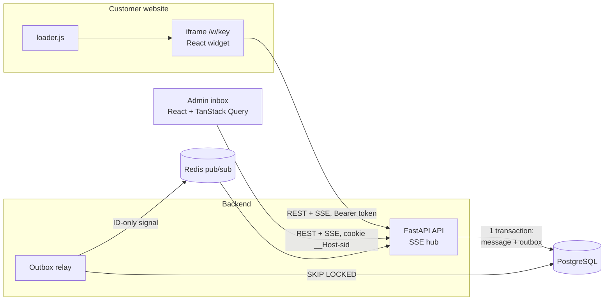

<p align="center">
  
</p>

AI customer-support agents with a human in the loop, built for small businesses. Customers message through a web widget and staff reply from a shared inbox. On top of that, an AI agent climbs a trust ladder of **Manual → Shadow → Learning → Autopilot**:

- **Manual**: staff answer everything; the agent stays out of the conversation.
- **Shadow**: the agent drafts a reply for every message in the background, and the drafts are compared against what staff actually sent.
- **Learning**: drafts appear in the inbox for staff to edit and send, and those corrections feed the agent's knowledge.
- **Autopilot**: the bot replies on its own, but only for the intents that have proven reliable. Every reply passes a single code-enforced send gate, and an intent is demoted automatically when its replies start going wrong.

Design: [step 1 — webchat ↔ inbox](docs/design/01-webchat-inbound-pipeline.md) · [step 2 — agent from a template](docs/design/02-agent-from-template.md) · [ordering + multi-channel inbox](docs/design/03-order-flow-and-unified-inbox.md) · [step 3 — shadow comparison](docs/design/04-shadow-comparison.md) · [step 4 — Learning](docs/design/05-learning.md) · [step 5 — Autopilot](docs/design/06-autopilot.md) · Try it yourself: [guide](docs/guides/01-test-pipeline.md)

## Architecture (step 1)



- Inbound messages are stored **exactly once** (unique index), with a gapless per-conversation `sequence` (row lock), in the same transaction as the outbox entry — [ADR-0013](docs/adr/0013-idempotency-sequence-outbox.md).
- The tenant is always resolved server-side; foreign keys use `(tenant_id, id)` — [ADR-0014](docs/adr/0014-tenant-context-customer-identity.md).
- The widget is an iframe with a signed token, allowlisted via `frame-ancestors` — [ADR-0017](docs/adr/0017-widget-iframe-token-origin.md).
- SSE only carries signals; REST is the source of truth — [ADR-0018](docs/adr/0018-realtime-sse-signals.md).
- Minimal staff auth with DB-backed session cookies — [ADR-0029](docs/adr/0029-minimal-staff-auth.md).

| Directory | Contents |
|---|---|
| `backend/` | FastAPI modular monolith (Clean Architecture), Alembic, tests against a real Postgres |
| `widget/` | `loader.js` + the app running inside the iframe |
| `frontend/` | Admin inbox (Feature-Sliced Design) |
| `e2e/` | Playwright: widget ↔ inbox |
| `docs/` | Designs, ADRs, runbooks |

## Running locally

Requires Docker, [uv](https://docs.astral.sh/uv/), and Node LTS.

```powershell
docker compose up -d postgres redis
cd backend
uv sync --extra dev
uv run alembic upgrade head
```

Create a sample tenant (a random password is printed **once**):

```powershell
uv run python -m app.entrypoints.cli seed --tenant "Shop A" --email owner@shop.test --origin http://localhost:5500
```

Start the processes, one per terminal. `WEBCHAT_TOKEN_SECRETS` is JSON of the form `{"k1": "<random string ≥ 32 bytes>"}` (see `.env.example`):

```powershell
cd backend; uv run uvicorn app.entrypoints.api:app --port 8000
```

```powershell
cd backend; uv run python -m app.entrypoints.worker
```

```powershell
cd backend; uv run python -m app.entrypoints.agent_worker   # agent queue: runs the agent runtime (drafts, shadow, autopilot)
```

```powershell
cd widget; npm ci; npm run build
```

```powershell
cd frontend; npm ci; npm run dev
```

```powershell
cd backend; uv run python -m http.server 5500 -d ../widget/demo
```

- Sample host page: `http://localhost:5500/?key=<public_key>` — click the chat button in the bottom-right corner.
- Admin inbox: `http://localhost:5173` — sign in with the email/password from the seed command.

## Testing

```powershell
cd backend; uv run ruff check .; uv run pytest
```

```powershell
cd e2e; npm ci; npx playwright test
```

E2E starts the API, worker, sample page, and admin app on its own; it needs Postgres and Redis running and the widget already built. Locally it uses the installed Chrome.

## Operations

- Health: `/health` (process), `/health/ready` (DB; reports Redis status but does not fail when Redis is down).
- Metrics: API `/metrics`, worker `:9101/metrics` (internal).
- One-line JSON logs with a `trace_id`; no message content, tokens, or IPs.
- Outbox runbook: [docs/runbooks/outbox.md](docs/runbooks/outbox.md).
