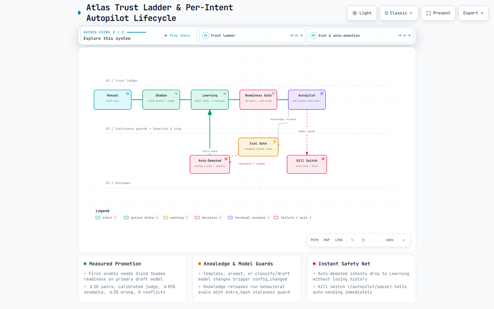
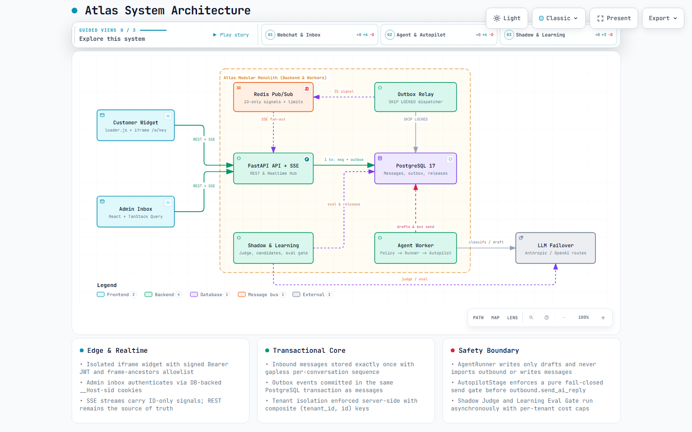
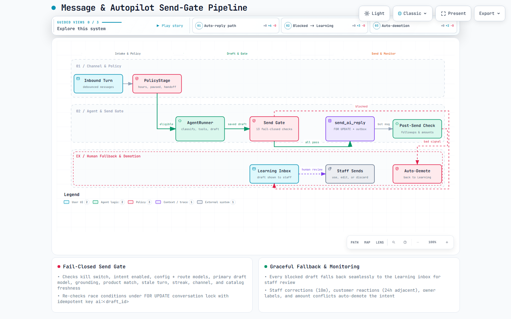

<p align="center">
  
</p>

<h1 align="center">Atlas</h1>

<p align="center">
  <strong>AI customer-support agents with a human in the loop, built for small businesses.</strong><br/>
  Customers chat through an isolated web widget; staff reply from a unified inbox; an AI agent earns autonomy step by step along a measured trust ladder.
</p>

---

## Trust Ladder: Manual → Shadow → Learning → Autopilot

Atlas never turns an LLM loose on customers on day one. Every tenant progresses through four explicit operating modes, and Autopilot is enabled **per intent** rather than all at once:

| Mode | Customer Experience | What the Agent Does | How Quality Is Measured |
|---|---|---|---|
| **Manual** | Staff answer everything directly | Stays out of the conversation | Baseline human response history |
| **Shadow** | Staff answer everything directly | Drafts replies blindly in the background without showing them to staff | Calibrated LLM Judge scores blind `(draft, human_reply)` pairs on the primary draft model |
| **Learning** | Staff send replies from the inbox | Surfaces drafts in the inbox for staff to use, edit, or discard | Staff edits and owner feedback feed versioned knowledge releases gated by behavioral evals |
| **Autopilot** | Bot auto-replies **only** on proven intents | Every candidate reply passes a single code-enforced 13-rule fail-closed send gate | Post-send monitoring (staff corrections, 24h adjacent customer reactions, owner labels, amount conflicts) auto-demotes failing intents back to Learning |

<picture>
  <source media="(prefers-color-scheme: dark)" srcset="docs/assets/trust-ladder-dark.png">
  <source media="(prefers-color-scheme: light)" srcset="docs/assets/trust-ladder-light.png">
  
</picture>

> Interactive diagram: [docs/diagrams/trust-ladder.html](docs/diagrams/trust-ladder.html) · Spec: [docs/diagrams/trust-ladder.json](docs/diagrams/trust-ladder.json)

### Per-Intent Promotion & Continuous Safety
- **Readiness gate (first enable)**: An intent can only be promoted to Autopilot after collecting at least **30 blind Shadow pairs** on the current primary draft model, with a **calibrated judge**, `≥ 85%` sendable rate, `≤ 2%` wrong rate, and `0` critical amount/policy conflicts.
- **Knowledge release protection**: Every knowledge release runs a per-intent behavioral eval suite (checking grounding, no hallucinated numbers, and no unnecessary handoffs, with `entry_id` + `entry_hash` staleness guards on price/shipping assertions). Regressing Learning releases are blocked from publishing; manual owner edits still publish and auto-demote only the affected intents (`eval_regressed`).
- **Config & model drift protection**: Changing the template, template version, prompt version, or `classify`/`draft` route models immediately stops auto-sending (`config_changed`) until re-verified.

---

## System Architecture

Atlas is a **FastAPI modular monolith** backed by **PostgreSQL 17** and **Redis**, with clean Clean-Architecture module boundaries enforced automatically by AST unit tests (`backend/tests/unit/test_architecture.py`).

<picture>
  <source media="(prefers-color-scheme: dark)" srcset="docs/assets/atlas-architecture-dark.png">
  <source media="(prefers-color-scheme: light)" srcset="docs/assets/atlas-architecture-light.png">
  
</picture>

> Interactive diagram: [docs/diagrams/atlas-architecture.html](docs/diagrams/atlas-architecture.html) · Spec: [docs/diagrams/atlas-architecture.json](docs/diagrams/atlas-architecture.json)

### Core Architectural Guarantees
- **Exactly-once inbound ingestion & transactional outbox**: Inbound messages are stored once (unique index) with a gapless per-conversation `sequence` under a row lock, in the same PostgreSQL transaction as their outbox record — [ADR-0013](docs/adr/0013-idempotency-sequence-outbox.md).
- **Strict server-side tenant isolation**: Tenant identity is resolved exclusively on the server; foreign keys use composite `(tenant_id, id)` keys — [ADR-0014](docs/adr/0014-tenant-context-customer-identity.md).
- **Isolated iframe widget**: Customer chat runs inside a sandboxed iframe (`loader.js` → `/w/<public_key>`) with signed Bearer JWTs and a `frame-ancestors` origin allowlist — [ADR-0017](docs/adr/0017-widget-iframe-token-origin.md).
- **Signal-only realtime SSE**: Outbox relay polls PostgreSQL via `SKIP LOCKED` and fans out ID-only signals through Redis pub/sub to FastAPI SSE streams; REST remains the source of truth — [ADR-0018](docs/adr/0018-realtime-sse-signals.md).
- **DB-backed staff sessions**: Admin inbox authenticates with `__Host-sid` session cookies stored in PostgreSQL — [ADR-0029](docs/adr/0029-minimal-staff-auth.md).
- **Stateless models, durable knowledge**: Business facts, policies, and product catalogs live in versioned PostgreSQL releases rather than model memory, with provider abstraction and automatic failover across Anthropic and OpenAI routes — [ADR-0015](docs/adr/0015-llm-provider-abstraction-and-failover.md), [ADR-0030](docs/adr/0030-stateless-model-durable-knowledge.md).

---

## Message & Autopilot Send-Gate Pipeline

`AgentRunner` is strictly **draft-only**: it classifies intent, retrieves grounded knowledge/catalog entries, and persists a draft. It is architecturally forbidden from importing `outbound` or writing to `messages`. Only `AutopilotStage` can promote a draft to a sent bot reply — and only after all **13 fail-closed gate rules** pass.

<picture>
  <source media="(prefers-color-scheme: dark)" srcset="docs/assets/autopilot-pipeline-dark.png">
  <source media="(prefers-color-scheme: light)" srcset="docs/assets/autopilot-pipeline-light.png">
  
</picture>

> Interactive diagram: [docs/diagrams/autopilot-pipeline.html](docs/diagrams/autopilot-pipeline.html) · Spec: [docs/diagrams/autopilot-pipeline.json](docs/diagrams/autopilot-pipeline.json)

### Ordered 13-Rule Fail-Closed Send Gate (`outbound/domain/gate.py`)

Every blocked draft falls back cleanly to the **Learning** inbox so staff still see the draft — zero lost turns.

| Priority | Rule | What It Blocks |
|---:|---|---|
| 1 | `kill_switch` | Tenant `ai_enabled = false` or `auto_send = false` |
| 2 | `intent_not_enabled` | Any intent of the turn is not in `autopilot`, or is in `NEVER_AUTOPILOT_INTENTS` / `handoff_intents` |
| 3 | `config_changed` | Run `config_key` (`template`, `template_version`, `prompt_version`, `models.classify`, `models.draft`) differs from enabled config keys |
| 4 | `model_not_primary` | Draft was produced by a fallback model instead of the route's primary draft model (falls back to Learning without demoting) |
| 5 | `not_grounded` | Draft is ungrounded (`grounded = false`) or fails deterministic `validate_draft` checks |
| 6 | `needs_human` | Draft explicitly requests human handoff |
| 7 | `order_flow` | Conversation has an active order request flow |
| 8 | `product_mismatch` | Customer named a specific product/SKU that the draft did not cite |
| 9 | `handling` | Conversation `handling != 'bot'` or conversation is closed |
| 10 | `stale` | A newer customer message or staff reply arrived after `based_on_sequence` (re-checked under `FOR UPDATE` lock) |
| 11 | `bot_streak` | 3 or more consecutive bot messages without a customer reply |
| 12 | `channel` | Channel provider is not in `AI_SEND_PROVIDERS` or fails channel window/quota checks |
| 13 | `catalog_stale` | Draft quotes amounts from an externally synced catalog item older than `catalog_max_age_hours` (CSV uploads never expire) |

### Post-Send Monitoring & Automatic Demotion
Once `send_ai_reply` commits the bot message (idempotent key `ai:<draft_id>`), Atlas monitors four live signals and automatically demotes the intent back to **Learning** when quality slips:
- **Staff correction** within 10 minutes of a bot reply.
- **Customer negative reaction** (adjacent customer message within 24 hours with negative signal).
- **Owner / staff bad-reply label** marked directly in the inbox.
- **Amount / price conflict** detected against current knowledge or catalog data.

---

## Repository Structure

| Directory | Contents |
|---|---|
| `backend/` | FastAPI modular monolith (Clean Architecture), Alembic migrations, background workers, unit & integration tests against real PostgreSQL |
| `widget/` | `loader.js` + isolated React chat widget running inside the customer iframe |
| `frontend/` | Admin inbox (React, TypeScript, TanStack Query, Feature-Sliced Design) |
| `e2e/` | Playwright end-to-end suite covering widget ↔ inbox flows |
| `docs/design/` | End-to-end design specs for Steps 1–5 |
| `docs/adr/` | Architecture Decision Records (`ADR-0008` through `ADR-0039`) |
| `docs/diagrams/` | Auto-generated interactive HTML diagrams and Archify JSON specs |
| `docs/runbooks/` | Operational runbooks (e.g., outbox recovery) |

---

## Documentation Index

- **Design specs**:
  - [Step 1 — Webchat ↔ Inbox Inbound Pipeline](docs/design/01-webchat-inbound-pipeline.md)
  - [Step 2 — Agent Runtime from Versioned Templates](docs/design/02-agent-from-template.md)
  - [Ordering Flow & Unified Multi-Channel Inbox](docs/design/03-order-flow-and-unified-inbox.md)
  - [Step 3 — Shadow Comparison & Calibrated Judge](docs/design/04-shadow-comparison.md)
  - [Step 4 — Learning via Versioned Knowledge Releases](docs/design/05-learning.md)
  - [Step 5 — Per-Intent Autopilot Behind Send Gate](docs/design/06-autopilot.md)
- **Key ADRs**:
  - [ADR-0008 Queue & Background Processing](docs/adr/0008-queue-and-background-processing.md) · [ADR-0009 Versioned Templates & Mode Ladder](docs/adr/0009-versioned-templates-and-mode-ladder.md) · [ADR-0010 Deterministic Agent Loop](docs/adr/0010-own-agent-loop-deterministic-workflow.md)
  - [ADR-0031 Conversation Policy Before Agent](docs/adr/0031-conversation-policy-before-agent.md) · [ADR-0033 Single Send Gate](docs/adr/0033-single-send-gate-for-automatic-messages.md) · [ADR-0037 Shadow & Calibrated Judge](docs/adr/0037-shadow-comparison-and-calibrated-judge.md) · [ADR-0038 Learning Knowledge Releases](docs/adr/0038-learning-through-reviewed-knowledge-releases.md) · [ADR-0039 Per-Intent Autopilot](docs/adr/0039-per-intent-autopilot-behind-send-gate.md)
- **Guides & Runbooks**:
  - [Try it yourself: End-to-End Pipeline Guide](docs/guides/01-test-pipeline.md)
  - [Outbox Runbook](docs/runbooks/outbox.md)

---

## Running Locally

Requires **Docker**, **[uv](https://docs.astral.sh/uv/)**, and **Node LTS**.

```powershell
docker compose up -d postgres redis
cd backend
uv sync --extra dev
uv run alembic upgrade head
```

Create a sample tenant (a random password is printed **once**):

```powershell
uv run python -m app.entrypoints.cli seed --tenant "Shop A" --email owner@shop.test --origin http://localhost:5500
```

Start the processes, one per terminal. `WEBCHAT_TOKEN_SECRETS` is JSON of the form `{"k1": "<random string ≥ 32 bytes>"}` (see `backend/.env.example`):

```powershell
# 1. FastAPI API + SSE hub
cd backend; uv run uvicorn app.entrypoints.api:app --port 8000
```

```powershell
# 2. Outbox relay + background jobs
cd backend; uv run python -m app.entrypoints.worker
```

```powershell
# 3. Agent queue worker (drafts, shadow, autopilot)
cd backend; uv run python -m app.entrypoints.agent_worker
```

```powershell
# 4. Build customer widget
cd widget; npm ci; npm run build
```

```powershell
# 5. Admin inbox dev server
cd frontend; npm ci; npm run dev
```

```powershell
# 6. Demo host page for the widget
cd backend; uv run python -m http.server 5500 -d ../widget/demo
```

- **Sample host page**: `http://localhost:5500/?key=<public_key>` — click the chat button in the bottom-right corner.
- **Admin inbox**: `http://localhost:5173` — sign in with the email/password printed by the `seed` command.

---

## Testing

```powershell
# Backend lint + full unit & integration test suite (including architecture boundary tests)
cd backend; uv run ruff check .; uv run pytest
```

```powershell
# End-to-end Playwright tests (widget ↔ inbox)
cd e2e; npm ci; npx playwright test
```

E2E starts the API, worker, sample host page, and admin app automatically; it requires Postgres and Redis running and the widget already built. Locally it uses the installed Chrome.

---

## Operations

- **Health checks**: `/health` (process liveness), `/health/ready` (database readiness; reports Redis status without failing readiness when Redis is temporarily down).
- **Metrics**: API `/metrics`, worker `:9101/metrics` (internal).
- **Structured logging**: One-line JSON logs tagged with `trace_id`; never logs message content, tokens, or IPs.
- **Runbooks**: [docs/runbooks/outbox.md](docs/runbooks/outbox.md).
