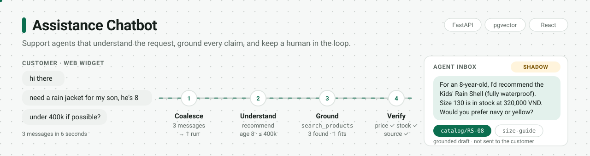
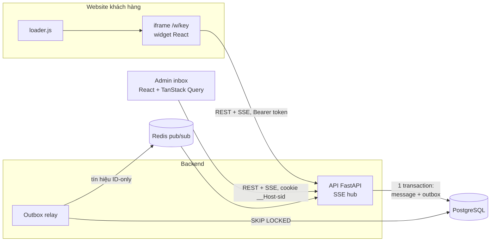

<p align="center">
  
</p>

AI customer-support agents with human-in-the-loop cho doanh nghiệp nhỏ: khách nhắn qua widget, nhân viên trả lời trong inbox; các bước sau thêm agent AI theo thang **Manual → Shadow → Learning → Autopilot**.

Bối cảnh: [PROJECT_CONTEXT.md](PROJECT_CONTEXT.md) · Quy tắc làm việc: [CONTRIBUTING.md](CONTRIBUTING.md) · Thiết kế bước 1: [docs/design/01-webchat-inbound-pipeline.md](docs/design/01-webchat-inbound-pipeline.md)

## Kiến trúc (bước 1)



- Tin vào được lưu **đúng một lần** (unique index) với `sequence` liên tục theo hội thoại (row lock), cùng transaction với outbox — [ADR-0013](docs/adr/0013-idempotency-sequence-outbox.md).
- Tenant luôn suy ra phía server; FK theo `(tenant_id, id)` — [ADR-0014](docs/adr/0014-tenant-context-customer-identity.md).
- Widget là iframe + token ký, allowlist qua `frame-ancestors` — [ADR-0017](docs/adr/0017-widget-iframe-token-origin.md).
- SSE chỉ mang tín hiệu, REST là sự thật — [ADR-0018](docs/adr/0018-realtime-sse-signals.md).
- Auth nhân viên tối thiểu, cookie DB-backed — [ADR-0029](docs/adr/0029-minimal-staff-auth.md).

| Thư mục | Nội dung |
|---|---|
| `backend/` | FastAPI, modular monolith (Clean Architecture), Alembic, test trên Postgres thật |
| `widget/` | `loader.js` + app trong iframe |
| `frontend/` | Admin inbox (FSD) |
| `e2e/` | Playwright: widget ↔ inbox |
| `docs/` | Thiết kế, ADR, runbook |

## Chạy local

Cần Docker, [uv](https://docs.astral.sh/uv/), Node LTS.

```powershell
docker compose up -d postgres redis
cd backend
uv sync --extra dev
uv run alembic upgrade head
```

Tạo tenant mẫu (mật khẩu ngẫu nhiên in ra **một lần**):

```powershell
uv run python -m app.entrypoints.cli seed --tenant "Shop A" --email owner@shop.test --origin http://localhost:5500
```

Chạy các tiến trình (mỗi lệnh một terminal). `WEBCHAT_TOKEN_SECRETS` là JSON `{"k1": "<chuỗi ngẫu nhiên ≥ 32 byte>"}` (xem `.env.example`):

```powershell
cd backend; uv run uvicorn app.entrypoints.api:app --port 8000
```

```powershell
cd backend; uv run python -m app.entrypoints.worker
```

```powershell
cd backend; uv run python -m app.entrypoints.agent_worker   # bước 2: hàng đợi agent (hiện chỉ ghi log)
```

```powershell
cd widget; npm ci; npm run build
```

```powershell
cd frontend; npm ci; npm run dev
```

```powershell
cd backend; uv run python -m http.server 5500 -d ../widget/demo
```

- Trang host mẫu: `http://localhost:5500/?key=<public_key>` — bấm nút chat ở góc phải.
- Admin inbox: `http://localhost:5173` — đăng nhập bằng email/mật khẩu từ seed.

## Kiểm tra

```powershell
cd backend; uv run ruff check .; uv run pytest
```

```powershell
cd e2e; npm ci; npx playwright test
```

E2E tự dựng API, worker, trang mẫu và admin; cần Postgres + Redis đang chạy và widget đã build. Local dùng Chrome đã cài.

## Vận hành

- Health: `/health` (process), `/health/ready` (DB; báo trạng thái Redis nhưng không fail khi Redis chết).
- Metric: API `/metrics`, worker `:9101/metrics` (nội bộ).
- Log JSON một dòng, có `trace_id`; không chứa nội dung tin, token, IP.
- Runbook outbox: [docs/runbooks/outbox.md](docs/runbooks/outbox.md).
