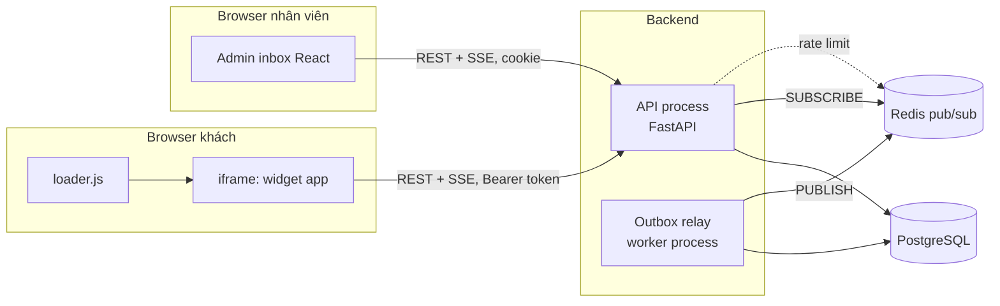
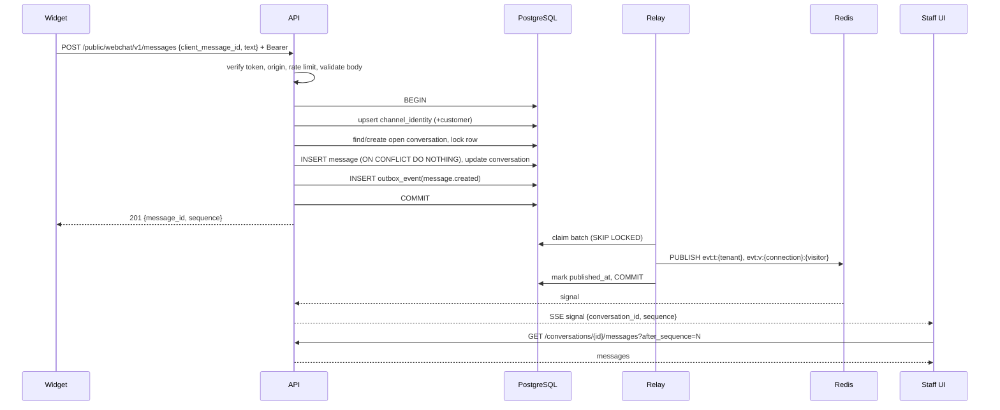
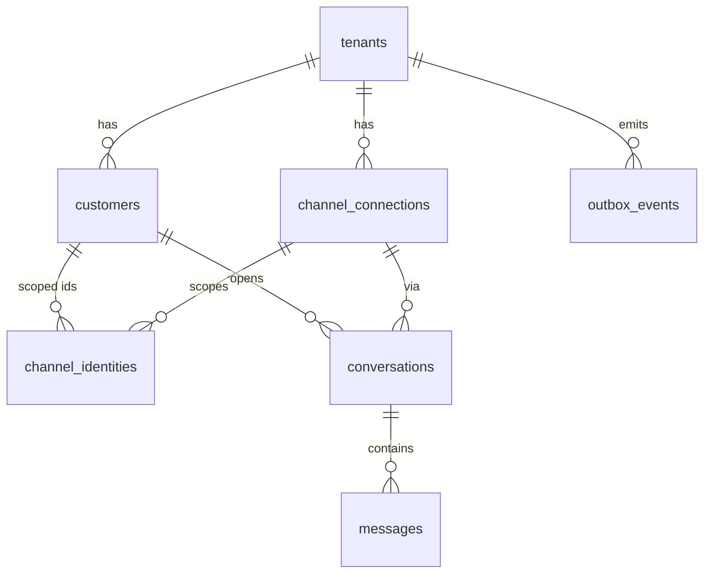
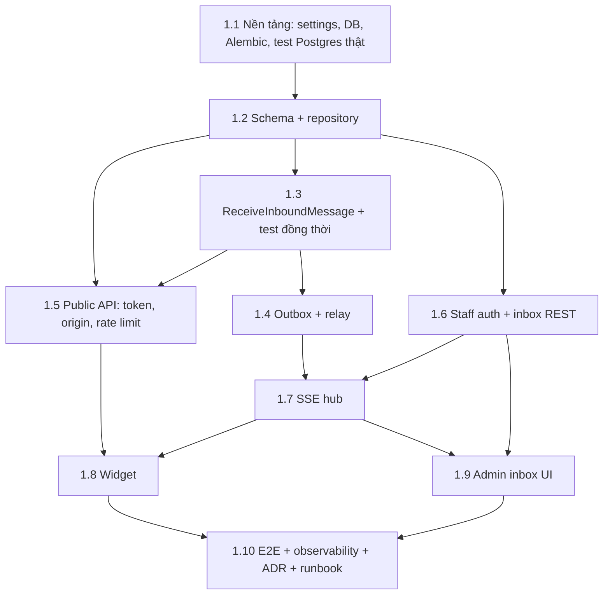

# Thiết kế chi tiết — Bước 1: Webchat → Inbound → Persist + Outbox → Inbox realtime

- Trạng thái: **đề xuất thiết kế, chưa implement** (repo mới có khung, xem `backend/`).
- Phạm vi nguồn: `PROJECT_CONTEXT.md` §9.2, §12.2–12.8, §13, §14, §16, §22.4 bước 1.
- Không có deadline. Thứ tự ở Mục 14 chỉ là quan hệ phụ thuộc kỹ thuật.
- Con số trong tài liệu (rate limit, kích thước, TTL) là **giá trị khởi điểm cần hiệu chỉnh bằng đo đạc**, không phải SLO cam kết (§20.1).

---

## 1. Mục tiêu và phạm vi

### 1.1. Mục tiêu

Một khách truy cập website nhúng widget, gửi tin nhắn. Tin được xác thực, chuẩn hóa, lưu **đúng một lần** dù client retry, và hiện **realtime** trong inbox của nhân viên. Nhân viên trả lời, khách thấy câu trả lời realtime. Toàn bộ luồng chạy được end-to-end, có test chứng minh các tính chất reliability.

Đây là nền móng của mọi bước sau: bước 2 (agent), 3 (shadow), 4 (learning) đều **gắn vào outbox event** `message.created` của bước này mà không sửa pipeline.

### 1.2. Trong phạm vi

| # | Hạng mục |
|---|---|
| 1 | Widget nhúng được (loader + iframe app), vi/en, responsive, accessible |
| 2 | Session khách ẩn danh (visitor) có token ký, origin allowlist, rate limit |
| 3 | Channel adapter `webchat` + `NormalizedChannelEvent` (§12.3) |
| 4 | Use case `ReceiveInboundMessage`: idempotent, gán `sequence` theo conversation |
| 5 | Resolve Customer / ChannelIdentity / Conversation |
| 6 | Transactional outbox + relay worker |
| 7 | Hub realtime (SSE) cho nhân viên và cho khách |
| 8 | Inbox tối thiểu: danh sách hội thoại, timeline, trả lời, đánh dấu đã đọc |
| 9 | Auth nhân viên tối thiểu (seed user + session cookie) |
| 10 | Seed CLI, observability cơ bản, test suite, ADR |

### 1.3. Ngoài phạm vi (có chủ đích)

AI/agent run, debounce (§9.2.1), mode ladder, handoff, routing/assignment, ticket, attachment/upload, typing indicator, read receipt cho khách, thu thập email/SĐT khách, merge customer, RLS Postgres, billing/credit, channel khác (Telegram…), full RBAC. Mỗi mục có chỗ gắn sẵn nhưng không dựng trước (Mục 15).

---

## 2. Quyết định thiết kế chính (tóm tắt)

| ID | Quyết định | Lý do ngắn | ADR (cần viết) |
|---|---|---|---|
| D1 | Widget = loader JS nhỏ + **iframe** chứa app React | Cô lập CSS/JS/storage khỏi trang host; `frame-ancestors` ép origin allowlist ở mức trình duyệt | 0017 |
| D2 | Khách xác thực bằng **session token ký (JWT HS256)**, không cookie | Cookie bên thứ ba trong iframe bị chặn; không cần DB để verify | 0017 |
| D3 | `public_key` → `channel_connection` → `tenant` do **server** resolve | Không tin tenant/connection ID từ browser (§12.8) | 0014 |
| D4 | Idempotency bằng **unique index** + `INSERT … ON CONFLICT DO NOTHING` | Đúng dưới race, không cần lock ứng dụng | 0013 |
| D5 | `sequence` per-conversation cấp bằng `conversations.last_sequence` dưới row lock | Thứ tự xác định, không gap, đơn giản | 0013 |
| D6 | Outbox trong cùng transaction; **relay worker** poll `FOR UPDATE SKIP LOCKED` | Không mất event khi commit xong mà publish hỏng | 0013 |
| D7 | Realtime = **SSE mang tín hiệu (ID), REST là nguồn sự thật** | Reconnect/mất event tự lành bằng refetch; không lộ nội dung qua Redis | 0018 |
| D8 | Khách dùng SSE qua `fetch` stream + header `Authorization` | `EventSource` không gửi được header; tránh token trên URL | 0017 |
| D9 | Staff auth: session cookie `__Host-`, DB-backed, argon2id | Tối thiểu nhưng đúng chuẩn; thay được sau (câu hỏi mở 24.2) | 0029* |
| D10 | Customer + identity tạo **lúc có tin đầu tiên**, không lúc mở widget | Chống rác DB do bot mở session hàng loạt | 0014 |
| D11 | PK dùng UUIDv4; thứ tự dựa `sequence`/`outbox.id`, không dựa PK | Không cần UUIDv7 ở bước này | — |

\* số ADR mới, nối tiếp danh sách khởi điểm §25 (đang tới 0028).

---

## 3. Kiến trúc tổng thể

### 3.1. Thành phần và tiến trình



- **API process**: HTTP, SSE, ghi DB. Có thể chạy nhiều instance.
- **Relay worker**: một process, đọc outbox, publish Redis. Bước 1 chạy **đúng một instance** (xem 8.4).
- **Redis**: pub/sub (tín hiệu realtime) + bộ đếm rate limit. **Không** là nguồn sự thật; mất Redis chỉ làm realtime chậm, không mất dữ liệu.

### 3.2. Luồng inbound (happy path)



### 3.3. Luồng trả lời của nhân viên

Nhân viên `POST /api/v1/conversations/{id}/messages` → cùng cơ chế: persist outbound message (`sender_type=human`) + outbox trong một transaction → relay → SSE tới **khách** (kênh `evt:v:{connection_id}:{visitor_id}`) và tới nhân viên khác trong tenant. Webchat không có provider bên ngoài nên "gửi" = đã persist và đã đẩy tín hiệu; `status = sent`. Delivery receipt thật cho kênh ngoài thuộc bước kênh tương ứng.

---

## 4. Mô hình miền

### 4.1. Khái niệm

| Thực thể | Vai trò | Module sở hữu |
|---|---|---|
| `ChannelConnection` | Một widget gắn với một tenant; có `public_key`, allowlist | `integration` |
| `Customer` | Người (ẩn danh ở bước này) | `customer` (**cần thêm module, khung hiện chưa có**) |
| `ChannelIdentity` | Định danh scoped của khách trong một connection (`visitor_id`) | `customer` |
| `Conversation` | Luồng tương tác; aggregate giữ `last_sequence`, `unread_count` | `conversation` |
| `Message` | Một tin (inbound/outbound), bất biến sau khi tạo | `conversation` |
| `OutboxEvent` | Sự kiện chờ phát | `shared/infrastructure` |
| `NormalizedChannelEvent` | Hợp đồng nội bộ giữa adapter và use case (§12.3) | `integration` |

### 4.2. Quy tắc nghiệp vụ (invariant)

1. Mỗi message thuộc đúng một conversation và một tenant; `tenant_id` của message = của conversation.
2. `(tenant, channel_connection, direction, external_message_id)` là duy nhất → idempotency.
3. `sequence` trong một conversation tăng dần 1, 2, 3… không trùng, không gap (gap chỉ xuất hiện nếu transaction rollback, và khi đó giá trị được cấp lại).
4. Mỗi `(tenant, customer, channel_connection)` có **tối đa một conversation `open`**.
5. Khách mới nhắn khi conversation cuối đã `closed` → tạo conversation mới cho cùng customer.
6. Không thể gửi message vào conversation `closed` (409).
7. Message không sửa/xóa ở bước này.

### 4.3. Ranh giới module và phụ thuộc

Theo §4.3, module không đọc bảng của module khác. Use case `ReceiveInboundMessage` (module `conversation`) gọi **public application interface** của `customer`:

```python
# customer/application/ports_public.py
class ResolveCustomerForChannelIdentity(Protocol):
    async def __call__(
        self, ctx: TenantContext, connection_id: UUID,
        provider: str, scoped_external_id: str,
    ) -> ResolvedCustomer: ...   # tạo Customer + ChannelIdentity nếu chưa có
```

`conversation` không import SQLAlchemy model của `customer`. Cả hai dùng chung một `UnitOfWork` (một transaction) do tầng application mở, để customer + conversation + message + outbox commit nguyên khối.

---

## 5. Thiết kế dữ liệu

Quy ước: `timestamptz` UTC; mọi bảng nghiệp vụ có `tenant_id`; FK tham chiếu cặp `(tenant_id, id)` để chặn tham chiếu chéo tenant (§13.1, §13.3). Alembic migration đầu tiên tạo toàn bộ bảng dưới đây.

```sql
CREATE EXTENSION IF NOT EXISTS citext;

CREATE TABLE tenants (
  id         uuid PRIMARY KEY,
  name       text NOT NULL,
  slug       text NOT NULL UNIQUE,
  status     text NOT NULL DEFAULT 'active' CHECK (status IN ('active','suspended')),
  locale     text NOT NULL DEFAULT 'vi',
  timezone   text NOT NULL DEFAULT 'Asia/Ho_Chi_Minh',
  created_at timestamptz NOT NULL DEFAULT now()
);

CREATE TABLE users (
  id            uuid PRIMARY KEY,
  email         citext NOT NULL UNIQUE,
  password_hash text NOT NULL,                 -- argon2id
  display_name  text NOT NULL,
  status        text NOT NULL DEFAULT 'active',
  created_at    timestamptz NOT NULL DEFAULT now()
);

-- Tối thiểu: một cột role. RBAC đầy đủ (§6.2) là migration expand sau.
CREATE TABLE tenant_memberships (
  tenant_id uuid NOT NULL REFERENCES tenants(id),
  user_id   uuid NOT NULL REFERENCES users(id),
  role      text NOT NULL CHECK (role IN ('owner','admin','agent')),
  status    text NOT NULL DEFAULT 'active',
  joined_at timestamptz NOT NULL DEFAULT now(),
  PRIMARY KEY (tenant_id, user_id)
);

CREATE TABLE staff_sessions (
  id          uuid PRIMARY KEY,
  tenant_id   uuid NOT NULL,
  user_id     uuid NOT NULL,
  token_hash  bytea NOT NULL UNIQUE,           -- sha256 của cookie value
  expires_at  timestamptz NOT NULL,
  created_at  timestamptz NOT NULL DEFAULT now(),
  FOREIGN KEY (tenant_id, user_id) REFERENCES tenant_memberships(tenant_id, user_id)
);

CREATE TABLE channel_connections (
  id                  uuid PRIMARY KEY,
  tenant_id           uuid NOT NULL REFERENCES tenants(id),
  provider            text NOT NULL CHECK (provider IN ('webchat')),  -- mở rộng bằng migration
  external_account_id text,
  status              text NOT NULL DEFAULT 'active' CHECK (status IN ('active','disabled')),
  public_key          text UNIQUE,             -- 'wpk_' + 24 ký tự base32 ngẫu nhiên, chỉ webchat
  config              jsonb NOT NULL DEFAULT '{}',  -- allowed_origins[], greeting, theme, privacy_url
  created_at          timestamptz NOT NULL DEFAULT now(),
  UNIQUE (tenant_id, id)
);

CREATE TABLE customers (
  id           uuid PRIMARY KEY,
  tenant_id    uuid NOT NULL REFERENCES tenants(id),
  display_name text NOT NULL,                  -- "Khách #A1B2" cho ẩn danh
  status       text NOT NULL DEFAULT 'active',
  created_at   timestamptz NOT NULL DEFAULT now(),
  UNIQUE (tenant_id, id)
);

CREATE TABLE channel_identities (
  id                  uuid PRIMARY KEY,
  tenant_id           uuid NOT NULL,
  customer_id         uuid NOT NULL,
  channel_connection_id uuid NOT NULL,
  provider            text NOT NULL,
  scoped_external_id  text NOT NULL,           -- visitor_id
  first_seen_at       timestamptz NOT NULL DEFAULT now(),
  last_inbound_at     timestamptz,
  FOREIGN KEY (tenant_id, customer_id)          REFERENCES customers(tenant_id, id),
  FOREIGN KEY (tenant_id, channel_connection_id) REFERENCES channel_connections(tenant_id, id),
  UNIQUE (tenant_id, channel_connection_id, scoped_external_id)
);

CREATE TABLE conversations (
  id                    uuid PRIMARY KEY,
  tenant_id             uuid NOT NULL,
  channel_connection_id uuid NOT NULL,
  customer_id           uuid NOT NULL,
  status                text NOT NULL DEFAULT 'open' CHECK (status IN ('open','closed')),
  last_sequence         bigint NOT NULL DEFAULT 0,
  last_message_at       timestamptz,
  last_message_preview  text,                  -- cắt ≤120 ký tự; cập nhật khi xóa dữ liệu (§16.8)
  unread_count          integer NOT NULL DEFAULT 0,
  version               integer NOT NULL DEFAULT 1,
  created_at            timestamptz NOT NULL DEFAULT now(),
  updated_at            timestamptz NOT NULL DEFAULT now(),
  closed_at             timestamptz,
  FOREIGN KEY (tenant_id, customer_id)           REFERENCES customers(tenant_id, id),
  FOREIGN KEY (tenant_id, channel_connection_id) REFERENCES channel_connections(tenant_id, id),
  UNIQUE (tenant_id, id)
);
-- Invariant 4:
CREATE UNIQUE INDEX uq_conversation_one_open
  ON conversations (tenant_id, customer_id, channel_connection_id) WHERE status = 'open';
-- Inbox list (keyset pagination):
CREATE INDEX ix_conversation_list
  ON conversations (tenant_id, status, last_message_at DESC, id DESC);

CREATE TABLE messages (
  id                    uuid PRIMARY KEY,
  tenant_id             uuid NOT NULL,
  channel_connection_id uuid NOT NULL,
  conversation_id       uuid NOT NULL,
  external_message_id   text NOT NULL,         -- client_message_id do client sinh
  direction             text NOT NULL CHECK (direction IN ('inbound','outbound')),
  sender_type           text NOT NULL CHECK (sender_type IN ('customer','human','system')),
  sender_ref            text,                  -- user_id nếu human
  message_type          text NOT NULL DEFAULT 'text' CHECK (message_type = 'text'),
  content               text NOT NULL CHECK (char_length(content) BETWEEN 1 AND 4000),
  status                text NOT NULL CHECK (status IN ('received','sent')),
  sequence              bigint NOT NULL,
  occurred_at           timestamptz NOT NULL,  -- giờ SERVER nhận; không tin đồng hồ client
  created_at            timestamptz NOT NULL DEFAULT now(),
  trace_id              text,
  FOREIGN KEY (tenant_id, conversation_id) REFERENCES conversations(tenant_id, id),
  UNIQUE (conversation_id, sequence),
  -- Invariant 2 (idempotency):
  UNIQUE (tenant_id, channel_connection_id, direction, external_message_id)
);

CREATE TABLE outbox_events (
  id             bigint GENERATED ALWAYS AS IDENTITY PRIMARY KEY,   -- con trỏ stream
  tenant_id      uuid NOT NULL,
  aggregate_type text NOT NULL,
  aggregate_id   uuid NOT NULL,
  event_type     text NOT NULL,
  payload        jsonb NOT NULL,                                    -- versioned, KHÔNG chứa nội dung tin
  trace_id       text,
  created_at     timestamptz NOT NULL DEFAULT now(),
  published_at   timestamptz,
  attempts       integer NOT NULL DEFAULT 0,
  last_error     text
);
CREATE INDEX ix_outbox_unpublished ON outbox_events (id) WHERE published_at IS NULL;
```

Ghi chú:

- `webhook_events` (§13.2) **không dùng** cho webchat: ingress là API nội bộ có xác thực, payload đã nhỏ và đã chuẩn hóa; lưu raw không thêm giá trị. Bảng này dành cho kênh có webhook thật.
- `audit_events` chưa tạo ở bước này; hành động nhạy cảm duy nhất là đăng nhập. Bước 2 (đổi mode/agent) là lúc audit trở thành bắt buộc. **Ghi nhận như một nợ có chủ đích.**
- Retention outbox: job xóa dòng `published_at` cũ hơn 7 ngày (cấu hình được).
- Dữ liệu cần xóa khi khách yêu cầu (§16.8): `messages.content`, `conversations.last_message_preview`, `customers.display_name`. Bước này chưa có API xóa nhưng schema đã tách rõ các cột đó.

### 5.1. Sơ đồ quan hệ



---

## 6. Hợp đồng nội bộ

### 6.1. `NormalizedChannelEvent` (bước này, webchat)

```python
@dataclass(frozen=True)
class NormalizedChannelEvent:
    tenant_id: UUID
    channel_connection_id: UUID
    provider: Literal["webchat"]
    external_message_id: str       # client_message_id (UUID v4 string, đã validate)
    external_customer_id: str      # visitor_id từ token
    direction: Literal["inbound"]
    message_type: Literal["text"]
    text: str                      # đã NFC-normalize, strip ký tự điều khiển, trim
    occurred_at: datetime          # giờ server
    trace_id: str
```

`tenant_id`, `channel_connection_id`, `external_customer_id` **chỉ lấy từ token đã verify**, không từ request body. Đây là điểm chặn lỗi “client tự khai tenant”.

### 6.2. `ChannelAdapter` cho webchat

Webchat không có webhook, nên `verify_webhook` không áp dụng; adapter webchat thực hiện:

- `authenticate(headers) -> VisitorContext` (verify token + origin).
- `parse_inbound_event(ctx, body) -> NormalizedChannelEvent` (validate + normalize).
- `send_message(command) -> DeliveryResult` (persist-only, trả `sent`).

Giữ `Protocol` chung (§12.4) với phương thức nào không áp dụng thì kênh khai báo capability `supports_webhook=False`. Không bắt webchat giả lập chữ ký.

### 6.3. Outbox event

```json
{
  "v": 1,
  "event_type": "message.created",
  "tenant_id": "…", "connection_id": "…", "conversation_id": "…",
  "customer_id": "…", "visitor_id": "…",
  "message_id": "…", "sequence": 42,
  "direction": "inbound", "sender_type": "customer",
  "occurred_at": "2026-11-19T10:00:00Z", "trace_id": "…"
}
```

Loại event ở bước này: `conversation.created`, `message.created`, `conversation.read`. **Payload không chứa nội dung tin** (giảm PII đi qua Redis/log; client luôn lấy nội dung qua REST đã qua kiểm tra quyền). Đây cũng là hợp đồng mà consumer bước 2 sẽ dùng.

---

## 7. Giao diện API

Tất cả lỗi trả JSON `{ "error": { "code": "...", "message": "..." }, "trace_id": "..." }`. Không trả stack trace.

### 7.1. Public (widget)

| Method & path | Auth | Mô tả |
|---|---|---|
| `GET /w/{public_key}` | Origin | HTML của iframe; header `Content-Security-Policy: frame-ancestors <allowed_origins>` động theo connection |
| `POST /public/webchat/v1/sessions` | Origin + rate limit | Body `{public_key, token?}` → `Origin` phải là origin của chính iframe (`PUBLIC_ORIGIN`, xem 8.2); nếu có token hợp lệ **của cùng connection** thì gia hạn và giữ `visitor_id`, nếu không thì sinh `visitor_id` mới. Trả `{token, expires_at, config}`. **Không ghi DB** |
| `POST /public/webchat/v1/messages` | Bearer | Body `{client_message_id, text}` → `201 {message_id, sequence, conversation_id}`; replay cùng `client_message_id` → `200` cùng body |
| `GET /public/webchat/v1/messages?after_sequence=&limit=` | Bearer | Tin của conversation hiện tại của khách; `{conversation_id, messages[], has_more}`; chưa có tin → danh sách rỗng |
| `GET /public/webchat/v1/events` | Bearer | SSE tín hiệu cho khách |

Token (JWT HS256, thuật toán **cố định**, không chấp nhận `alg` do token tự khai):

```json
{ "tid": "<tenant>", "cid": "<connection>", "vid": "<visitor uuid>",
  "iat": 0, "exp": 0, "kid": "k1" }
```

TTL khởi điểm 7 ngày, gia hạn khi gọi `sessions` còn hợp lệ. Secret trong env `WEBCHAT_TOKEN_SECRET`, có `kid` để xoay khóa. Token hết hạn hẳn → khách thành `visitor_id` mới (mất lịch sử hiển thị phía khách, nhân viên vẫn thấy hai customer riêng; merge là bước sau).

### 7.2. Staff

| Method & path | Mô tả |
|---|---|
| `POST /api/v1/auth/login` / `POST /api/v1/auth/logout` / `GET /api/v1/auth/me` | Session cookie |
| `GET /api/v1/conversations?status=&cursor=&limit=` | Danh sách, keyset theo `(last_message_at, id)` |
| `GET /api/v1/conversations/{id}` | Chi tiết + customer + connection |
| `GET /api/v1/conversations/{id}/messages?after_sequence=&limit=` | Timeline, tăng dần |
| `POST /api/v1/conversations/{id}/messages` | Body `{client_message_id, text}` → trả lời; idempotent như inbound |
| `POST /api/v1/conversations/{id}/read` | `unread_count = 0` |
| `GET /api/v1/events` | SSE tín hiệu cho tenant của nhân viên |

Khớp §15.2 (đường dẫn `/api/v1/conversations…` giữ nguyên để không phát sinh lệch contract). Mọi truy vấn lọc `tenant_id` từ session, **không** từ tham số.

### 7.3. Định dạng SSE

```text
event: signal
id: 10482
data: {"t":"message.created","c":"<conversation_id>","s":42}

: heartbeat            (mỗi 15 giây)

event: resync          (server buộc client tải lại; gửi khi hàng đợi của client đầy)
data: {}
```

`id` là `outbox_events.id`. Bước này **không replay** theo `Last-Event-ID`: client khi kết nối lại luôn refetch (7.4). `id` vẫn phát để bước sau có thể thêm replay mà không đổi định dạng.

### 7.4. Quy tắc client realtime (staff UI và widget)

1. Nhận `signal` → invalidate query liên quan (`conversations`, `messages:{id}`) → refetch REST với `after_sequence`.
2. Mất kết nối/`resync`/tab quay lại foreground → refetch toàn bộ phần đang xem.
3. SSE chết hẳn (không kết nối được) → polling dự phòng ~30 giây.
4. Mọi cập nhật idempotent theo `(conversation_id, sequence)`; hiển thị luôn sắp theo `sequence`.

Nguyên tắc: **SSE là tín hiệu, REST là sự thật.** Mất tín hiệu không bao giờ làm mất tin.

---

## 8. Thiết kế chi tiết backend

### 8.1. Use case `ReceiveInboundMessage`

```text
input : NormalizedChannelEvent
output: ReceiveResult(message_id, conversation_id, sequence, created: bool)

fast path (ngoài transaction):
  nếu tồn tại message theo khóa idempotency → trả kết quả cũ, created=false

BEGIN
  1. customer = ResolveCustomerForChannelIdentity(...)        # upsert identity, tạo Customer nếu mới
  2. conv = SELECT … WHERE open (tenant, customer, connection) FOR UPDATE
     nếu không có → INSERT conversation (bắt unique_violation → SELECT FOR UPDATE lại)
     + ghi outbox conversation.created
  3. next = conv.last_sequence + 1
  4. INSERT message(sequence=next, …) ON CONFLICT (idempotency key) DO NOTHING RETURNING id
     - không trả dòng (đã có bản khác thắng race) → ROLLBACK, đọc bản cũ, created=false
  5. UPDATE conversation SET last_sequence=next, last_message_at=now,
        last_message_preview=…, unread_count=unread_count+1, version=version+1
  6. INSERT outbox_events(message.created, …)
COMMIT
```

Điểm đáng chú ý:

- Row lock ở bước 2 **tuần tự hóa** các message cùng conversation → `sequence` đúng không cần lock toàn cục.
- Race “hai request đầu tiên cùng lúc của một khách”: unique index `uq_conversation_one_open` + `uq_channel_identity` đảm bảo chỉ một bên tạo; bên thua bắt `unique_violation` và đọc lại. Cần test (Mục 12).
- Retry khi serialization/deadlock: tối đa 3 lần, backoff ngắn; vượt quá → 503 + `Retry-After`. Client retry với **cùng** `client_message_id` nên an toàn.
- Isolation `READ COMMITTED` là đủ vì các bất biến được bảo vệ bằng unique index và row lock, không bằng suy luận đọc-rồi-ghi.

### 8.2. Chuẩn hóa và validate đầu vào

| Kiểm tra | Quy tắc khởi điểm |
|---|---|
| Body | ≤ 16 KB, `Content-Type: application/json`, schema Pydantic `extra="forbid"` |
| `client_message_id` | UUID v4 hợp lệ |
| `text` | NFC; loại ký tự điều khiển (trừ `\n`); trim; 1–4000 ký tự sau chuẩn hóa; chuỗi rỗng sau trim → 422 |
| Token | chữ ký, `exp`, `kid`, `alg=HS256` cố định, connection còn `active`, tenant còn `active` |
| Origin | `config.allowed_origins` của connection ép bằng `frame-ancestors` ở `GET /w/{key}`; chỉ nhận đúng dạng `scheme://host[:port]` (chặn chèn directive CSP); rỗng ⇒ **404** (fail closed). API public nhận `Origin` = `PUBLIC_ORIGIN` |

Ghi chú (sửa trong lúc làm 1.5): widget chạy trong iframe do backend phục vụ, nên request API mang `Origin` của **iframe**, không phải của site khách. Vì vậy allowlist của tenant chỉ có hiệu lực qua `frame-ancestors`; kiểm tra `Origin` ở API chỉ chặn site khác gọi thẳng API từ trình duyệt.

Origin **không phải ranh giới bảo mật** (client không phải trình duyệt có thể giả header). Vai trò: chống nhúng trái phép và giảm lạm dụng; ranh giới thật là token + rate limit.

### 8.3. Rate limit

Redis, cửa sổ cố định `INCR` + `EXPIRE`:

| Phạm vi | Khởi điểm |
|---|---|
| `sessions` / IP | 10 / phút |
| `messages` / visitor | 20 / phút |
| `messages` / IP | 120 / phút |
| `messages` / connection | 1.000 / phút |
| SSE đồng thời / visitor | 3; / tenant (staff) 20 |

Vượt → `429` + `Retry-After`. Redis lỗi ⇒ **fail closed cho `sessions`, fail open có giới hạn bộ nhớ cục bộ cho `messages`** (tránh sập chat vì Redis nhưng vẫn chặn flood thô). Giới hạn đã biết: cửa sổ cố định cho phép burst gấp đôi ở ranh giới cửa sổ; nâng lên sliding window khi đo thấy cần.

### 8.4. Outbox relay

```text
loop:
  BEGIN
    rows = SELECT … FROM outbox_events WHERE published_at IS NULL
           ORDER BY id LIMIT 100 FOR UPDATE SKIP LOCKED
    với mỗi row: PUBLISH evt:t:{tenant} và evt:v:{connection}:{visitor} (nếu payload có visitor_id)
    UPDATE published_at = now() cho các row đã publish
  COMMIT
  nếu rows rỗng: ngủ 200 ms
  nếu publish lỗi: tăng attempts + last_error, backoff mũ + jitter (tối đa vài giây)
```

- **At-least-once**: crash giữa publish và commit → publish lại. Tín hiệu trùng vô hại vì client idempotent.
- `FOR UPDATE SKIP LOCKED` an toàn khi chạy nhiều relay, **nhưng làm mất thứ tự toàn cục**. Bước 1 chạy một relay; thứ tự hiển thị đã được bảo đảm bằng `sequence` nên không phụ thuộc thứ tự publish.
- Chọn poll 200 ms thay vì `LISTEN/NOTIFY`. Giới hạn đã biết: độ trễ thêm tối đa ~200 ms và tải truy vấn khi rảnh. Nâng cấp khi đo thấy cần: `pg_notify` trong transaction để đánh thức relay, giữ poll làm lưới an toàn.
- Redis pub/sub là **at-most-once**: API instance mất kết nối thoáng qua sẽ bỏ lỡ tín hiệu. Đã chấp nhận vì cơ chế refetch (7.4). Consumer cần **độ bền** (agent trigger ở bước 2) **không** dùng pub/sub này; chọn Redis Streams có consumer group hoặc bảng consumer riêng trong ADR-0008 trước bước 2.

### 8.5. SSE hub trong API process

- Mỗi API process giữ một subscriber Redis dùng chung (pattern `evt:*` hoặc đăng ký theo kênh khi có client đầu tiên).
- Registry `channel → set[Connection]`, mỗi connection có `asyncio.Queue(maxsize=…)`.
- Hàng đợi đầy (client chậm) → đóng connection kèm `resync`, không để nghẽn toàn hệ thống.
- Heartbeat 15 giây để proxy không cắt kết nối rảnh.
- Khi đóng: hủy đăng ký, giải phóng slot đếm kết nối.
- Staff: kênh `evt:t:{tenant_id}` lấy từ session. Khách: kênh `evt:v:{connection_id}:{visitor_id}` lấy thẳng từ token, **không cần tra DB** nên đăng ký được ngay cả khi khách chưa gửi tin nào (chưa có customer/identity) và vẫn nhận được tin nhân viên về sau.

### 8.6. Auth nhân viên (tối thiểu)

- `POST /auth/login`: email + mật khẩu (argon2id), rate limit theo IP và theo email; thông báo lỗi không phân biệt “sai email” và “sai mật khẩu”.
- Tạo `staff_sessions` với giá trị ngẫu nhiên 256-bit; DB chỉ lưu **sha256**. Cookie `__Host-sid`: `HttpOnly; Secure; SameSite=Lax; Path=/`.
- CSRF: `SameSite=Lax` + bắt buộc header tùy chỉnh (`X-Requested-With`) cho method không an toàn + kiểm tra `Origin`.
- Session hết hạn tuyệt đối 12 giờ (khởi điểm), logout xóa dòng.
- Quyền: `agent`/`admin`/`owner` đều xem và trả lời hội thoại của tenant mình. Hàm `authorize(actor, action, resource)` tồn tại ngay (dù mới có một luật) để bước sau thay bằng RBAC đầy đủ không đổi chỗ gọi.
- Seed CLI sinh tenant, user, connection; **mật khẩu ngẫu nhiên in ra console một lần**, không đặt mặc định, không commit.

### 8.7. Cấu trúc thư mục dự kiến

```text
backend/src/app/
├── config/settings.py                  # Pydantic Settings, đọc env
├── shared/
│   ├── domain/                         # TenantContext, ids, errors
│   ├── application/unit_of_work.py
│   └── infrastructure/
│       ├── db.py                       # engine, session
│       ├── outbox.py                   # ghi outbox + relay
│       └── redis.py
├── modules/
│   ├── customer/                       # MỚI: Customer, ChannelIdentity
│   ├── integration/
│   │   ├── domain/                     # ChannelConnection, NormalizedChannelEvent
│   │   ├── infrastructure/webchat/     # adapter, token, origin, rate limit
│   │   └── presentation/http/public_webchat.py
│   ├── conversation/
│   │   ├── domain/                     # Conversation, Message, policies
│   │   ├── application/                # ReceiveInboundMessage, SendStaffMessage, MarkRead
│   │   ├── infrastructure/persistence/
│   │   └── presentation/http/
│   ├── inbox/                          # read model: list, SSE hub
│   │   └── presentation/http/
│   └── identity/                       # staff login, session, authorize()
├── workers/outbox_relay.py
└── entrypoints/{api.py,worker.py,cli.py}
```

---

## 9. Thiết kế widget

### 9.1. Triển khai

Khách nhúng:

```html
<script src="https://<host>/widget/loader.js" data-key="wpk_xxx" async></script>
```

- `loader.js` (vanilla TS, không dependency): tạo nút nổi + `<iframe src="/w/{public_key}">`, `postMessage` chỉ để mở/đóng và đổi kích thước, **không truyền token qua postMessage**.
- Iframe app: React + TS, build riêng (`widget/`), tách khỏi admin để bundle nhỏ.
- Token lưu trong `localStorage` của **origin iframe**; storage bị phân vùng theo site nhúng, nên mỗi site khách có `visitor_id` riêng — là hành vi chấp nhận được và có lợi cho cô lập.
- Trang iframe do backend phục vụ kèm `frame-ancestors` động: đây là nơi **allowlist origin có hiệu lực ở trình duyệt**.

### 9.2. Hành vi

| Tình huống | Hành vi |
|---|---|
| Mở lần đầu | `POST sessions` → nhận token + config (lời chào, theme); hiển thị lời chào cục bộ, **không tạo bản ghi DB** |
| Gửi tin | sinh `client_message_id` bằng `crypto.randomUUID()`, hiển thị lạc quan (`sending`) |
| Thành công | đối chiếu theo `client_message_id` → `sent`, gắn `sequence` |
| Lỗi mạng / 5xx | retry tự động tối đa 3 lần với backoff, **cùng** `client_message_id`; vẫn lỗi → `failed` + nút “Gửi lại” |
| 401 | gọi lại `sessions` một lần; nếu vẫn 401 → báo lỗi và đóng băng gửi |
| 429 | hiển thị chờ theo `Retry-After`, không retry dồn dập |
| Nhận tin nhân viên | signal → `GET messages?after_sequence=` → thêm vào timeline, vùng `aria-live="polite"` đọc tin mới |
| Mất SSE | tự kết nối lại với backoff + jitter; refetch khi kết nối lại |
| Tab ẩn rồi hiện | refetch |

### 9.3. Bảo mật và chất lượng

- Nội dung tin hiển thị **chỉ dạng text** (React escape), không `dangerouslySetInnerHTML`, không markdown/HTML từ nhân viên hay model. Không tự động linkify ở bước này.
- CSP của trang iframe: `default-src 'self'; connect-src 'self'; frame-ancestors <allowlist>`; không `unsafe-inline`.
- Accessibility: điều hướng bàn phím, nhãn `aria`, tương phản đủ chuẩn, `prefers-reduced-motion`, nhãn ô nhập, trạng thái gửi đọc được bằng screen reader.
- i18n: `vi` mặc định, `en` thay thế; chuỗi tách khỏi code.
- Responsive: toàn màn hình trên di động.
- **Thông báo quyền riêng tư**: `config.privacy_url` hiển thị link ở footer widget; nội dung và cơ sở pháp lý do tenant/nền tảng quyết định (cần legal review, §16.6, §24.7). Widget không đặt cookie bên thứ ba.

---

## 10. Thiết kế admin inbox (bước 1)

Theo FSD-inspired (§5):

```text
frontend/src/
├── app/                      # router, providers, query client
├── pages/inbox/              # layout 2 cột: danh sách | hội thoại
├── widgets/
│   ├── inbox-layout/
│   └── conversation-workspace/
├── features/
│   ├── authenticate-user/
│   ├── send-message/         # composer + optimistic + retry cùng client_message_id
│   └── mark-conversation-read/
├── entities/
│   ├── conversation/         # types, query keys, hooks
│   └── message/
└── shared/{api,ui,lib}/      # client sinh từ OpenAPI, hook useEventSignals (SSE)
```

- Server state bằng TanStack Query; SSE chỉ gọi `invalidateQueries`.
- Danh sách phân trang keyset (infinite query), sắp theo `last_message_at` giảm dần; badge `unread_count`.
- Timeline: tải `after_sequence` tăng dần; cuộn tự động chỉ khi người dùng đang ở đáy.
- Composer: Enter gửi, Shift+Enter xuống dòng; tin đang gửi/lỗi hiển thị trạng thái, gửi lại dùng cùng `client_message_id`.
- Trạng thái loading/empty/error cho cả hai cột (tiêu chuẩn hoàn chỉnh §27.2).
- Không giữ dữ liệu nghiệp vụ authoritative ở client; không lưu token vào `localStorage` (cookie HttpOnly).

---

## 11. Bảo mật: mô hình đe dọa của bước này

| Đe dọa | Biện pháp | Kiểm chứng |
|---|---|---|
| Client giả tenant/connection | Tenant suy ra từ `public_key` + token ký; body không chứa tenant | test: token connection A gửi vào dữ liệu connection B → từ chối |
| Cross-tenant leak / IDOR | Mọi query lọc `tenant_id` từ session/token; FK theo `(tenant_id, id)`; ID conversation của tenant khác trả 404 | test cross-tenant bắt buộc cho mọi endpoint staff |
| Khách đọc hội thoại người khác | Endpoint public chỉ trả conversation của `customer` suy ra từ `visitor_id` trong token | test: visitor A không đoán được dữ liệu visitor B |
| Giả token / `alg=none` | `alg` cố định HS256, `exp` bắt buộc, `kid` kiểm tra, so sánh hằng thời gian | unit test token |
| Nhúng widget trái phép | `frame-ancestors` + kiểm tra Origin; allowlist rỗng ⇒ từ chối | integration test header |
| Flood / spam | Rate limit nhiều tầng, giới hạn body, giới hạn SSE | test 429 + `Retry-After` |
| Bot tạo rác DB | Session không ghi DB; customer tạo khi có tin đầu | test: mở N session ⇒ 0 hàng mới |
| Stored XSS vào inbox nhân viên | Render text-only, CSP, không HTML | test: payload `` hiển thị literal |
| Replay / double-submit | Idempotency key bằng unique index | test đồng thời (Mục 12) |
| Lộ PII qua log/Redis | Log không chứa nội dung tin/IP thô; outbox payload chỉ chứa ID | review log + test redaction |
| Brute-force đăng nhập | Rate limit theo IP và email; argon2id; thông báo lỗi chung | test |
| Session hijack nhân viên | Cookie `__Host-` HttpOnly Secure SameSite; CSRF header; hết hạn tuyệt đối | test CSRF |
| Slowloris/SSE treo | heartbeat, giới hạn số kết nối, queue có biên | test tải nhẹ |

Dữ liệu tin của khách là **untrusted data** (§16.3) từ lúc lưu; điều này quan trọng cho bước 2 khi đưa vào prompt. Bước này không có LLM nên chưa có bề mặt prompt injection.

---

## 12. Chiến lược kiểm thử

Mọi test integration chạy trên **PostgreSQL thật** (cùng image pgvector trong compose), không mock DB, vì các bất biến sống trong index và lock.

| Nhóm | Ca kiểm thử bắt buộc |
|---|---|
| Unit | chuẩn hóa text (NFC, ký tự điều khiển, độ dài); token (hết hạn, sai chữ ký, `alg` lạ, `kid` lạ); policy resolve conversation; validate allowlist origin |
| Integration — idempotency | 50 request song song cùng `client_message_id` ⇒ đúng 1 message, 1 outbox `message.created`, mọi response cùng `message_id` |
| Integration — sequence | 100 tin song song vào cùng conversation ⇒ `sequence` đúng 1..100, không trùng, không gap |
| Integration — race khởi tạo | 2 tin đầu tiên đồng thời của một khách mới ⇒ 1 customer, 1 identity, 1 conversation |
| Integration — transaction | ép lỗi giữa chừng (sau INSERT message, trước COMMIT) ⇒ không có message mồ côi và không có outbox lệch |
| Integration — outbox | relay chết giữa chừng ⇒ khởi động lại publish tiếp, không mất; chạy 2 relay ⇒ không publish trùng quá ngưỡng cho phép (chấp nhận at-least-once, kiểm tra không mất) |
| Integration — tenant | với mỗi endpoint staff: tenant B không đọc/ghi được dữ liệu tenant A |
| Integration — closed | gửi vào conversation `closed` ⇒ 409; khách nhắn sau khi đóng ⇒ conversation mới |
| Contract | OpenAPI sinh ra khớp schema client; client TS sinh từ OpenAPI biên dịch được; fixture payload widget ↔ adapter |
| Security | Origin sai/rỗng, token giả, body quá lớn, rate limit, payload XSS, CSRF staff |
| E2E (Playwright) | widget gửi tin ⇒ hiện trong inbox; nhân viên trả lời ⇒ khách thấy; ngắt SSE rồi nối lại ⇒ không mất tin; 2 tab khách; reload widget giữ lịch sử |
| Chaos nhẹ | tắt Redis ⇒ API vẫn nhận tin, inbox cập nhật được qua polling dự phòng; bật lại ⇒ phục hồi |
| Tải khói | k6/locust: ghi lại `p95` của POST message và độ trễ outbox→publish trong môi trường được mô tả đầy đủ |

Cách báo cáo số liệu tuân thủ §22.3: ghi cấu hình máy, dataset, thời điểm; không gọi benchmark tổng hợp là kết quả production.

---

## 13. Quan sát và vận hành

### 13.1. Log và trace

- Log có cấu trúc JSON; mỗi request có `trace_id` (nhận từ header hợp lệ hoặc sinh mới), lưu vào `messages.trace_id` và `outbox_events.trace_id`, chuyển tiếp vào signal SSE.
- **Không** log `text`, token, IP thô (băm có muối hoặc cắt octet cuối nếu cần cho điều tra lạm dụng), email.

### 13.2. Metric

| Metric | Ý nghĩa |
|---|---|
| `inbound_messages_total{result=created\|duplicate\|rejected,reason}` | lưu lượng và lý do từ chối |
| `outbox_unpublished_count`, `outbox_oldest_age_seconds` | sức khỏe relay (cảnh báo khi tuổi tăng) |
| `outbox_publish_lag_seconds` (histogram) | `published_at − created_at` |
| `sse_connections{audience=staff\|visitor}` | số kết nối |
| `sse_resync_total` | số lần ép client tải lại |
| `rate_limited_total{scope}` | hiệu quả chống lạm dụng |
| `db_tx_retries_total` | xung đột/deadlock |
| `http_request_duration_seconds{route}` | latency |

### 13.3. Vận hành

- `docker-compose.yml` hiện có Postgres + Redis; bổ sung service `api` và `relay` khi code sẵn sàng.
- Healthcheck: `/health` (process), `/health/ready` (DB + Redis).
- Seed: `python -m app.entrypoints.cli seed-demo` tạo dữ liệu mẫu, **không** chạy trên production.
- Runbook ngắn trong `docs/runbooks/outbox.md`: relay ngừng → xử lý thế nào; đọc `last_error`; replay thủ công bằng cách `UPDATE … SET published_at = NULL` cho khoảng ID (an toàn nhờ idempotent).

---

## 14. Trình tự thực hiện (thứ tự phụ thuộc, không phải deadline)



| Bước | Nội dung | Điều kiện hoàn tất |
|---|---|---|
| 1.1 | `settings`, engine async, Alembic, fixture test dùng Postgres thật, CI chạy lint+test | `pytest` xanh trên DB thật; migration lên/xuống chạy được |
| 1.2 | Migration đầu tiên (Mục 5); repository có `tenant_id` bắt buộc | test unique/FK chéo tenant bị DB từ chối |
| 1.3 | Use case + normalizer; viết **test đồng thời trước** rồi mới code | 3 test idempotency/sequence/race (Mục 12) xanh |
| 1.4 | Ghi outbox trong UoW; relay + backoff; metric lag | test crash/restart xanh; không mất event |
| 1.5 | Token, origin, rate limit, 3 endpoint public, `GET /w/{key}` | bộ test bảo mật public xanh |
| 1.6 | Login, session, `authorize()`, REST inbox + trả lời + read | test cross-tenant mọi endpoint xanh |
| 1.7 | SSE hub staff + visitor, heartbeat, resync | test reconnect + queue đầy xanh |
| 1.8 | Loader + iframe app, i18n, a11y | kiểm thủ công trên trang mẫu + test e2e phía khách |
| 1.9 | Inbox UI theo Mục 10 | e2e hai chiều xanh |
| 1.10 | E2E đầy đủ, dashboard metric cơ bản, 5 ADR, runbook, README sơ đồ | tiêu chí chấp nhận Mục 16 đạt |

Nên giữ nguyên thứ tự “test đồng thời trước, code sau” ở 1.3: các bất biến này là lý do tồn tại của bước 1 và sai ở đây rất đắt về sau.

---

## 15. Điểm gắn cho các bước sau (không dựng trước)

| Bước sau | Gắn vào đâu | Không phải đổi gì ở bước 1 |
|---|---|---|
| 2 — Agent từ template | Consumer của outbox `message.created`; bảng `agent_runs` mới; debounce theo conversation (§9.2.1) | pipeline inbound, schema `messages` |
| 3 — Shadow | Cùng consumer, chế độ shadow; `shadow_comparisons` so với tin `outbound/human` đã có | nhờ `sender_type` + `sequence` đã tách rõ AI/người |
| 4 — Learning | Draft là bảng riêng, **không** là `messages` (draft ≠ sent message, §26.4) | `messages` chỉ chứa tin đã gửi |
| 5 — Autopilot + approval | Gửi qua cùng đường persist outbound + policy engine kênh | endpoint trả lời, outbox |
| Kênh khác (Telegram…) | Adapter mới, `channel_connections.provider` thêm giá trị | `ReceiveInboundMessage` nhận `NormalizedChannelEvent` bất kể kênh |
| Merge customer | Bảng `customer_merge_events`, đổi `channel_identities.customer_id` | quan hệ identity → customer |
| Replay SSE | Dùng `outbox.id` đã phát trong `id:` | định dạng SSE |
| RLS | Bật `ROW SECURITY` với `SET LOCAL app.tenant_id` | `tenant_id` đã có ở mọi bảng, query đã lọc |
| Durable consumer | ADR-0008 (Redis Streams / bảng consumer) | outbox |

---

## 16. Tiêu chí chấp nhận của bước 1

Bước 1 được xem là xong khi **tất cả** đúng và có bằng chứng chạy:

1. Nhúng snippet vào trang mẫu ⇒ widget mở, gửi tin, tin xuất hiện trong inbox của nhân viên ở **tenant đúng** mà không cần reload.
2. Nhân viên trả lời ⇒ khách thấy không cần reload; thứ tự theo `sequence`.
3. Gửi cùng `client_message_id` nhiều lần (kể cả song song) ⇒ đúng một message và một outbox event.
4. 100 tin song song vào một conversation ⇒ `sequence` liên tục 1..100.
5. Relay bị kill giữa chừng ⇒ khởi động lại, không mất event nào.
6. Redis tắt ⇒ vẫn nhận và lưu tin; inbox đồng bộ lại qua polling; bật lại ⇒ SSE phục hồi.
7. Tenant A không đọc/ghi được gì của tenant B qua bất kỳ endpoint nào (test tự động).
8. Origin không nằm trong allowlist ⇒ không tạo session và widget không nhúng được; allowlist rỗng ⇒ từ chối.
9. Payload XSS hiển thị thành text trong widget và inbox.
10. Mở N session mà không gửi tin ⇒ không tạo hàng DB nào.
11. Log mẫu không chứa nội dung tin, token, IP thô.
12. Có: OpenAPI, README kèm sơ đồ, 5 ADR (Mục 17), runbook outbox, báo cáo tải khói có mô tả môi trường.
13. CI chạy lint + toàn bộ test trên Postgres thật và xanh.

---

## 17. ADR cần viết cho bước 1

| Mã | Chủ đề | Ý chính cần chốt |
|---|---|---|
| ADR-0013 | Idempotency, sequence, transactional outbox | unique index, row lock, at-least-once, đọc lại khi thua race |
| ADR-0014 | Tenant context và định danh khách | `public_key`→tenant phía server; lazy customer; unique/FK theo tenant |
| ADR-0017 | Widget: iframe, token, origin | vì sao iframe, `frame-ancestors`, JWT không cookie, giới hạn của Origin |
| ADR-0018 | Realtime: SSE “tín hiệu + REST là sự thật” | vì sao không WebSocket, không replay, reconnect = refetch |
| ADR-0029 (mới) | Auth nhân viên tối thiểu | cookie DB-backed, argon2id, CSRF; điều kiện thay bằng IdP |

---

## 18. Rủi ro và cách giảm

| Rủi ro | Mức | Giảm thiểu |
|---|---|---|
| Sai sequence/idempotency dưới tải thật | Cao | test đồng thời viết trước; ràng buộc ở DB, không ở code |
| SSE qua proxy/CDN bị buffer hoặc cắt | Trung bình | heartbeat, header `Cache-Control: no-cache`, `X-Accel-Buffering: no`; polling dự phòng |
| Relay đơn là điểm nghẽn/điểm lỗi | Trung bình | giám sát `outbox_oldest_age`; chấp nhận ở bước 1; scale bằng nhiều relay + SKIP LOCKED khi đo thấy cần |
| Redis pub/sub mất tín hiệu | Thấp (đã thiết kế chịu) | refetch; không dùng cho consumer cần bền |
| Lạm dụng widget công khai (spam, chi phí về sau khi có AI) | Cao về sau | rate limit nhiều tầng, session không ghi DB; bước 2 phải có credit/budget cho từng tenant |
| Storage iframe bị trình duyệt chặn/xóa → mất `visitor_id` | Thấp | chấp nhận: khách thành customer mới; merge là bước sau |
| Thu thập dữ liệu ẩn danh vướng luật bảo vệ dữ liệu cá nhân | Cần xác minh | thông báo quyền riêng tư, tối thiểu hóa, không lưu IP thô; legal review (§24.7) |
| `last_message_preview` giữ bản sao nội dung | Thấp | cắt ngắn; đưa vào quy trình xóa dữ liệu |

---

## 19. Câu hỏi mở của bước 1 và mặc định đề xuất

| Câu hỏi | Mặc định nếu chưa có quyết định |
|---|---|
| Cấp tenant/connection thế nào khi chưa có UI admin? | Seed CLI; UI cấu hình widget để sau |
| Một khách có thể có nhiều conversation mở? | Không (invariant 4) |
| Đóng hội thoại: ai, khi nào? | Chưa có endpoint đóng ở bước 1; cột `status` đã sẵn; bước sau |
| Staff auth tự xây hay IdP? | Tự xây tối thiểu, có `authorize()` làm ranh giới (câu hỏi 24.2 vẫn mở) |
| Giới hạn kích thước tin | 4.000 ký tự; hiệu chỉnh khi có dữ liệu thật |
| Lưu tin nhắn bao lâu? | Chưa đặt retention (§16.8); cột và job xóa là việc của bước có chính sách |
| Cần typing indicator/“đã xem”? | Không ở bước 1 |
| Hosting/data residency khi demo | Dữ liệu giả lập trên hạ tầng bất kỳ; adapter không phụ thuộc nhà cung cấp (§3.9, 24.3) |

---

## 20. Tóm tắt một dòng

Widget iframe xác thực bằng token ký → adapter chuẩn hóa → một transaction duy nhất ghi customer/conversation/message/outbox (idempotent bằng unique index, thứ tự bằng `sequence`) → relay đẩy **tín hiệu** qua Redis → SSE báo UI → UI **lấy sự thật qua REST**. Mất Redis, mất SSE hay retry client đều không làm mất hoặc nhân đôi tin.
